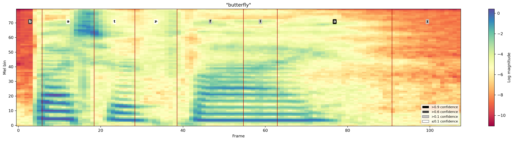

# Bournemouth Forced Aligner (BFA)

<div align="center">

[](https://www.python.org/downloads/)
[](https://badge.fury.io/py/bournemouth-forced-aligner)
[](https://www.gnu.org/licenses/gpl-3.0)
[](https://github.com/tabahi/bournemouth-forced-aligner/stargazers)

**Find where every phoneme and word starts and ends in a recording, in 82 languages.**

[Getting started](#getting-started) • [Language support](docs/language-support.md) • [About the models](docs/about-models.md) • [Evaluation](docs/evaluation.md) • [Developer guide](docs/README.md) • [Changelog](CHANGELOG.md)

</div>

You give BFA a recording and the words spoken in it. It gives back a time for every phoneme and
every word, as a Praat TextGrid or a JSON file. This is called **forced alignment**. You don't need
a pronunciation dictionary or any training: BFA works out the phonemes from the text itself.



## Getting started

### 1. Install

You need [Python](https://www.python.org/downloads/) 3.8 or newer. Then, in a terminal
(Command Prompt or PowerShell on Windows):

```bash
pip install bournemouth-forced-aligner
```

This works on Windows, macOS and Linux, and reads WAV, FLAC, OGG and MP3 files.

### 2. Align one recording

```bash
balign recording.wav "the words spoken in the recording" --preset=en-us --textgrid=recording.TextGrid
```

- `recording.wav` is your audio file.
- The text in quotes is what is said in it, written out in ordinary spelling.
- `--preset=en-us` is the language: American English here. See [step 3](#3-other-languages) for others.
- `--textgrid=recording.TextGrid` writes a TextGrid you can open in [Praat](https://www.fon.hum.uva.nl/praat/),
  with a `phonemes` tier and a `words` tier.

BFA also writes `recording.vs.json` next to the audio, with the same times and more detail.

The first run downloads the models, about 1.3 GB in all, once. After that BFA works offline.

To try it on a recording that comes with BFA, download
[butterfly.wav](examples/samples/audio/109867__timkahn__butterfly.wav) and run:

```bash
balign butterfly.wav "butterfly" --preset=en-us --textgrid=butterfly.TextGrid
```

```text
  b   →    0 ms –  52 ms  (confidence: 0.89)
  ə   →   52 ms – 168 ms  (confidence: 0.09)
  t   →  168 ms – 258 ms  (confidence: 0.05)
  ɝ   →  258 ms – 351 ms  (confidence: 0.01)
  f   →  351 ms – 498 ms  (confidence: 0.28)
  ɫ   →  498 ms – 572 ms  (confidence: 0.11)
  a   →  572 ms – 826 ms  (confidence: 0.94)
  ɪ   →  826 ms – 982 ms  (confidence: 0.25)
```

Phonemes are written in IPA. The confidence says how sure the model is of each phoneme. Compare
it between phonemes of one recording, not as an absolute score: a correctly placed phoneme often
reads below 0.5 ([why](docs/about-models.md#confidence)).

### 3. Other languages

Change `--preset`:

```bash
balign aufnahme.wav "guten Morgen" --preset=de --textgrid=aufnahme.TextGrid
```

| | | | |
|---|---|---|---|
| `en-us` English (US) | `en-GB` English (UK) | `de` German | `fr` French |
| `es` Spanish | `pt` Portuguese | `it` Italian | `nl` Dutch |
| `ru` Russian | `uk` Ukrainian | `pl` Polish | `tr` Turkish |
| `zh` Mandarin | `yue` Cantonese | `ja` Japanese | `ko` Korean |
| `vi` Vietnamese | `th` Thai | `ar` Arabic | `fa` Persian |
| `hi` Hindi | `ur` Urdu | `el` Greek | `sw` Swahili |

That is a sample. All 82 languages, and what to know about each (tone, word segmentation), are
on the [language support](docs/language-support.md) page, or run `balign --list-presets`.
Japanese, Cantonese and Thai need one extra install step, listed [below](#optional-extras).

### 4. A long recording

For a recording with many sentences, such as an interview, put the transcript in a JSON file.
Give each stretch of speech its start and end time in seconds:

```json
{"segments": [
  {"start": 0.0, "end": 4.2, "text": "so where did you grow up"},
  {"start": 4.6, "end": 9.8, "text": "in a small town near the coast"}
]}
```

```bash
balign interview.wav interview.json --preset=en-us --textgrid=interview.TextGrid
```

The times don't need to be exact, but each stretch must contain all of its words (a little
silence either side is fine). BFA finds the phonemes inside each stretch.
[Whisper](https://github.com/openai/whisper) and most speech-to-text tools write this format
(with extra fields, which BFA ignores).

### 5. From Python

```python
from bournemouth_aligner import BFA

aligner = BFA(preset="en-us")
audio = aligner.load_audio("butterfly.wav")
result = aligner.process_sentence("butterfly", audio)

for ph in result["segments"][0]["phoneme_ts"]:
    print(ph["ipa_label"], round(ph["start_ms"]), round(ph["end_ms"]), round(ph["confidence"], 2))

aligner.convert_to_textgrid(result, output_file="butterfly.TextGrid")
```

For a transcript file: `aligner.process_srt_file("interview.json", "interview.wav", ts_out_path="interview.vs.json")`.
More in [examples/](examples/) and the [developer guide](docs/README.md), which also explains
every field of the JSON output.

#### Many files at once

Aligning all your files in one call is much faster than one call per file. With a GPU, also set
`n_jobs=4`: the alignment search then runs in 4 worker processes while the GPU works on the next
batch. The output is the same.

```python
import json
from bournemouth_aligner import BFA

if __name__ == "__main__":                    # needed when n_jobs > 1
    aligner = BFA(preset="en-us", n_jobs=4)
    names = ["interview1", "interview2"]
    transcripts = [json.load(open(n + ".json")) for n in names]
    audio = [aligner.load_audio(n + ".wav") for n in names]

    results = aligner.process_segments(transcripts, audio)    # one call for every file
    for name, result in zip(names, results):
        aligner.convert_to_textgrid(result, output_file=name + ".TextGrid")
```

## Tips for good results

- **The text must match the audio.** Every phoneme of the text is placed somewhere, so a word that
  isn't spoken gets squeezed into its neighbours. Segments that went badly are flagged in the
  JSON as `coverage_analysis["bad_alignment"]`.
- **Write numbers as words.** "twenty five", not "25". The same goes for abbreviations and symbols.
- **Shorter stretches align better.** A stretch of up to 2 minutes is aligned in one pass, and
  longer ones are handled automatically, but a transcript split into sentences works best.
- **The phonemes come from a dictionary-style pronunciation of the text**, not from what the
  speaker actually said. Reduced or dialectal pronunciations are aligned against the standard form.
- **Conversational vs read speech.** The default setting is tuned for conversational speech. For
  each phoneme's own onset, rather than the boundaries as a whole, try `--boundary-bonus-weight=0`.

## Optional extras

```bash
pip install "bournemouth-forced-aligner[ja]"     # Japanese word segmentation (fugashi + unidic-lite)
pip install "bournemouth-forced-aligner[yue]"    # Cantonese word segmentation (pycantonese)
pip install "bournemouth-forced-aligner[th]"     # Thai word segmentation (pythainlp)
pip install "bournemouth-forced-aligner[ph66]"   # the espeak-ng phoneme set; also needs the espeak-ng program
pip install "bournemouth-forced-aligner[audio]"  # other audio formats (m4a, aac, mp4); also needs FFmpeg
```

The latest code from GitHub: `pip install git+https://github.com/tabahi/bournemouth-forced-aligner.git`.

## What's inside

| | |
|---|---|
| Speed | 6-20× faster than real time on a CPU, 100-500× with a GPU ([details](#speed)) |
| Resolution | 5 ms frames, with each boundary placed between frames |
| Languages | 82 with the default phoneme set, including Mandarin, Cantonese, Japanese, Korean, Vietnamese, Thai, Arabic, Persian, Hindi and Greek; 80+ through espeak-ng (`ph66`) |
| Output | Praat TextGrid; JSON with phoneme, word and phoneme-group times, plus tone, stress and length; phoneme embeddings |
| Runs on | Linux, macOS, Windows |

### Phoneme sets

BFA has two phoneme sets, each with its own models:

| `phoneme_set` | Pronunciations from | Models | Languages |
|---|---|---|---|
| **`std`** (default) | [standard_g2p](https://github.com/tabahi/CharsiuG2P), a neural G2P model | one per writing system: `mbfa-latin`, `mbfa-cyrillic`, `mbfa-cjk`, `mbfa-japanese`, `mbfa-vietnamese`, `mbfa-thai`, `mbfa-abjad`, `mbfa-brahmic`, `mbfa-other-alphabetic` | 82, with tone, stress and length labels |
| `ph66` | espeak-ng, reduced to 66 phonemes | `CUPE-3-en` (English), `CUPE-3-mls7` (everything else) | 80+, trained on English and 7 European languages |

```bash
balign recording.wav "hello world" --preset=en-us --phoneme-set=ph66   # the most accurate English model
balign recording.wav "<Bengali text>" --preset=bn --phoneme-set=ph66   # Bengali: only ph66 has it so far
```

### Models

Each language group has its own model, downloaded from [Hugging Face](https://huggingface.co/Tabahi)
the first time it's needed: nine for the default phoneme set, three for `ph66`, and two
alternative Latin-script models. Each is a small neural network (about 15 M parameters) that
looks at 120 ms of audio at a time and estimates which phoneme is being spoken every 5 ms. How
they are trained and how a boundary is read off them: [about the models](docs/about-models.md).

### Accuracy

Phoneme-boundary F1 on two hand-labelled English corpora (TIMIT, 6,300 read sentences; Buckeye,
255 conversational recordings), against the Montreal Forced Aligner (MFA):

| | TIMIT, within 10 ms | TIMIT, within 25 ms | Buckeye, within 25 ms |
|---|---:|---:|---:|
| BFA `CUPE-3-en` (ph66, English) | **58.7** | 76.8 | 74.2 |
| BFA `mbfa-latin` (default, 36 languages) | 53.7 | 72.6 | 68.4 |
| MFA `english_us_arpa` (English model + dictionary) | 55.2 | **80.9** | **84.3** |

- **BFA's boundaries are more precise.** The English model beats MFA within 10 ms and has a lower
  median error (7 vs 8 ms). At 25 ms MFA leads by 4 points, because BFA has more large misses.
- **One model covers 36 languages, with no pronunciation dictionary.** MFA needs a separate
  acoustic model and dictionary for each language.
- **Buckeye favours MFA.** Its reference boundaries were first placed by an HMM aligner with an
  ARPAbet dictionary, the same approach MFA uses, and MFA scores higher on this noisy
  conversational corpus than on clean TIMIT.

The full analysis is on the [evaluation](docs/evaluation.md) page.

### Speed

Time to align, on a 16-core CPU and an NVIDIA RTX A6000. BFA aligns everything in one call
with `n_jobs=4`, at its default settings:

| | 100 TIMIT clips (5 min of audio) | 10 Buckeye interviews (90 min) |
|---|---:|---:|
| BFA `CUPE-3-en`, GPU | **2.1 s** | **26 s** |
| BFA `mbfa-latin` (default), GPU | 3.3 s | 34 s |
| BFA `mbfa-latin` (default), CPU | 49 s | 562 s |
| MFA, 8 jobs, CPU | 95-154 s | 149-243 s |

- BFA needs 3-9 s to start, once per process; MFA's times include about 1 min of start-up per call.
- **On short clips, set `duration_max=10`.** Every segment is padded to `duration_max` (30 s by
  default), so 10 s is up to 2.6× faster, with the same result: 100 TIMIT clips take 0.9 s with
  a GPU and 15 s on a CPU (`CUPE-3-en`).
- On a CPU, BFA is faster than MFA on short jobs and slower on long conversational recordings
  at the default padding.

Full timings: [evaluation](docs/evaluation.md#cost).

### Settings worth knowing

| Python / command line | |
|---|---|
| `boundary_bonus_weight` / `--boundary-bonus-weight` | How strongly boundaries are pulled towards sudden changes in the sound. The default, 15, is set for conversational speech. 0 gives better onsets for individual phonemes. |
| `duration_max=10` | Up to 2.6× faster on short clips, same result. Long segments are never cut. |
| `n_jobs=4` | Run the alignment search in 4 worker processes when one call aligns many segments (`process_segments`, `process_srt_file`). With a GPU: 2.4× faster on long recordings. Little effect on a CPU. Same output; your script needs `if __name__ == "__main__":`. |
| `low_confidence_level` | The confidence below which a phoneme counts as doubtful when flagging bad segments. |
| `punctuation_sil=True` | Let the aligner place a pause at commas and full stops (default phoneme set only). |
| `warn_level=0` | Print nothing, downloads included. |

All options: `balign --help`, and the [developer guide](docs/README.md).

## Upgrading from 1.x

BFA 2.0 is not compatible with 1.x. The acoustic models are new: no CTC, no blank class, 5 ms
frames, and a multilingual model family that is now the default. The alignment method has
changed too: a segmental Viterbi, the same decoder the models were trained with, places each
boundary where two phoneme posteriors cross, instead of snapping CTC spikes onto onsets. v1
models do not load, and the output and constructor arguments have changed: see the
[CHANGELOG](CHANGELOG.md). To keep using 1.x, pin it: `pip install "bournemouth-forced-aligner<2"`.

## Contribute

- **More language groups.** Khmer and Burmese need G2P work first.
- **ONNX / C++.** [`bournemouth_aligner/cpp_onnx/`](bournemouth_aligner/cpp_onnx/) still
  targets the v1 model.

Open an [issue](https://github.com/tabahi/bournemouth-forced-aligner/issues) to discuss.
Start with the [developer guide](docs/README.md).


[Getting started](#getting-started) • [Language support](docs/language-support.md) • [About the models](docs/about-models.md) • [Evaluation](docs/evaluation.md) • [Developer guide](docs/README.md) • [Changelog](CHANGELOG.md)

<div align="center">

[⭐ Star on GitHub](https://github.com/tabahi/bournemouth-forced-aligner) • [🐛 Report issues](https://github.com/tabahi/bournemouth-forced-aligner/issues) 

</div>
