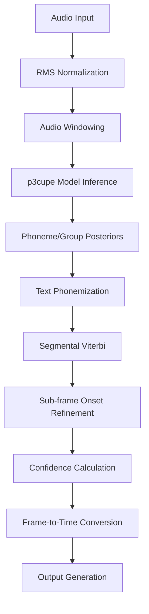

# Bournemouth Forced Aligner (BFA)

<div align="center">

[](https://www.python.org/downloads/)
[](https://badge.fury.io/py/bournemouth-forced-aligner)
[](https://www.gnu.org/licenses/gpl-3.0)
[](https://github.com/tabahi/bournemouth-forced-aligner/stargazers)

**Automatically label which phoneme is spoken at which millisecond in an audio recording.**

[🚀 Quick Start](#getting-started) • [🔧 Installation](#-installation) • [🌍 Languages](#-language-presets) • [💻 CLI](#-command-line-interface-cli) • [🐛 Issues](https://github.com/tabahi/bournemouth-forced-aligner/issues)

</div>

---

## What does it do?

**Forced alignment** is the process of automatically finding *exactly when* each word or sound occurs in an audio recording, given a transcript of what was said.

BFA takes two inputs — an **audio file** and its **text transcript** — and produces a detailed output with millisecond timestamps for every phoneme (the individual sounds that make up words).

```
Input:  🎵 audio.wav  +  📄 "butterfly"

Output:
  b   →    1 ms –  52 ms  (confidence: 0.95)
  ʌ   →   52 ms – 169 ms  (confidence: 0.39)
  ɾ   →  169 ms – 257 ms  (confidence: 0.02)
  ɚ   →  257 ms – 352 ms  (confidence: 0.20)
  f   →  352 ms – 448 ms  (confidence: 0.95)
  l   →  448 ms – 498 ms  (confidence: 0.94)
  aɪ  →  498 ms – 828 ms  (confidence: 0.96)
```

Every phone ends where the next begins — the alignment covers the audio with no gaps, and each
onset is placed between frames rather than on them.

The output can be exported as a **Praat TextGrid** file for visual inspection, or as **JSON** for use in scripts and TTS pipelines.

### Key Facts

| | |
|---|---|
| ⚡ Speed | ~1 second to align 10 seconds of audio (on CPU) |
| 🎯 Resolution | 5 ms frames, with sub-frame onsets read off the posteriors |
| 🌍 Languages | 80+ languages — English, German, French, Spanish, Hindi, Arabic, and many more |
| 📄 Output formats | JSON timestamps, Praat TextGrid, phoneme embeddings |
| 🖥️ Runs on | Linux, macOS, Windows — CPU or GPU |

---

## *What's new in v2.0*

**BFA v2 runs on p3cupe, a phoneme model whose output *is* the boundary detector.** Each
phone's posterior is trained to hold across the interior of its own segment and fall to exactly
0.5 at each of its two boundaries, where the neighbouring phone rises through 0.5 — so a
boundary is the **crossing of two posteriors**: a continuous quantity, read off by
interpolation rather than snapped to a frame.

- **5 ms frames**, and sub-frame onsets on top of them.
- **One decoder.** A segmental Viterbi: every frame belongs to a phone or a pause, with a soft
  minimum phone duration. It is the *same* decoder that built the model's training targets, so
  what you decode with is what was trained.
- **One global search.** Posterior evidence and acoustic change are weighed together while the
  path is chosen, not patched up afterwards.
- **⚠️ Breaking change.** v2 does not load v1 checkpoints, and the settings that only served
  them are gone. See the [CHANGELOG](CHANGELOG.md) for the full list and what replaced it.
- **⚠️ Checkpoints are not published yet** — see [Language Presets](#-language-presets) for how
  to point BFA at a local one in the meantime.

---

**Words and phonemes aligned to a Mel-spectrogram:**


*See [mel_spectrum_alignment.py](examples/mel_spectrum_alignment.py) for a full example.*

---

## 🚀 Installation

> **Prerequisites:** Python 3.8 or newer. If you don't have Python yet, download it from [python.org](https://www.python.org/downloads/).

### Step 1 — Install system dependencies

**Linux (Ubuntu / Debian):**
```bash
sudo apt-get install espeak-ng ffmpeg
```

**macOS:**
```bash
brew install espeak-ng ffmpeg
```

Or install everything in the conda environment
```bash
conda create -n bfa
conda activate bfa
conda install pip
conda install "ffmpeg"
# or
conda install "ffmpeg" -c conda-forge
```

**Windows:**  
Download and install [eSpeak NG](https://github.com/espeak-ng/espeak-ng/blob/master/docs/guide.md) and [ffmpeg](https://ffmpeg.org/download.html), then add both to your system PATH.

### Step 2 — Install BFA

```bash
pip install bournemouth-forced-aligner
```

### Step 3 — Verify it works

```bash
python -c "from bournemouth_aligner import PhonemeTimestampAligner; print('Installation successful')"
```

---

## Getting Started

### Quickstart — command line

If you just want to try BFA on a file right away, no Python needed:

```bash
balign butterfly.wav "butterfly" --preset=en-us --mel-path=mel_spectrum.png
```

This aligns the word *butterfly* in [`butterfly.wav`](examples/samples/audio/109867__timkahn__butterfly.wav), saves the phoneme timestamps to `butterfly.vs.json` (same folder as the audio), and also saves a mel-spectrogram image to [`mel_spectrum.png`](mel_spectrum_butterfly.png).


---


> **Tip:** Replace `"butterfly"` with any sentence spoken in the audio, and `--preset=en-us` with your language code (`de`, `fr`, `hi`, `ar`, …). Run `balign --help` to see more options.


### Python example

```python
from bournemouth_aligner import PhonemeTimestampAligner

# 1. Create the aligner — it will automatically download the right model
#    Change "en-us" to your language code, e.g. "de", "fr", "es", "hi"
aligner = PhonemeTimestampAligner(preset="en-us")

# 2. Load your audio file (WAV, MP3, FLAC, etc.)
audio = aligner.load_audio("butterfly.wav")

# 3. Run alignment
#    Provide the transcript exactly as spoken in the audio
result = aligner.process_sentence("butterfly", audio)

# 4. Print the phoneme timestamps
for phoneme in result["segments"][0]["phoneme_ts"]:
    print(f"{phoneme['ipa_label']:>5}  {phoneme['start_ms']:.0f} ms – {phoneme['end_ms']:.0f} ms  (confidence: {phoneme['confidence']:.2f})")
```

That's it. No configuration files, no dictionary downloads, no corpus setup.

> **Note:** The first run will automatically download the model from HuggingFace (~50 MB). Subsequent runs use the cached copy.

### Export to Praat TextGrid

```python
# Save a TextGrid file that you can open directly in Praat
aligner.convert_to_textgrid(result, output_file="my_recording.TextGrid")
```

### Multi-language examples

```python
# German
aligner_de = PhonemeTimestampAligner(preset="de")

# French
aligner_fr = PhonemeTimestampAligner(preset="fr")

# Hindi
aligner_hi = PhonemeTimestampAligner(preset="hi")

# Spanish
aligner_es = PhonemeTimestampAligner(preset="es")
```

See the [full preset list](#-language-presets) for all 80+ supported languages.

---

### 📊 Sample Output

<details>
<summary>📋 Click to see the full JSON output for "butterfly"</summary>

```json
{
    "segments": [
        {
            "start": 0.0,
            "end": 1.2588125,
            "text": "butterfly",
            "ph66": [
                29,
                10,
                58,
                9,
                43,
                56,
                23
            ],
            "pg16": [
                7,
                2,
                14,
                2,
                8,
                13,
                5
            ],
            "coverage_analysis": {
                "target_count": 7,
                "aligned_count": 7,
                "missing_count": 0,
                "extra_count": 0,
                "coverage_ratio": 1.0,
                "missing_phonemes": [],
                "extra_phonemes": [],
                "bad_alignment": false
            },
            "ipa": [
                "b",
                "ʌ",
                "ɾ",
                "ɚ",
                "f",
                "l",
                "aɪ"
            ],
            "word_num": [
                0,
                0,
                0,
                0,
                0,
                0,
                0
            ],
            "words": [
                "butterfly"
            ],
            "phoneme_ts": [
                {
                    "phoneme_id": 29,
                    "phoneme_label": "b",
                    "ipa_label": "b",
                    "start_ms": 1.046869084239006,
                    "end_ms": 52.5,
                    "confidence": 0.9456192255020142,
                    "is_estimated": false,
                    "target_seq_idx": 0,
                    "index": 0
                },
                {
                    "phoneme_id": 10,
                    "phoneme_label": "ʌ",
                    "ipa_label": "ʌ",
                    "start_ms": 52.5,
                    "end_ms": 168.70805740356445,
                    "confidence": 0.39453771710395813,
                    "is_estimated": false,
                    "target_seq_idx": 1,
                    "index": 1
                },
                {
                    "phoneme_id": 58,
                    "phoneme_label": "ɾ",
                    "ipa_label": "ɾ",
                    "start_ms": 168.70805740356445,
                    "end_ms": 257.18225479125977,
                    "confidence": 0.015983885154128075,
                    "is_estimated": false,
                    "target_seq_idx": 2,
                    "index": 2
                },
                {
                    "phoneme_id": 9,
                    "phoneme_label": "ɚ",
                    "ipa_label": "ɚ",
                    "start_ms": 257.18225479125977,
                    "end_ms": 352.5,
                    "confidence": 0.20140987634658813,
                    "is_estimated": false,
                    "target_seq_idx": 3,
                    "index": 3
                },
                {
                    "phoneme_id": 43,
                    "phoneme_label": "f",
                    "ipa_label": "f",
                    "start_ms": 352.5,
                    "end_ms": 447.5,
                    "confidence": 0.9529293775558472,
                    "is_estimated": false,
                    "target_seq_idx": 4,
                    "index": 4
                },
                {
                    "phoneme_id": 56,
                    "phoneme_label": "l",
                    "ipa_label": "l",
                    "start_ms": 447.5,
                    "end_ms": 497.5,
                    "confidence": 0.9412255883216858,
                    "is_estimated": false,
                    "target_seq_idx": 5,
                    "index": 5
                },
                {
                    "phoneme_id": 23,
                    "phoneme_label": "aɪ",
                    "ipa_label": "aɪ",
                    "start_ms": 497.5,
                    "end_ms": 827.5,
                    "confidence": 0.9648973345756531,
                    "is_estimated": false,
                    "target_seq_idx": 6,
                    "index": 6
                }
            ],
            "group_ts": [
                {
                    "group_id": 7,
                    "group_label": "voiced_stops",
                    "start_ms": 1.046869084239006,
                    "end_ms": 52.5,
                    "confidence": 0.8825665712356567,
                    "is_estimated": false,
                    "target_seq_idx": 0,
                    "index": 0
                },
                {
                    "group_id": 2,
                    "group_label": "central_vowels",
                    "start_ms": 52.5,
                    "end_ms": 168.70805740356445,
                    "confidence": 0.333845853805542,
                    "is_estimated": false,
                    "target_seq_idx": 1,
                    "index": 1
                },
                {
                    "group_id": 14,
                    "group_label": "rhotics",
                    "start_ms": 168.70805740356445,
                    "end_ms": 257.18225479125977,
                    "confidence": 0.06540156155824661,
                    "is_estimated": false,
                    "target_seq_idx": 2,
                    "index": 2
                },
                {
                    "group_id": 2,
                    "group_label": "central_vowels",
                    "start_ms": 257.18225479125977,
                    "end_ms": 352.5,
                    "confidence": 0.5041145086288452,
                    "is_estimated": false,
                    "target_seq_idx": 3,
                    "index": 3
                },
                {
                    "group_id": 8,
                    "group_label": "voiceless_fricatives",
                    "start_ms": 352.5,
                    "end_ms": 447.5,
                    "confidence": 0.9766589999198914,
                    "is_estimated": false,
                    "target_seq_idx": 4,
                    "index": 4
                },
                {
                    "group_id": 13,
                    "group_label": "laterals",
                    "start_ms": 447.5,
                    "end_ms": 497.5,
                    "confidence": 0.9302259087562561,
                    "is_estimated": false,
                    "target_seq_idx": 5,
                    "index": 5
                },
                {
                    "group_id": 5,
                    "group_label": "diphthongs",
                    "start_ms": 497.5,
                    "end_ms": 827.5,
                    "confidence": 0.9568509459495544,
                    "is_estimated": false,
                    "target_seq_idx": 6,
                    "index": 6
                }
            ],
            "words_ts": [
                {
                    "word": "butterfly",
                    "start_ms": 1.046869084239006,
                    "end_ms": 827.5,
                    "confidence": 0.6309432863656964,
                    "ph66": [
                        29,
                        10,
                        58,
                        9,
                        43,
                        56,
                        23
                    ],
                    "ipa": [
                        "b",
                        "ʌ",
                        "ɾ",
                        "ɚ",
                        "f",
                        "l",
                        "aɪ"
                    ]
                }
            ]
        }
    ]
}
```

</details>

### Understanding the Output

Every segment in the output contains the following keys:

| Key | What it contains | Useful for |
|-----|-----------------|------------|
| `phoneme_ts` | Per-phoneme timestamps: `ipa_label`, `start_ms`, `end_ms`, `confidence`, `is_estimated` | Phonetic annotation, TTS training |
| `group_ts` | Same timestamps but grouped into 16 broad phoneme categories (vowels, stops, fricatives…) | Coarser acoustic analysis |
| `words_ts` | Word-level timestamps derived from the phonemes | Word-level annotation |
| `ipa` | IPA sequence for the segment (from espeak-ng) | Phonemic transcription reference |
| `ph66` | Numeric indices into BFA's 66-class phoneme set | Model-internal representation |
| `pg16` | Numeric indices into 16 phoneme group categories | Model-internal representation |
| `words` | List of words in the segment | Word boundary reference |
| `word_num` | Word index for each phoneme (parallel to `ph66`) | Maps each phoneme to its parent word |
| `coverage_analysis` | Quality report: how many phonemes were aligned, missing, or estimated | Filtering out bad segments |

**Reading `confidence`:** the peak posterior the model put on this phoneme inside its own segment. Higher is surer, but the scale is model-specific — see [Reading confidence](#reading-confidence) before setting a threshold. `is_estimated` is always `false`: forced alignment places every phoneme it reports, so nothing is inserted after the fact.

---

---

## 🛠️ API Reference

### 🌍 Language Presets

BFA supports **80+ languages**. Pass the language code as `preset` and phonemisation is handled by [espeak-ng](https://github.com/espeak-ng/espeak-ng), which is free and works offline.

> **Note:** the preset picks both the checkpoint and the espeak-ng language. Two checkpoints
> exist today — **English** and **Multilingual** — so every non-English preset resolves to the
> Multilingual one. The Multilingual checkpoint covers 7 European languages, so for anything
> further afield the "Model Used" column below is a statement of intent until the **Universal**
> checkpoint is trained. See [Available checkpoints](#available-checkpoints).

**Supported language families:** Indo-European (Germanic, Romance, Slavic, Indic, Iranian…), Turkic, Semitic, Dravidian, and several others.

**Not supported:** Tonal languages — Chinese (Mandarin, Cantonese), Vietnamese, Thai, Burmese — and isolating/agglutinative families such as Japanese and Korean. That is a limit of the ph66 phoneme inventory, not just of the training data, so a different checkpoint will not fix it.

```python
aligner = PhonemeTimestampAligner(preset="de")   # German
aligner = PhonemeTimestampAligner(preset="hi")   # Hindi
aligner = PhonemeTimestampAligner(preset="fr")   # French
aligner = PhonemeTimestampAligner(preset="ar")   # Arabic
aligner = PhonemeTimestampAligner(preset="ru")   # Russian
```

#### 📋 Complete Preset Table

<details>
<summary>🔍 Click to view all 80+ supported language presets</summary>

| **Language** | **Preset Code** | **Model Used** | **Language Family** |
|--------------|-----------------|----------------|-------------------|
| **🇺🇸 ENGLISH VARIANTS** | | |
| English (US) | `en-us`, `en` | English | West Germanic |
| English (UK) | `en-gb` | English | West Germanic |
| English (Caribbean) | `en-029` | English | West Germanic |
| English (Lancastrian) | `en-gb-x-gbclan` | English | West Germanic |
| English (RP) | `en-gb-x-rp` | English | West Germanic |
| English (Scottish) | `en-gb-scotland` | English | West Germanic |
| English (West Midlands) | `en-gb-x-gbcwmd` | English | West Germanic |
| **🇪🇺 EUROPEAN LANGUAGES** | | |
| German | `de` | Multilingual | West Germanic |
| French | `fr` | Multilingual | Romance |
| French (Belgium) | `fr-be` | Multilingual | Romance |
| French (Switzerland) | `fr-ch` | Multilingual | Romance |
| Spanish | `es` | Multilingual | Romance |
| Spanish (Latin America) | `es-419` | Multilingual | Romance |
| Italian | `it` | Multilingual | Romance |
| Portuguese | `pt` | Multilingual | Romance |
| Portuguese (Brazil) | `pt-br` | Multilingual | Romance |
| Polish | `pl` | Multilingual | West Slavic |
| Dutch | `nl` | Multilingual | West Germanic |
| Danish | `da` | Multilingual | North Germanic |
| Swedish | `sv` | Multilingual | North Germanic |
| Norwegian Bokmål | `nb` | Multilingual | North Germanic |
| Icelandic | `is` | Multilingual | North Germanic |
| Czech | `cs` | Multilingual | West Slavic |
| Slovak | `sk` | Multilingual | West Slavic |
| Slovenian | `sl` | Multilingual | South Slavic |
| Croatian | `hr` | Multilingual | South Slavic |
| Bosnian | `bs` | Multilingual | South Slavic |
| Serbian | `sr` | Multilingual | South Slavic |
| Macedonian | `mk` | Multilingual | South Slavic |
| Bulgarian | `bg` | Multilingual | South Slavic |
| Romanian | `ro` | Multilingual | Romance |
| Hungarian | `hu` | Multilingual | Uralic |
| Estonian | `et` | Multilingual | Uralic |
| Latvian | `lv` | Multilingual | Baltic |
| Lithuanian | `lt` | Multilingual | Baltic |
| Catalan | `ca` | Multilingual | Romance |
| Aragonese | `an` | Multilingual | Romance |
| Papiamento | `pap` | Multilingual | Romance |
| Haitian Creole | `ht` | Multilingual | Romance |
| Afrikaans | `af` | Multilingual | West Germanic |
| Luxembourgish | `lb` | Multilingual | West Germanic |
| Irish Gaelic | `ga` | Multilingual | Celtic |
| Scottish Gaelic | `gd` | Multilingual | Celtic |
| Welsh | `cy` | Multilingual | Celtic |
| **🌏 INDO-EUROPEAN LANGUAGES (Universal)** | | |
| Russian | `ru` | Universal *(planned)* | East Slavic |
| Russian (Latvia) | `ru-lv` | Universal *(planned)* | East Slavic |
| Ukrainian | `uk` | Universal *(planned)* | East Slavic |
| Belarusian | `be` | Universal *(planned)* | East Slavic |
| Hindi | `hi` | Universal *(planned)* | Indic |
| Bengali | `bn` | Universal *(planned)* | Indic |
| Urdu | `ur` | Universal *(planned)* | Indic |
| Punjabi | `pa` | Universal *(planned)* | Indic |
| Gujarati | `gu` | Universal *(planned)* | Indic |
| Marathi | `mr` | Universal *(planned)* | Indic |
| Nepali | `ne` | Universal *(planned)* | Indic |
| Assamese | `as` | Universal *(planned)* | Indic |
| Oriya | `or` | Universal *(planned)* | Indic |
| Sinhala | `si` | Universal *(planned)* | Indic |
| Konkani | `kok` | Universal *(planned)* | Indic |
| Bishnupriya Manipuri | `bpy` | Universal *(planned)* | Indic |
| Sindhi | `sd` | Universal *(planned)* | Indic |
| Persian | `fa` | Universal *(planned)* | Iranian |
| Persian (Latin) | `fa-latn` | Universal *(planned)* | Iranian |
| Kurdish | `ku` | Universal *(planned)* | Iranian |
| Greek (Modern) | `el` | Universal *(planned)* | Greek |
| Greek (Ancient) | `grc` | Universal *(planned)* | Greek |
| Armenian (East) | `hy` | Universal *(planned)* | Indo-European |
| Armenian (West) | `hyw` | Universal *(planned)* | Indo-European |
| Albanian | `sq` | Universal *(planned)* | Indo-European |
| Latin | `la` | Universal *(planned)* | Italic |
| **🇹🇷 TURKIC LANGUAGES (Universal)** | | |
| Turkish | `tr` | Universal *(planned)* | Turkic |
| Azerbaijani | `az` | Universal *(planned)* | Turkic |
| Kazakh | `kk` | Universal *(planned)* | Turkic |
| Kyrgyz | `ky` | Universal *(planned)* | Turkic |
| Uzbek | `uz` | Universal *(planned)* | Turkic |
| Tatar | `tt` | Universal *(planned)* | Turkic |
| Turkmen | `tk` | Universal *(planned)* | Turkic |
| Uyghur | `ug` | Universal *(planned)* | Turkic |
| Bashkir | `ba` | Universal *(planned)* | Turkic |
| Chuvash | `cu` | Universal *(planned)* | Turkic |
| Nogai | `nog` | Universal *(planned)* | Turkic |
| **🇫🇮 URALIC LANGUAGES (Universal)** | | |
| Finnish | `fi` | Universal *(planned)* | Uralic |
| Lule Saami | `smj` | Universal *(planned)* | Uralic |
| **🕌 SEMITIC LANGUAGES (Universal)** | | |
| Arabic | `ar` | Universal *(planned)* | Semitic |
| Hebrew | `he` | Universal *(planned)* | Semitic |
| Amharic | `am` | Universal *(planned)* | Semitic |
| Maltese | `mt` | Universal *(planned)* | Semitic |
| **🏝️ MALAYO-POLYNESIAN LANGUAGES (Universal)** | | |
| Indonesian | `id` | Universal *(planned)* | Malayo-Polynesian |
| Malay | `ms` | Universal *(planned)* | Malayo-Polynesian |
| **🇮🇳 DRAVIDIAN LANGUAGES (Universal)** | | |
| Tamil | `ta` | Universal *(planned)* | Dravidian |
| Telugu | `te` | Universal *(planned)* | Dravidian |
| Kannada | `kn` | Universal *(planned)* | Dravidian |
| Malayalam | `ml` | Universal *(planned)* | Dravidian |
| **🇬🇪 SOUTH CAUCASIAN LANGUAGES (Universal)** | | |
| Georgian | `ka` | Universal *(planned)* | South Caucasian |
| **🗾 LANGUAGE ISOLATES & OTHERS (Universal)** | | |
| Basque | `eu` | Universal *(planned)* | Language Isolate |
| Quechua | `qu` | Universal *(planned)* | Quechuan |
| **🛸 CONSTRUCTED LANGUAGES (Universal)** | | |
| Esperanto | `eo` | Universal *(planned)* | Constructed |
| Interlingua | `ia` | Universal *(planned)* | Constructed |
| Ido | `io` | Universal *(planned)* | Constructed |
| Lingua Franca Nova | `lfn` | Universal *(planned)* | Constructed |
| Lojban | `jbo` | Universal *(planned)* | Constructed |
| Pyash | `py` | Universal *(planned)* | Constructed |
| Lang Belta | `qdb` | Universal *(planned)* | Constructed |
| Quenya | `qya` | Universal *(planned)* | Constructed |
| Klingon | `piqd` | Universal *(planned)* | Constructed |
| Sindarin | `sjn` | Universal *(planned)* | Constructed |

</details>

#### 🔧 Model Selection Guide

| **Family** | **Covers** | **Status** |
|---|---|---|
| **English** | English variants | available |
| **Multilingual** | 7 European languages | available |
| **Universal** | the wider preset table above | *not trained yet* |

Non-English presets fall back to **Multilingual** until **Universal** exists, so a preset for a
language outside those 7 currently loads a model that has never heard it. The "Model Used"
column above says where each preset is *headed*, not what loads today.

**⚠️ Unsupported Language Types:**
- **Tonal languages**: Chinese (Mandarin, Cantonese), Vietnamese, Thai, Burmese
- **Distant families**: Japanese, Korean, most African languages (Swahili, etc.)
- **Indigenous languages**: Most Native American, Polynesian (except Indonesian/Malay)
- **Recommendation**: these are limits of the ph66 phoneme inventory, not just of the training
  data, so a different checkpoint will not fix them

### Initialization

```python
PhonemeTimestampAligner(
    preset="en-us",               # Language code — selects model and phonemiser automatically
    model_name=None,              # Override the model by name (optional)
    cupe_ckpt_path=None,          # Override with a local model file path (optional)
    lang="en-us",                 # espeak-ng language code for phonemisation
    duration_max=30,              # Padding width in seconds for the batched short-segment path
    device="auto",                # "auto" | "cpu" | "cuda" | "mps"
    boundary_bonus_weight=None,   # Onset bonus; None = the checkpoint's own trained value
    sub_frame_onsets=True,        # Interpolate onsets at the posterior crossing
    min_phone_frames=None,        # Duration floor in 5 ms frames; None = the checkpoint's value
    soft_phone_frames=None,       # Frames above the floor a phone may give up; None = ditto
    bad_confidence_threshold=0.6, # Flag segments where >60% of phonemes are low-confidence
    low_confidence_level=0.25,    # What counts as "low confidence" for that share
    segment_max_seconds=120,      # Decode whole up to this length, chunk beyond it
    chunk_audio=True,             # Walk longer segments in overlapping windows
    chunk_seconds=10.0,           # Window length for that walk
    chunk_max_phonemes=200,       # Cap on one window's phoneme budget
    chunk_phonemes_per_second=15, # Budget rate, measured over SPEECH seconds
    chunk_vad=True,               # Energy VAD for speech-seconds and cut placement
    warn_level=1,                 # 0 silent, 1 warnings, 2 warnings + geometry/decoder info
)
```

**For most users, only `preset` and `cupe_ckpt_path` need to be set.** Everything about the
decoder defaults to the value the checkpoint was *trained* with, which is what its posteriors
were shaped by.

<details>
<summary>Parameter details</summary>

| Parameter | Default | What it does |
|-----------|---------|-------------|
| `preset` | `"en-us"` | Language code. Picks the checkpoint and the espeak-ng language. |
| `model_name` | `None` | Checkpoint filename, overriding the preset's choice. Looked for on disk first, then on HuggingFace. |
| `cupe_ckpt_path` | `None` | Path to a local p3cupe checkpoint. Highest priority. |
| `lang` | `"en-us"` | espeak-ng language code. See [all codes](https://github.com/espeak-ng/espeak-ng/blob/master/docs/languages.md). |
| `duration_max` | `30` | Padding width for the batched path. Segments longer than this are decoded on their own, unpadded — so this trades memory against how many segments share one forward pass, and never truncates. |
| `device` | `"auto"` | `"auto"` detects CUDA/MPS/CPU. The Viterbi itself always runs on CPU, where it measures ~3x faster than on CUDA (tiny per-frame tensors make it launch-bound). |
| `boundary_bonus_weight` | `None` | Weight on the log-mel acoustic-change bonus added to every phone-onset transition inside the Viterbi. `None` uses the checkpoint's trained value (30 for the shipped one); `0` turns it off. See [The onset bonus](#the-onset-bonus). |
| `sub_frame_onsets` | `True` | Place each onset at the interpolated crossing of the two neighbouring posteriors instead of on the 5 ms grid. This is the readout the loss was shaped for. |
| `min_phone_frames` | `None` | Shortest phone the aligner may emit, in 5 ms frames (6 = 30 ms for the shipped checkpoint). A clip whose text will not fit at this floor automatically gets a shorter one rather than losing its alignment. |
| `soft_phone_frames` | `None` | Frames above the floor that a phone may give up, at a cost each — the soft half of the duration prior. |
| `bad_confidence_threshold` | `0.6` | Share of low-confidence phonemes that flags a segment as `bad_alignment`. |
| `low_confidence_level` | `0.25` | Confidence below which a phoneme counts towards that share. Calibrated against these checkpoints' posteriors — see [Reading confidence](#reading-confidence). |
| `segment_max_seconds` | `120` | Segments up to this long are decoded in one pass and never chunked. Whole decoding is more accurate than chunking, so raise it if the hardware allows; the cost is roughly 1.8 s of Viterbi per 32 s of audio. |
| `chunk_audio` | `True` | Walk segments longer than `segment_max_seconds` in overlapping windows. See [Long audio](#long-audio). |
| `chunk_seconds` | `10.0` | Window length for that walk. |
| `chunk_max_phonemes` | `200` | Blunt cap on one window's phoneme budget. |
| `chunk_phonemes_per_second` | `15.0` | Budget rate over **speech** seconds (a safe upper bound for English). |
| `chunk_vad` | `True` | Energy VAD used to measure speech seconds per window and to land cuts in pauses. |
| `warn_level` | `1` | `0` silent, `1` warnings only, `2` adds the resolved frame geometry and decoder settings. |

**Model priority (highest → lowest):** `cupe_ckpt_path` → `model_name` → `preset` → defaults.

</details>

---

<a id="available-checkpoints"></a>
**Available checkpoints.** None are published yet.

| Family | Checkpoint | Trained on |
|---|---|---|
| English | `m_pa07b_final_e5_libri360h.pt` | LibriSpeech, 360 h |
| Multilingual | `m_pa07a_final_e4_MLS_7h.pt` | MLS, 7 European languages, English excluded |
| Universal | *TODO — not trained yet* | *the wider preset table* |

<!-- TODO: publish these to HuggingFace and put the repo link here, e.g.
     https://huggingface.co/<org>/<repo>/tree/main/ckpt -->

Until they are on HuggingFace, `preset=` and `model_name=` resolve by looking for the file on
disk first. BFA searches, in order:

1. `$BFA_MODEL_DIR`
2. `./models/p3cupe/` (relative to the working directory)
3. `~/.cache/bournemouth_aligner/`

So with a checkpoint at `models/p3cupe/m_pa07b_final_e5_libri360h.pt`, a plain
`PhonemeTimestampAligner(preset="en-us")` works. Otherwise pass it explicitly:

```python
aligner = PhonemeTimestampAligner(cupe_ckpt_path="path/to/m_pa07b_final_e5_libri360h.pt")
```


### `process_srt_file` — align a whole recording from a transcript file

**When to use:** You have a full audio file and a Whisper-style JSON transcript (segments with `start`, `end`, `text`). This is the most common entry point for corpus annotation.

```python
timestamps = aligner.process_srt_file(
    srt_path,           # path to transcript JSON (Whisper output format)
    audio_path,         # path to audio file
    ts_out_path=None,   # optional: save results to this JSON file
    extract_embeddings=False,
    vspt_path=None,     # optional: save phoneme embeddings to this .pt file
    do_groups=False,    # set True to also return phoneme group timestamps
    batch_size=4, # reduce if out-of-memory
    debug=True
)


aligner.warn_level = 3 # 0 = no warnings, 1 = important warnings (more critical for downstream tasks), 2 = all warnings (including low-confidence phonemes and bad confidence patterns). Critical errors will be raised as exceptions regardless of warn_level
```

Returns a dict with a `"segments"` key. See [example_advanced.py](examples/example_advanced.py).

---

### `process_sentence` — align one sentence

**When to use:** You have a single sentence and its audio clip (already loaded).

```python
result = aligner.process_sentence(
    text,               # transcript of the audio
    audio_wav,          # audio waveform tensor from load_audio()
    extract_embeddings=False,
    do_groups=False,    # set True to also return phoneme group timestamps
    debug=False
)
# Returns a dict with "segments" key (one segment)
# If extract_embeddings=True, returns (result, phoneme_embeddings, group_embeddings)
```

See [basic_usage.py](examples/basic_usage.py).

---

### `process_sentences_batch` — align many sentences at once

**When to use:** You have a list of sentences and corresponding audio clips and want to process them all efficiently in one call.

```python
results = aligner.process_sentences_batch(
    texts,       # list of transcript strings
    audio_wavs,  # list of audio waveform tensors (one per text)
    do_groups=False,
    debug=False
)
# Returns a list of result dicts, one per input
```

See [batch_aligment.py](examples/batch_aligment.py).

---

---

### `process_segments` — batch alignment from segmented transcripts

**When to use:** You have multiple audio files each with multiple time-stamped segments (e.g. output from Whisper over a corpus). This is the most efficient entry point for large-scale annotation.

```python
# Each item in srt_data corresponds to one audio file
srt_data = [
    {"segments": [{"start": 0.0, "end": 3.5, "text": "hello world"}, ...]},  # file 1
    {"segments": [{"start": 0.0, "end": 5.0, "text": "another recording"}, ...]},  # file 2
]
audio_wavs = [wav1, wav2]  # one waveform per file

batch_results = aligner.process_segments(
    srt_data,
    audio_wavs,
    do_groups=False,
    batch_size=4, # reduce if out-of-memory
    debug=True
)
# Returns a list of dicts (one per file), each with a "segments" key

# With phoneme embeddings:
batch_results, phoneme_embds, group_embds = aligner.process_segments(
    srt_data, audio_wavs, extract_embeddings=True
)
# phoneme_embds[file_idx][segment_idx] = embedding tensor
```

See [batch_aligment.py](examples/batch_aligment.py) for a complete working example.

---
### `phonemize_sentence` — convert text to IPA and phoneme indices

Useful for inspecting how BFA will interpret your text before running alignment.

```python
result = aligner.phonemize_sentence("butterfly")

print(result["eipa"])     # ['b', 'ʌ', 'ɾ', 'ɚ', 'f', 'l', 'aɪ']  — original espeak-ng IPA
print(result["mipa"])     # ['b', 'ʌ', 'ɾ', 'ɚ', 'f', 'l', 'aɪ']  — mapped IPA (after ph66 reduction)
print(result["ph66"])     # [29, 10, 58, 9, 43, 56, 23]             — numeric indices for the model
print(result["pg16"])     # [7, 2, 14, 2, 8, 13, 5]                 — phoneme group indices
print(result["words"])    # ['butterfly']
print(result["word_num"]) # [0, 0, 0, 0, 0, 0, 0]  — which word each phoneme belongs to
```

To change the espeak-ng language after initialisation:
```python
aligner.phonemizer.set_backend(language='de')  # switch to German phonemisation
```

#### About ph66 and the phoneme alphabet

BFA uses a reduced alphabet of **66 phoneme classes (ph66)** that maps the full IPA inventory of any supported language onto a shared set of symbols. This is what the acoustic model was trained on.

- `phoneme_label` in the output is the ph66 symbol (e.g. `"a:"`, `"b"`).
- `ipa_label` is the original espeak-ng IPA for that position (e.g. `"ɑː"`, `"b"`).
- For compound phonemes like /ɑːɹ/, BFA splits them into two entries. The second half gets `ipa_label: "-"` to indicate continuation.

<details>
<summary>Example: how a compound phoneme (ɑːɹ) appears in the output JSON</summary>

```json
{
    "phoneme_id": 19,
    "phoneme_label": "a:",
    "ipa_label": "ɑːɹ",
    "start_ms": 2478.1,
    "end_ms": 2606.8,
    "confidence": 0.937,
    "is_estimated": false
},
{
    "phoneme_id": 59,
    "phoneme_label": "ɹ",
    "ipa_label": "-",
    "start_ms": 2606.8,
    "end_ms": 2639.0,
    "confidence": 0.665,
    "is_estimated": false
}
```

The original IPA /ɑːɹ/ is assigned to the first part; the second part carries `"-"` to signal it is a continuation.

</details>


---

### `extract_timestamps_from_segment_batch` — low-level batch inference

This is the internal method that `process_segments` calls. Most users will not need it directly. It takes raw audio tensors and phoneme index sequences and runs the CUPE model + Viterbi decoder.

See [run_simplipied_pipeline.py](examples/run_simplipied_pipeline.py) for a working example of the simplified variant (`extract_timestamps_from_segment_simplified`).

---

### `convert_to_textgrid` — export to Praat

Converts the alignment result to a [Praat TextGrid](https://www.fon.hum.uva.nl/praat/manual/TextGrid_file_format.html) file with separate tiers for phonemes, phoneme groups, and words.

```python
# Save to file
aligner.convert_to_textgrid(result, output_file="recording.TextGrid")

# Or get the TextGrid content as a string (e.g. to embed in your own pipeline)
textgrid_str = aligner.convert_to_textgrid(result, output_file=None)

# Include confidence scores in the tier labels
aligner.convert_to_textgrid(result, output_file="recording.TextGrid", include_confidence=True)
```


---


## 🔧 Advanced Usage

### How boundaries are placed

BFA has one decoder: a **segmental Viterbi** over p3cupe's per-frame posteriors. Every frame
belongs to exactly one phone of the transcript, each phone is a chain of sub-states with a soft
minimum duration, and an optional `SIL` may be skipped wherever the phonemizer wrote one for a
comma the speaker did not pause at.

The important property is that this is the **same decoder that built the model's training
targets**. p3cupe is trained by hard-EM: its own Viterbi alignment of the known phoneme
sequence becomes the target its posteriors are shaped towards. So the posteriors you decode
were shaped by this exact topology — decoding with a different one decodes a model that was
never trained.

That shape is what makes a boundary readable. Each phone's posterior is held at 1.0 across the
interior of its segment and brought down to exactly 0.5 at each of its two boundaries, where
the neighbour rises through 0.5 — so two phones **cross** at their shared boundary and nowhere
else. `sub_frame_onsets=True` (the default) reads that crossing off by linear interpolation,
which is why the 5 ms frame grid is not the resolution limit. Every onset is placed inside the
search itself — nothing is moved afterwards.

<a id="the-onset-bonus"></a>
#### The onset bonus

`boundary_bonus_weight` adds `weight × (local log-mel spectral change)` nats to every
transition that *starts* a phone at a given frame, so posterior evidence and acoustic change
are traded off inside one global search. It defaults to whatever the loaded checkpoint was
trained with (30 for the shipped one); `0` turns it off.

The evidence points both ways, so it is worth knowing which way your data leans:

- **Against.** Scored per phone *onset* on TIMIT, the bonus costs about 7 f1@25 — it drags stop
  onsets onto the burst and pulls vowel onsets early. (Measured on the English `pa01d`
  checkpoint: per-phone f1@25 68.0 at weight 30 against 74.6 at weight 0.)
- **For.** Measured on Buckeye conversational speech with the shipped MLS checkpoint, 40
  segments × 3 seeds, it is the better setting on every one:

  | | seed 0 | seed 1 | seed 2 |
  |---|---|---|---|
  | f1@25, weight 0 → 30 | 60.2 → **64.6** | 59.8 → **61.5** | 60.8 → **63.2** |
  | f1@10, weight 0 → 30 | 36.2 → **43.8** | 34.5 → **40.1** | 39.1 → **45.1** |

  and the median absolute onset error falls from 12–14 ms to 9–11 ms.

The difference is most likely the checkpoint. The shipped one was trained on MLS *without*
English, so its English posteriors are weak and the aligner leans on acoustic change for
placement more than a strong English model would. Re-measure with
`tests/test_buckeye.py --cfg '{"boundary_bonus_weight": 0}'` when an English checkpoint exists.

<a id="reading-confidence"></a>
#### Reading confidence

A phoneme's `confidence` is **the highest posterior the model puts on that phone anywhere
inside its own segment** — the peak, not the mean, because the hat-shaped target makes the
frames at both ends of every segment uncertain *by design*, and averaging over the segment
would read a short phone (nearly all ramp) as far less confident than a long one of identical
quality.

**Read it as a relative number, not an absolute one.** The training target has entropy by
design, so the posteriors never saturate and a perfectly well-placed phone routinely reads
below 0.5 — a threshold that would be alarming for a model trained to emit one-hot spikes
means nothing here. Compare segments against other segments *from the same checkpoint*; that
is what `low_confidence_level` is for, and its default is calibrated against the checkpoints
listed above.

### Unreliable transcripts

**BFA always performs forced alignment: every phoneme of the transcript gets a timestamp**
(bar an optional `SIL` the speaker did not pause at). There is no mode that lets the decoder
decline words the audio does not contain.

So when the text holds words that are not in the audio, those phonemes are squeezed into the
neighbouring audio. What BFA does instead is *report* it: `coverage_analysis["bad_alignment"]`
is set when too many phonemes come out below `low_confidence_level`, or when a segment's
confidence is healthy at the start and collapsed at the end — the signature of an alignment
that starts on the right audio and then runs away from it.

If a segment's text genuinely cannot fit its audio at one frame per phone, that segment is
skipped with a warning naming it, and the rest of the batch is aligned normally.

<a id="long-audio"></a>
### 🕙 Long audio

Segments up to `segment_max_seconds` (120 s) are decoded **in one pass**, and that is the
accurate path. The segmental decoder does not collapse on long audio: it has no band
constraint, and every phone is placed in one global search. On
`30s.wav` (32 s, 356 phonemes) the last phoneme lands at 31.88 s of a 31.88 s clip.

Segments longer than that are walked in overlapping windows, purely to bound the Viterbi's
time and memory (it is a python loop over frames, ~1.8 s per 32 s of audio). Each window gets
a phoneme budget sized from its **speech** seconds — that is what `chunk_vad` is for, since a
window holding 4 s of speech and 6 s of pause contains ~60 phonemes, not ~150 — and is capped
at what its frames can physically hold at the duration floor.

A window is then trusted only as far into its own **audio** as `TRUST_WINDOW_FRACTION` (75 %),
and everything past that is handed back to the next window, which sees it with real audio on
both sides instead of at its edge. That cap matters more than it sounds: this decoder cannot
cram (it enforces a minimum phone duration and reports infeasibility instead), so an
over-budgeted window places its surplus phonemes early rather than announcing itself. Trimming
by phoneme *count* keeps almost all of them and the walk runs ahead of the audio:

| `30s.wav` forced through the chunker at 10 s windows | last phoneme ends | mean confidence | flagged |
|---|---|---|---|
| count trim only | 30.31 s | 0.217 | yes |
| time cap *(current)* | 31.87 s | 0.317 | no |
| whole-segment decode | 31.88 s | 0.319 | no |

```python
aligner = PhonemeTimestampAligner(preset="en-us", duration_max=60)

# Nothing to do — segments over segment_max_seconds are chunked automatically.
result = aligner.process_sentence(long_text, wav, debug=True)
#   window   0.00- 10.00s  speech  9.20s  budget 138  kept  89 (derailed at confidence)  next cut 7.47s
#   window   7.47- 17.47s  speech  8.42s  budget 127  kept  79 (derailed at trim)        next cut 14.93s
#   window  14.93- 24.93s  speech  8.34s  budget 126  kept  75 (derailed at trim)        next cut 22.39s
#   window  22.39- 31.95s  speech  8.70s  budget 113  kept 113 (kept whole window)       next cut 31.87s

# Retune on a live aligner without rebuilding it:
aligner.set_chunking(seconds=8.0, phonemes_per_second=13.0, segment_max_seconds=60.0)

# The VAD is a public utility too:
speech_spans = aligner.detect_speech_segments(wav)   # [(start_sec, end_sec), ...]
```

Segments longer than `duration_max` but shorter than `segment_max_seconds` are decoded on
their own, unpadded audio rather than being truncated to the batch's padding width.

### 🎙️ Mel-Spectrogram Alignment

For TTS and speech synthesis workflows, BFA can produce **frame-wise phoneme labels** aligned to a mel-spectrogram. This makes it straightforward to create duration labels for [HiFi-GAN](https://github.com/jik876/hifi-gan) and [BigVGAN](https://github.com/NVIDIA/BigVGAN) vocoders.

See the full working example: [mel_spectrum_alignment.py](examples/mel_spectrum_alignment.py).

#### Extract Mel Spectrogram

```python
PhonemeTimestampAligner.extract_mel_spectrum(
    wav,
    wav_sample_rate,
    vocoder_config={'num_mels': 80, 'num_freq': 1025, 'n_fft': 1024, 'hop_size': 256, 'win_size': 1024, 'sampling_rate': 22050, 'fmin': 0, 'fmax': 8000, 'model': 'whatever_22khz_80band_fmax8k_256x'}
)
```

**Description:**  
Extracts mel spectrogram from audio with vocoder compatibility.

**Parameters:**
- `wav`: Input waveform tensor of shape `(1, T)`
- `wav_sample_rate`: Sample rate of the input waveform
- `vocoder_config`: Configuration dictionary for HiFiGAN/BigVGAN vocoder compatibility.

**Returns:**  
- `mel`: Mel spectrogram tensor of shape `(frames, mel_bins)` - transposed for easy frame-wise processing

#### Frame-wise Assortment

```python
PhonemeTimestampAligner.framewise_assortment(
    aligned_ts,
    total_frames,
    frames_per_second,
    gap_contraction=5,
    select_key="phoneme_id"
)
```

**Description:**  
Converts timestamp-based phoneme alignment to frame-wise labels matching mel-spectrogram frames.

**Parameters:**
- `aligned_ts`: List of timestamp dictionaries (from `phoneme_ts`, `group_ts`, or `word_ts`)
- `total_frames`: Total number of frames in the mel spectrogram
- `frames_per_second`: Frame rate of the mel spectrogram
- `gap_contraction`: Number of frames to fill silent gaps on either side of segments (default: 5)
- `select_key`: Key to extract from timestamps (`"phoneme_id"`, `"group_id"`, etc.)

**Returns:**  
- List of frame labels with length `total_frames`

#### Frame Compression

```python
PhonemeTimestampAligner.compress_frames(frames_list)
```

**Description:**  
Compresses consecutive identical frame values into run-length encoded format.

**Example:**
```python
frames = [0,0,0,0,1,1,1,1,3,4,5,4,5,2,2,2]
compressed = compress_frames(frames)
# Returns: [(0,4), (1,4), (3,1), (4,1), (5,1), (4,1), (5,1), (2,3)]
```

**Returns:**  
- List of `(frame_value, count)` tuples

#### Frame Decompression

```python
PhonemeTimestampAligner.decompress_frames(compressed_frames)
```

**Description:**  
Decompresses run-length encoded frames back to full frame sequence.

**Parameters:**
- `compressed_frames`: List of `(phoneme_id, count)` tuples

**Returns:**  
- Decompressed list of frame labels

<details>
<summary>📊 Complete mel-spectrum alignment example</summary>

```python
# pip install librosa
import torch
from bournemouth_aligner import PhonemeTimestampAligner

# Initialize aligner
extractor = PhonemeTimestampAligner(preset="en-us", 
                                  lang='en-us', duration_max=10, device='auto')

# Process audio and get timestamps
audio_wav = extractor.load_audio("examples/samples/audio/109867__timkahn__butterfly.wav")
timestamps = extractor.process_sentence("butterfly", audio_wav)

# Extract mel spectrogram with vocoder compatibility
vocoder_config = {'num_mels': 80, 'hop_size': 256, 'sampling_rate': 22050}
segment_wav = audio_wav[:, :int(timestamps['segments'][0]['end'] * extractor.resampler_sample_rate)]
mel_spec = extractor.extract_mel_spectrum(segment_wav, extractor.resampler_sample_rate, vocoder_config)

# Create frame-wise phoneme alignment
total_frames = mel_spec.shape[0]
frames_per_second = total_frames / timestamps['segments'][0]['end']
frames_assorted = extractor.framewise_assortment(
    aligned_ts=timestamps['segments'][0]['phoneme_ts'], 
    total_frames=total_frames, 
    frames_per_second=frames_per_second
)

# Compress and visualize
compress_framesed = extractor.compress_frames(frames_assorted)
# Use provided plot_mel_phonemes() function to visualize
```

</details>


### Integration Examples

<details>
<summary>🎙️ Whisper Integration</summary>

```python
# pip install git+https://github.com/openai/whisper.git 
import whisper, json
from bournemouth_aligner import PhonemeTimestampAligner

# Transcribe and align
model = whisper.load_model("turbo")
result = model.transcribe("audio.wav")
with open("whisper_output.srt.json", "w") as f:
    json.dump(result, f)

# Process with BFA
extractor = PhonemeTimestampAligner(preset="en-us")
timestamps = extractor.process_srt_file("whisper_output.srt.json", "audio.wav", "timestamps.json")
```

</details>

<details>
<summary>🔬 Manual pipeline — load audio and align in a few lines</summary>

```python
import torch
from bournemouth_aligner import PhonemeTimestampAligner

# Initialize and process
extractor = PhonemeTimestampAligner(preset="en-us")
audio_wav = extractor.load_audio("audio.wav")  # Handles resampling and normalization
timestamps = extractor.process_sentence("your text here", audio_wav)

# Export to Praat
extractor.convert_to_textgrid(timestamps, "output.TextGrid")
```

</details>

### 🤖 Machine Learning: Phoneme Embeddings

BFA can optionally return **per-phoneme embeddings** (512-dimensional vectors) from the CUPE model. These can be used as phoneme-level acoustic features in downstream ML models. See [read_embeddings.py](examples/read_embeddings.py) for how to load and use them.

---

## 💻 Command Line Interface (CLI)

BFA installs a `balign` command so you can align audio without writing any Python.

### Syntax

```
balign AUDIO_PATH TEXT_OR_SRT [OUTPUT_PATH] [OPTIONS]
```

`TEXT_OR_SRT` is either:
- A **quoted sentence** — the text spoken in the audio (text mode, the default)
- A **path to a JSON transcript file** — auto-detected when the argument points to an existing file (SRT mode)

`OUTPUT_PATH` is optional. When omitted, the result is saved next to the audio as `<name>.vs.json`.

---

### Examples

```bash
# Align a single word — text mode (simplest)
balign butterfly.wav "butterfly" --preset=en-us

# Save a mel-spectrogram image at the same time
balign butterfly.wav "butterfly" --preset=en-us --mel-path=mel_spectrum.png

# Align a full sentence, save TextGrid for Praat
balign speech.wav "hello world" result.json --preset=en-us --textgrid=result.TextGrid

# Align from a Whisper transcript file (SRT mode)
balign interview.wav transcript.srt.json aligned.json --preset=en-us

# German
balign speech.wav "hallo welt" --preset=de

# Hindi with GPU
balign speech.wav "नमस्ते" out.json --preset=hi --device=cuda

# Save phoneme embeddings
balign speech.wav "hello world" out.json --preset=en-us --embeddings=emb.pt

# Batch-align all wav files in a folder (SRT mode)
for f in *.wav; do balign "$f" "${f%.wav}.srt.json" "${f%.wav}.vs.json" --preset=en-us; done
```

---

### Options

| Option | Default | What it does |
|--------|---------|-------------|
| `--preset LANG` | `en-us` | Language code — picks the right model automatically. Use `--list-presets` to see all. |
| `--mel-path PATH` | — | Save mel spectrogram as `.png` (image) or `.pt` (raw tensor). |
| `--textgrid PATH` | — | Save a Praat TextGrid file with phoneme, group, and word tiers. |
| `--embeddings PATH` | — | Save per-phoneme CUPE embeddings as a `.pt` tensor. |
| `--device auto\|cpu\|cuda` | `auto` | Inference device. |
| `--lang CODE` | *(from preset)* | Override the espeak-ng language code only. |
| `--model NAME` | *(from preset)* | Override the CUPE model name (advanced). |
| `--duration-max FLOAT` | `60.0` | Padding width in seconds for the batched short-segment path. Longer segments are decoded on their own, unpadded. |
| `--boundary-bonus-weight FLOAT` | *(checkpoint's)* | Weight on the acoustic-change onset bonus. `0` turns it off. See [The onset bonus](#the-onset-bonus). |
| `--sub-frame-onsets / --frame-grid-onsets` | on | Interpolate onsets at the posterior crossing rather than snapping to the 5 ms grid. |
| `--min-phone-frames INT` | *(checkpoint's)* | Duration floor in 5 ms frames. |
| `--segment-max-seconds FLOAT` | `120` | Decode whole up to this length, chunk beyond it. |
| `--chunk-audio / --no-chunk-audio` | on | Walk longer segments in overlapping windows. See [Long audio](#long-audio). |
| `--chunk-seconds FLOAT` | `10.0` | Window length for that walk. |
| `--chunk-max-phonemes INT` | `200` | Cap on one window's phoneme budget. |
| `--chunk-pps FLOAT` | `15.0` | Budget rate, in phonemes per second of **speech**. |
| `--chunk-vad / --no-chunk-vad` | on | Energy VAD for per-window speech seconds and cut placement. |
| `--debug` | off | Print segment-by-segment progress (and per-window chunk decisions). |
| `--list-presets` | — | Print all supported language codes and exit. |
| `--version` | — | Print version and exit. |

---

### Transcript file format (SRT mode)

When aligning a full recording, provide a JSON file in Whisper's output format:

```json
{
  "segments": [
    {"start": 0.0, "end": 3.5, "text": "hello world this is a test"},
    {"start": 3.5, "end": 7.2, "text": "another segment of speech"}
  ]
}
```

Generate this automatically with [Whisper](#integration-examples) or write it by hand for small files.

---

## 🧠 How It Works

BFA is built on the **CUPE (Contextless Universal Phoneme Encoder)** model. Unlike HMM-based aligners like MFA, CUPE is a neural network that processes audio frame-by-frame independently (no context window), which is what makes it multilingual.

[BFA: Multilingual Text-to-Speech Forced Alignment](https://arxiv.org/pdf/2509.23147)

### Alignment pipeline



**Step by step:**

1. **Audio preprocessing** — RMS normalisation, then a sliding window (120 ms windows, 80 ms
   stride). The model never sees more than one window at a time, which is what stops it
   learning any single language's phonotactics.
2. **p3cupe inference** — a CNN assigns a probability to each of 66 phoneme classes for every
   **5 ms** frame. The per-window outputs are stitched back onto one clip-long grid; the
   window stride advances a whole number of frames, so `time_ms(frame f) = f × 5.0` exactly,
   with no correction term anywhere.
3. **Text phonemisation** — espeak-ng converts the transcript to a sequence of ph66 indices.
4. **Segmental Viterbi** — every frame is assigned to one phone of that sequence. Each phone
   is a chain of sub-states with a soft minimum duration, optional `SIL` states may be
   skipped, frames are scored on `log p(c|x) − log p̄(c)` (the hybrid-HMM scaled likelihood),
   and acoustic change contributes an onset bonus. One global search, no greedy post-pass.
5. **Sub-frame refinement** — each onset is moved to the interpolated point where the two
   neighbouring phones' posteriors cross.
6. **Confidence scoring** — each phone gets the peak posterior it achieves inside its own
   segment.
7. **Timestamp conversion** — frame positions become milliseconds, plus any segment offset.

### Key alignment parameters

Everything about the decoder defaults to the value the loaded checkpoint was **trained** with,
because its posteriors were shaped by targets that this same decoder built. The knobs below are
worth turning in roughly this order.

#### `boundary_bonus_weight` (default: the checkpoint's value, 30 for the shipped one)

How much acoustic change is allowed to move an onset. This is the one knob with measurements
pointing both ways — see [The onset bonus](#the-onset-bonus). Decode with `0` when comparing
one checkpoint against another, so the comparison is about the model rather than about the flux.

#### `min_phone_frames` / `soft_phone_frames` (default: the checkpoint's, 6 + 4)

The duration prior, in 5 ms frames: the first `min_phone_frames` (30 ms) are mandatory, and the
`soft_phone_frames` after them may each be given up at a cost. A phone shorter than the sum
pays per missing frame, which is what makes the prior *soft* — a constant per-phone cost would
be a no-op, since every path enters the same number of phones.

A clip whose text will not fit at this floor gets a shorter floor automatically rather than
losing its alignment, so you do not need to lower it for fast speech.

#### `sub_frame_onsets` (default: `True`)

Read each onset at the interpolated crossing of the two neighbouring posteriors rather than on
the 5 ms frame grid. This is the readout the loss was shaped for, and it is what removes the
2.5 ms quantisation floor the frame grid would otherwise impose. Turn it off if you need onsets
that land exactly on frame boundaries.

#### `low_confidence_level` / `bad_confidence_threshold`

What counts as a doubtful phoneme, and how many of them make a doubtful segment. See
[Reading confidence](#reading-confidence) — confidences here are not on a one-hot scale.

**Technical details:**

- **Audio processing**: 16 kHz, 120 ms windows at 80 ms stride, 5 ms output frames
- **Model**: p3cupe, a 13.5M-parameter CNN with a 38.9 ms receptive field and no transformer
- **Alignment**: segmental Viterbi with a soft duration prior, class-prior-normalised emissions
  and an optional acoustic-change onset bonus
- **Quality assurance**: every transcript phoneme is aligned (bar skippable silences), and
  doubtful segments are flagged rather than silently repaired

> **Performance note**: the Viterbi is a python loop over frames on small tensors, so it runs
> on CPU even when the model is on a GPU — measured ~3x faster there (1.8 s vs 5.0 s for a 32 s
> clip), bit-identical either way.

--- 


### Accuracy benchmark

<!-- TODO: re-measure and repopulate for v2. Every number and figure that used to sit here was
     produced by the v1 model and decoder, neither of which exists any more, so they have been
     removed rather than left to be read as current. The harness is in `evaluation/`:
     `process_alignments.py` sweeps, `compute_metrics.py` scores into
     `evaluation/results/*.csv`. -->

Benchmarks for v2 are being re-measured. The evaluation harness lives in [`evaluation/`](evaluation/):

```bash
python evaluation/process_alignments.py     # align a corpus, once per configuration
python evaluation/compute_metrics.py        # score them into evaluation/results/*.csv
```

> ⚠️ **Recommended maximum segment length: 30 seconds.** For longer recordings, segment the
> audio first using Whisper or a VAD tool. Longer segments are still aligned — up to
> `segment_max_seconds` in one pass, beyond that in overlapping windows — but a segmented
> transcript gives the aligner more to anchor to.

---

## 🔬 Comparison with MFA (Montreal Forced Aligner)

BFA and [MFA](https://montreal-forced-aligner.readthedocs.io/) are both forced aligners with
complementary strengths.

<div align="center">

| | BFA | MFA |
|--------|-----|-----|
| **No dictionary needed** | ✅ espeak-ng generates phonemes on the fly | ❌ Requires a pronunciation dictionary |
| **Language coverage** | 80+ languages via espeak-ng | Limited to available dictionaries |
| **Output resolution** | 5 ms frames, sub-frame onsets | 10 ms frames |
| **Boundary accuracy** | *being re-measured for v2* | — |

</div>

<!-- TODO: restore the per-phoneme-class comparison (stops, breathy sounds, tail endings) once
     it has been re-measured against a v2 checkpoint. -->

### Praat TextGrid visualisation

**"In being comparatively modern"** — LJ Speech sample


---

## Contribute

- **ONNX port** — the exporter in [`bournemouth_aligner/cpp_onnx/`](bournemouth_aligner/cpp_onnx/) targets the v1 model and has not been ported to v2 yet. Start a [discussion](https://github.com/tabahi/bournemouth-forced-aligner/issues) if you want to help.
- **Mandarin and other tonal languages** — a new phoneme inventory would be needed; ph66 does not cover tone. Start a [discussion](https://github.com/tabahi/bournemouth-forced-aligner/issues) if you'd like to help.

## Frequently Asked Questions

**Q: Do I need a pronunciation dictionary?**  
No. BFA uses [espeak-ng](https://github.com/espeak-ng/espeak-ng) to generate IPA phonemisations automatically for all supported languages.

**Q: Where do I get the model?**  
The p3cupe checkpoints are not published yet. Put `m_pa07b_final_e5_libri360h.pt` under
`models/p3cupe/` (or set `$BFA_MODEL_DIR`), or pass `cupe_ckpt_path=` directly. See
[Available checkpoints](#available-checkpoints).

**Q: Does it work on noisy or spontaneous speech?**  
Yes, but accuracy is lower than on clean read speech. Check `coverage_analysis["bad_alignment"]` to filter out unreliable segments.

**Q: What is the difference between `phoneme_label` and `ipa_label`?**  
`phoneme_label` is BFA’s internal ph66 symbol (e.g. `"a:"`); `ipa_label` is the original espeak-ng IPA (e.g. `"ˈɑːɹ"`). Use `ipa_label` for phonetic analysis and `phoneme_label` for model-internal comparisons.

**Q: Why is confidence low for some phonemes?**  
Two reasons, and they are worth telling apart. The model assigns low probability where the acoustic evidence is weak — short stops, reduced vowels, phonemes at segment boundaries. But the loss also deliberately does not saturate, so confidences sit lower *throughout* than you may expect: see [Reading confidence](#reading-confidence). Low confidence does not necessarily mean the timestamp is wrong; check visually in Praat if needed.

**Q: Can I align a language that is not in the preset list?**  
You can pass any espeak-ng `lang` code and BFA will phonemise it, but the ph66 mapper does not cover tonal languages or distant families, so results will vary. See [espeak-ng language codes](https://github.com/espeak-ng/espeak-ng/blob/master/docs/languages.md).

**Q: What audio format does it accept?**  
Any format supported by `torchaudio` / ffmpeg — WAV, MP3, FLAC, OGG, M4A, and others.

## Citation

If you use BFA in research, please cite:

```bibtex
@misc{rehman2025bfa,
      title={BFA: Real-time Multilingual Text-to-speech Forced Alignment}, 
      author={Abdul Rehman and Jingyao Cai and Jian-Jun Zhang and Xiaosong Yang},
      year={2025},
      eprint={2509.23147},
      archivePrefix={arXiv},
      primaryClass={eess.AS},
      url={https://arxiv.org/abs/2509.23147}, 
}
```
---


[⭐ Star us on GitHub](https://github.com/tabahi/bournemouth-forced-aligner) • [🐛 Report Issues](https://github.com/tabahi/bournemouth-forced-aligner/issues) 

</div>
