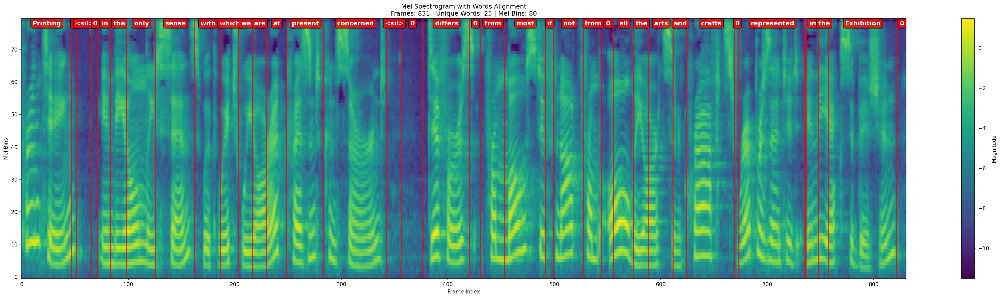
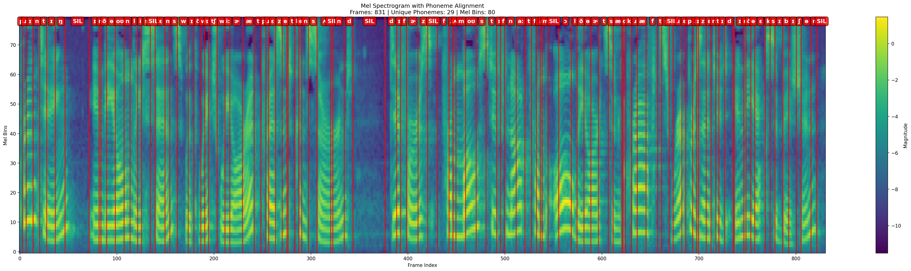
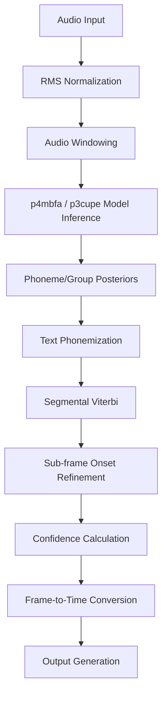
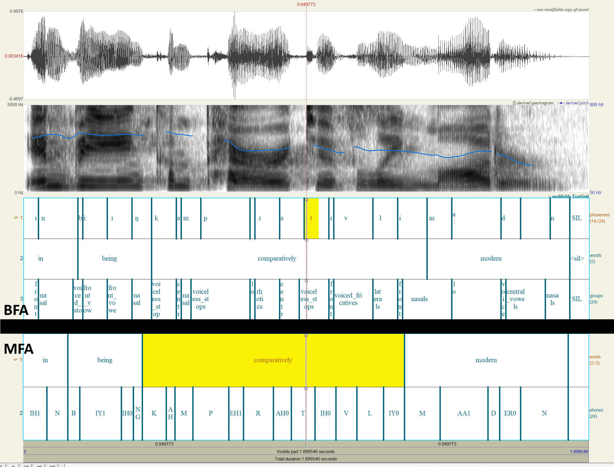

# Bournemouth Forced Aligner (BFA)

<div align="center">

[](https://www.python.org/downloads/)
[](https://badge.fury.io/py/bournemouth-forced-aligner)
[](https://www.gnu.org/licenses/gpl-3.0)
[](https://github.com/tabahi/bournemouth-forced-aligner/stargazers)

**Automatically label which phoneme is spoken at which millisecond in an audio recording.**

[🚀 Quick Start](#getting-started) • [🔧 Installation](#-installation) • [🌍 Languages](#-language-presets) • [💻 CLI](#-command-line-interface-cli) • [🐛 Issues](https://github.com/tabahi/bournemouth-forced-aligner/issues)

</div>

---

## What does it do?

**Forced alignment** is the process of automatically finding *exactly when* each word or sound occurs in an audio recording, given a transcript of what was said.

BFA takes two inputs — an **audio file** and its **text transcript** — and produces a detailed output with millisecond timestamps for every phoneme (the individual sounds that make up words).

```
Input:  🎵 audio.wav  +  📄 "butterfly"

Output:
  b   →    0 ms –  52 ms  (confidence: 0.89)
  ə   →   52 ms – 168 ms  (confidence: 0.09)
  t   →  168 ms – 258 ms  (confidence: 0.05)
  ɝ   →  258 ms – 351 ms  (confidence: 0.01)
  f   →  351 ms – 498 ms  (confidence: 0.28)
  ɫ   →  498 ms – 572 ms  (confidence: 0.11)
  a   →  572 ms – 826 ms  (confidence: 0.94)
  ɪ   →  826 ms – 982 ms  (confidence: 0.25)
```

Every phone ends where the next begins — the alignment covers the audio with no gaps, and each
onset is placed between frames rather than on them.

The output can be exported as a **Praat TextGrid** file for visual inspection, or as **JSON** for use in scripts and TTS pipelines.

### Key Facts

| | |
|---|---|
| ⚡ Speed | ~1 second to align 10 seconds of audio (on CPU) |
| 🎯 Resolution | 5 ms frames, with sub-frame onsets read off the posteriors |
| 🌍 Languages | 63 languages in the default `std` phoneme set today (Latin, Cyrillic, Chinese, Japanese scripts), 80+ through the `ph66` set — see [Phoneme sets](#-phoneme-sets) |
| 📄 Output formats | JSON timestamps, Praat TextGrid, phoneme embeddings |
| 🖥️ Runs on | Linux, macOS, Windows — CPU or GPU |

---

## *What's new in v2.0*

**Two phoneme sets, one aligner.** BFA now has a second, multilingual stack, and it is the
default:

| `phoneme_set` | Text → phonemes | Acoustic model | Languages |
|---|---|---|---|
| **`"std"`** *(default)* | [standard_g2p](https://github.com/tabahi/CharsiuG2P) — a ByT5 G2P, no system packages | **p4mbfa**, one model per *language group* ([`mbfa-latin`](https://huggingface.co/Tabahi/mbfa-latin), …) | 63 today, tonal languages included |
| `"ph66"` | espeak-ng, reduced to 66 phonemes | **p3cupe** ([`CUPE-3-en`](https://huggingface.co/Tabahi/CUPE-3-en), [`CUPE-3-mls7`](https://huggingface.co/Tabahi/CUPE-3-mls7)) | English — the best English model of the two — plus 7 European languages |

`PhonemeTimestampAligner(preset="de")` uses `std`; add `phoneme_set="ph66"` to get the espeak-ng
stack. Everything else — the decoder, chunking, the output format — is the same code for both.
See [Phoneme sets](#-phoneme-sets) for what differs and how to choose.

**Both run on a phoneme model whose output *is* the boundary detector.** Each
phone's posterior is trained to hold across the interior of its own segment and fall to exactly
0.5 at each of its two boundaries, where the neighbouring phone rises through 0.5 — so a
boundary is the **crossing of two posteriors**: a continuous quantity, read off by
interpolation rather than snapped to a frame.

- **5 ms frames**, and sub-frame onsets on top of them.
- **One decoder.** A segmental Viterbi: every frame belongs to a phone or a pause, with a soft
  minimum phone duration. It is the *same* decoder that built the model's training targets, so
  what you decode with is what was trained.
- **One global search.** Posterior evidence and acoustic change are weighed together while the
  path is chosen, not patched up afterwards.
- **⚠️ Breaking change.** v2 does not load v1 checkpoints, and the settings that only served
  them are gone. See the [CHANGELOG](CHANGELOG.md) for the full list and what replaced it.
- **Models download themselves.** Every model is a Hugging Face repository, fetched on first
  use — see [Available models](#available-checkpoints).

---

**Words and phonemes aligned to a Mel-spectrogram:**




*See [mel_spectrum_alignment.py](examples/mel_spectrum_alignment.py) for a full example.*

---

## 🚀 Installation

> **Prerequisites:** Python 3.8 or newer. If you don't have Python yet, download it from [python.org](https://www.python.org/downloads/).

### Step 1 — Install system dependencies

Only **ffmpeg** is needed for the default (`std`) phoneme set. **espeak-ng** is needed only if
you use `phoneme_set="ph66"`.

**Linux (Ubuntu / Debian):**
```bash
sudo apt-get install ffmpeg
sudo apt-get install espeak-ng      # only for phoneme_set="ph66"
```

**macOS:**
```bash
brew install ffmpeg
brew install espeak-ng              # only for phoneme_set="ph66"
```

Or install everything in the conda environment
```bash
conda create -n bfa
conda activate bfa
conda install pip
conda install "ffmpeg"
# or
conda install "ffmpeg" -c conda-forge
```

**Windows:**  
Download and install [ffmpeg](https://ffmpeg.org/download.html) and add it to your system PATH. For `phoneme_set="ph66"`, also install [eSpeak NG](https://github.com/espeak-ng/espeak-ng/blob/master/docs/guide.md).

### Step 2 — Install BFA

```bash
pip install bournemouth-forced-aligner            # the default std phoneme set
pip install "bournemouth-forced-aligner[ph66]"    # + the espeak-ng / ph66 set
```

Thai, Japanese and Cantonese are written without spaces and need a word segmenter, installed
as an extra. Mandarin needs none.

```bash
pip install "bournemouth-forced-aligner[ja]"      # Japanese: fugashi + unidic-lite
pip install "bournemouth-forced-aligner[yue]"     # Cantonese: pycantonese
pip install "bournemouth-forced-aligner[th]"      # Thai: pythainlp
```

**Japanese will not load without it:** `PhonemeTimestampAligner(preset="ja")` raises
`ImportError: word segmentation for 'jpn' needs fugashi unidic-lite` until `fugashi` and
`unidic-lite` are installed (`pip install fugashi unidic-lite` does the same as the extra).

### Step 3 — Verify it works

```bash
python -c "from bournemouth_aligner import PhonemeTimestampAligner; print('Installation successful')"
```

---

## Getting Started

### Quickstart — command line

If you just want to try BFA on a file right away, no Python needed:

```bash
balign butterfly.wav "butterfly" --preset=en-us --mel-path=mel_spectrum.png
```

This aligns the word *butterfly* in [`butterfly.wav`](examples/samples/audio/109867__timkahn__butterfly.wav), saves the phoneme timestamps to `butterfly.vs.json` (same folder as the audio), and also saves a mel-spectrogram image to [`mel_spectrum.png`](mel_spectrum_butterfly.png).


---


> **Tip:** Replace `"butterfly"` with any sentence spoken in the audio, and `--preset=en-us` with your language code (`de`, `fr`, `ru`, `zh`, `ja`, …). Run `balign --list-presets` to see which languages each phoneme set covers, and `balign --help` for more options.


### Python example

```python
from bournemouth_aligner import PhonemeTimestampAligner

# 1. Create the aligner — it will automatically download the right model
#    Change "en-us" to your language code, e.g. "de", "fr", "es", "ru", "zh"
aligner = PhonemeTimestampAligner(preset="en-us")

# 2. Load your audio file (WAV, MP3, FLAC, etc.)
audio = aligner.load_audio("butterfly.wav")

# 3. Run alignment
#    Provide the transcript exactly as spoken in the audio
result = aligner.process_sentence("butterfly", audio)

# 4. Print the phoneme timestamps
for phoneme in result["segments"][0]["phoneme_ts"]:
    print(f"{phoneme['ipa_label']:>5}  {phoneme['start_ms']:.0f} ms – {phoneme['end_ms']:.0f} ms  (confidence: {phoneme['confidence']:.2f})")
```

That's it. No configuration files, no dictionary downloads, no corpus setup.

> **Note:** The first run downloads two things from the Hugging Face Hub into its usual cache (`~/.cache/huggingface`): the aligner model (~55 MB) and, the first time text is phonemized, the `std` set's G2P model [`charsiu/g2p_multilingual_byT5_small_100`](https://huggingface.co/charsiu/g2p_multilingual_byT5_small_100) (~1.2 GB, once). Later runs use the cached copies. Set `$BFA_G2P_DIR` if you already have the G2P model somewhere, or use `phoneme_set="ph66"`, which needs no G2P model.

### Export to Praat TextGrid

```python
# Save a TextGrid file that you can open directly in Praat
aligner.convert_to_textgrid(result, output_file="my_recording.TextGrid")
```

### Multi-language examples

```python
# German
aligner_de = PhonemeTimestampAligner(preset="de")

# French
aligner_fr = PhonemeTimestampAligner(preset="fr")

# Spanish
aligner_es = PhonemeTimestampAligner(preset="es")

# Russian, Mandarin, Japanese - each a different language group, so a different model
aligner_ru = PhonemeTimestampAligner(preset="ru")
aligner_zh = PhonemeTimestampAligner(preset="zh")
aligner_ja = PhonemeTimestampAligner(preset="ja")   # needs: pip install fugashi unidic-lite

# Hindi - no std model yet. ph66 will phonemize it, but CUPE-3-mls7 was not trained on Hindi
aligner_hi = PhonemeTimestampAligner(preset="hi", phoneme_set="ph66")
```

See [Phoneme sets](#-phoneme-sets) for which languages each set covers.

---

### 📊 Sample Output

The block below is the `ph66` output. The `std` set writes the same structure with its own
keys (`local_ph` / `gold_phg` instead of `ph66` / `pg16`) and adds `tone`, `stress` and `length`
— see [Understanding the Output](#understanding-the-output).

<details>
<summary>📋 Click to see the full JSON output for "butterfly" (<code>phoneme_set="ph66"</code>)</summary>

```json
{
    "segments": [
        {
            "start": 0.0,
            "end": 1.2588125,
            "text": "butterfly",
            "ph66": [
                29,
                10,
                58,
                9,
                43,
                56,
                23
            ],
            "pg16": [
                7,
                2,
                14,
                2,
                8,
                13,
                5
            ],
            "coverage_analysis": {
                "target_count": 7,
                "aligned_count": 7,
                "missing_count": 0,
                "extra_count": 0,
                "coverage_ratio": 1.0,
                "missing_phonemes": [],
                "extra_phonemes": [],
                "bad_alignment": false
            },
            "ipa": [
                "b",
                "ʌ",
                "ɾ",
                "ɚ",
                "f",
                "l",
                "aɪ"
            ],
            "word_num": [
                0,
                0,
                0,
                0,
                0,
                0,
                0
            ],
            "words": [
                "butterfly"
            ],
            "phoneme_ts": [
                {
                    "phoneme_id": 29,
                    "phoneme_label": "b",
                    "ipa_label": "b",
                    "start_ms": 1.046869084239006,
                    "end_ms": 52.5,
                    "confidence": 0.9456192255020142,
                    "target_seq_idx": 0,
                    "index": 0
                },
                {
                    "phoneme_id": 10,
                    "phoneme_label": "ʌ",
                    "ipa_label": "ʌ",
                    "start_ms": 52.5,
                    "end_ms": 168.70805740356445,
                    "confidence": 0.39453771710395813,
                    "target_seq_idx": 1,
                    "index": 1
                },
                {
                    "phoneme_id": 58,
                    "phoneme_label": "ɾ",
                    "ipa_label": "ɾ",
                    "start_ms": 168.70805740356445,
                    "end_ms": 257.18225479125977,
                    "confidence": 0.015983885154128075,
                    "target_seq_idx": 2,
                    "index": 2
                },
                {
                    "phoneme_id": 9,
                    "phoneme_label": "ɚ",
                    "ipa_label": "ɚ",
                    "start_ms": 257.18225479125977,
                    "end_ms": 352.5,
                    "confidence": 0.20140987634658813,
                    "target_seq_idx": 3,
                    "index": 3
                },
                {
                    "phoneme_id": 43,
                    "phoneme_label": "f",
                    "ipa_label": "f",
                    "start_ms": 352.5,
                    "end_ms": 447.5,
                    "confidence": 0.9529293775558472,
                    "target_seq_idx": 4,
                    "index": 4
                },
                {
                    "phoneme_id": 56,
                    "phoneme_label": "l",
                    "ipa_label": "l",
                    "start_ms": 447.5,
                    "end_ms": 497.5,
                    "confidence": 0.9412255883216858,
                    "target_seq_idx": 5,
                    "index": 5
                },
                {
                    "phoneme_id": 23,
                    "phoneme_label": "aɪ",
                    "ipa_label": "aɪ",
                    "start_ms": 497.5,
                    "end_ms": 827.5,
                    "confidence": 0.9648973345756531,
                    "target_seq_idx": 6,
                    "index": 6
                }
            ],
            "group_ts": [
                {
                    "group_id": 7,
                    "group_label": "voiced_stops",
                    "start_ms": 1.046869084239006,
                    "end_ms": 52.5,
                    "confidence": 0.8825665712356567,
                    "target_seq_idx": 0,
                    "index": 0
                },
                {
                    "group_id": 2,
                    "group_label": "central_vowels",
                    "start_ms": 52.5,
                    "end_ms": 168.70805740356445,
                    "confidence": 0.333845853805542,
                    "target_seq_idx": 1,
                    "index": 1
                },
                {
                    "group_id": 14,
                    "group_label": "rhotics",
                    "start_ms": 168.70805740356445,
                    "end_ms": 257.18225479125977,
                    "confidence": 0.06540156155824661,
                    "target_seq_idx": 2,
                    "index": 2
                },
                {
                    "group_id": 2,
                    "group_label": "central_vowels",
                    "start_ms": 257.18225479125977,
                    "end_ms": 352.5,
                    "confidence": 0.5041145086288452,
                    "target_seq_idx": 3,
                    "index": 3
                },
                {
                    "group_id": 8,
                    "group_label": "voiceless_fricatives",
                    "start_ms": 352.5,
                    "end_ms": 447.5,
                    "confidence": 0.9766589999198914,
                    "target_seq_idx": 4,
                    "index": 4
                },
                {
                    "group_id": 13,
                    "group_label": "laterals",
                    "start_ms": 447.5,
                    "end_ms": 497.5,
                    "confidence": 0.9302259087562561,
                    "target_seq_idx": 5,
                    "index": 5
                },
                {
                    "group_id": 5,
                    "group_label": "diphthongs",
                    "start_ms": 497.5,
                    "end_ms": 827.5,
                    "confidence": 0.9568509459495544,
                    "target_seq_idx": 6,
                    "index": 6
                }
            ],
            "words_ts": [
                {
                    "word": "butterfly",
                    "start_ms": 1.046869084239006,
                    "end_ms": 827.5,
                    "confidence": 0.6309432863656964,
                    "ph66": [
                        29,
                        10,
                        58,
                        9,
                        43,
                        56,
                        23
                    ],
                    "ipa": [
                        "b",
                        "ʌ",
                        "ɾ",
                        "ɚ",
                        "f",
                        "l",
                        "aɪ"
                    ]
                }
            ]
        }
    ]
}
```

</details>

### Understanding the Output

The result is `{"phoneme_set": ..., "lang": ..., "segments": [...]}`. `phoneme_set` says which
inventory every id in the file is written in — `"ph66"`, or `"std/<language group>"` such as
`"std/latin"` — because the same number is a different phoneme in each.

Every segment contains the following keys:

| Key | What it contains | Useful for |
|-----|-----------------|------------|
| `phoneme_ts` | Per-phoneme timestamps: `ipa_label`, `start_ms`, `end_ms`, `confidence`, `target_seq_idx` (and `tone`, `stress`, `length` in the std set) | Phonetic annotation, TTS training |
| `group_ts` | Same timestamps but grouped into broad phoneme categories (vowels, stops, fricatives…): 15 in std, 16 in ph66 | Coarser acoustic analysis |
| `words_ts` | Word-level timestamps derived from the phonemes | Word-level annotation |
| `ipa` | IPA sequence for the segment, as the G2P wrote it | Phonemic transcription reference |
| `local_ph` *(std)* / `ph66` *(ph66)* | Numeric phoneme indices in the model's own label space | Model-internal representation |
| `gold_phg` *(std)* / `pg16` *(ph66)* | Numeric phoneme-group indices | Model-internal representation |
| `tone`, `stress`, `length` *(std)* | One value per phoneme, from the G2P: tone index (0 = none), stress 0/1/2, length 0/1/2 | Prosody labels; tonal languages |
| `words` | List of words in the segment | Word boundary reference |
| `word_num` | Word index for each phoneme (parallel to the phoneme indices) | Maps each phoneme to its parent word |
| `coverage_analysis` | Quality report: how many phonemes were aligned or missing, and whether the segment is flagged `bad_alignment` | Filtering out bad segments |

**Reading `confidence`:** the peak posterior the model put on this phoneme inside its own segment. Higher is surer, but the scale is model-specific — see [Reading confidence](#reading-confidence) before setting a threshold. `is_estimated` is always `false`: forced alignment places every phoneme it reports, so nothing is inserted after the fact.

---

---

## 🛠️ API Reference

### 🔤 Phoneme sets

A *phoneme set* is a phonemizer plus the label space its ids live in, and each one is decoded
by its own model family. Naming either settles the other, and a model settles both.

| | `phoneme_set="std"` *(default)* | `phoneme_set="ph66"` |
|---|---|---|
| Phonemizer | standard_g2p — a ByT5 G2P for 100 languages, vendored in BFA | espeak-ng (system package) |
| Label space | one token list **per language group** (208 tokens for `latin`, 48 for `cjk`, …) + 15 phoneme groups | 66 phonemes + 16 groups, shared by every language |
| Model | **p4mbfa** — one per language group: `mbfa-latin`, `mbfa-cyrillic`, `mbfa-cjk`, `mbfa-japanese` | **p3cupe** — `CUPE-3-en` for English, `CUPE-3-mls7` for everything else (English + de es fr it nl pl pt) |
| Tone, stress, length | yes, one value per phoneme | no |
| Silence at punctuation | not by default (`punctuation_sil=True` to add it) | always |
| Numbers, abbreviations | **not expanded** — spell them out | expanded by espeak-ng |
| First-run download | G2P model, ~1.2 GB, once | none |

**Languages in the `std` set.** A language belongs to one *language group* (by script), and a
group can be aligned once it has a model. Four do today:

| Language group | Tokens | Languages the G2P covers (BCP 47) |
|---|---:|---|
| `latin` | 208 | af az bs ca cs cy da de en en-GB eo es es-419 es-MX et eu fi fr fr-CA ga gl hu ia id io is it la lb lt mi ms mt nb nl pl pt pt-BR ro se sk sl sq sv sw tk tl tr uz … |
| `cyrillic` | 127 | ba be bg hbs kk mk ru sr tt uk … |
| `cjk` | 48 | zh zh-Hant yue |
| `japanese` | 28 | ja |

Run `balign --list-presets` for the exact list. Codes are accepted in any common spelling —
`en-us`, `EN-GB`, `pt-br`, `cmn`, `zh-tw` — and resolved to the canonical one.
Vietnamese, Greek/Armenian/Georgian/Korean/Amharic, Arabic-script, Indic and Thai groups are
defined but have no model yet; asking for one of their languages raises an error that
names `phoneme_set="ph66"` as the way through. BFA never falls back silently, because the two
sets' ids and output keys differ.

```python
aligner = PhonemeTimestampAligner(preset="de")                        # std / latin
aligner = PhonemeTimestampAligner(preset="zh")                        # std / cjk, with tone
aligner = PhonemeTimestampAligner(phoneme_set="ph66")                 # espeak-ng + CUPE-3-en
aligner = PhonemeTimestampAligner(preset="fr", phoneme_set="ph66")    # espeak-ng + CUPE-3-mls7
aligner = PhonemeTimestampAligner(model_name="mbfa-latin-benchmark")  # a published model by name
aligner = PhonemeTimestampAligner(ckpt_path="my_checkpoint.pt", lang="ru")   # the file decides
```

The table lists what the G2P can phonemize into each group's tokens. Each model was *trained*
on a subset of them (the FLEURS languages - see [Available models](#available-checkpoints));
a language of the group the model never heard is aligned through the phonemes it shares.

**Which to use for English.** Both work, and the English-only `CUPE-3-en` (ph66) is the more
accurate of the two on English boundaries; `mbfa-latin` (std) is the one that also covers 35
other languages, tone and stress. Onset f1 within 25 ms, same files and scorer, each model
with its published decoder settings:

| | TIMIT, 100 files | Buckeye, 3 interviews |
|---|---|---|
| ph66, `CUPE-3-en` *(English ph66 preset)* | 75.8 | **68.9** |
| ph66, `CUPE-3-en-base` | **76.7** | 67.8 |
| ph66, `CUPE-3-mls7` *(non-English ph66 preset)* | 74.9 | 65.2 |
| std, `mbfa-latin` *(default)* | 73.1 | 63.6 |
| std, `mbfa-latin-benchmark` | 74.1 | 63.2 |

These are small samples; the model cards carry the 400-clip TIMIT numbers. On Buckeye the
three ph66 models score higher with the onset bonus switched off — see
[The onset bonus](#the-onset-bonus).

**Switching language.** Within a language group, `aligner.phonemizer.set_backend(language="fr")`
is enough. Across groups the model has to change too: `aligner.load_model(preset="ru")`.

**Already-phonemized input.** In the std set, a segment that carries `gold_ph` — a
standard_g2p `.gs.json` segment — is aligned from those phonemes and its text is not
phonemized again, so the G2P model is never loaded for it:

```python
gs = json.load(open("clip.gs.json"))
result = aligner.process_segments([{"segments": gs["segments"]}], [audio])
```

**Where the G2P model lives.** It is
[`charsiu/g2p_multilingual_byT5_small_100`](https://huggingface.co/charsiu/g2p_multilingual_byT5_small_100),
downloaded by `huggingface_hub` into its own cache (`~/.cache/huggingface`, moved with
`$HF_HOME`) on the first call that phonemizes text. `$BFA_G2P_DIR` (or `g2p_model_dir=`) points
BFA at a copy you already have, and `g2p_device=` puts the G2P on a different device from the
aligner.

### 🌍 Language Presets

The tables below are the **`ph66`** set's presets. For the default `std` set, see
[Phoneme sets](#-phoneme-sets) above.

`ph66` phonemizes **80+ languages**: pass the language code as `preset` together with `phoneme_set="ph66"` and phonemisation is handled by [espeak-ng](https://github.com/espeak-ng/espeak-ng), which is free and works offline.

> **Note:** the language picks one of two p3cupe models. English presets load
> [`CUPE-3-en`](https://huggingface.co/Tabahi/CUPE-3-en), the most accurate English model BFA
> has. Every other preset loads [`CUPE-3-mls7`](https://huggingface.co/Tabahi/CUPE-3-mls7),
> which was trained on English and then on **German, Spanish, French, Italian, Dutch, Polish
> and Portuguese**. For a language outside those eight it aligns that language's phonemes by
> their nearest sounds in the ones it knows, and BFA prints a warning saying so. Prefer the
> `std` set wherever it has a model for the language.

**Supported language families:** Indo-European (Germanic, Romance, Slavic, Indic, Iranian…), Turkic, Semitic, Dravidian, and several others.

**Not supported by ph66:** Tonal languages — Chinese (Mandarin, Cantonese), Vietnamese, Thai, Burmese — and isolating/agglutinative families such as Japanese and Korean. That is a limit of the ph66 phoneme inventory, not just of the training data, so a different p3cupe model will not fix it. Mandarin, Cantonese and Japanese are covered by the `std` set.

```python
aligner = PhonemeTimestampAligner(preset="de", phoneme_set="ph66")   # German
aligner = PhonemeTimestampAligner(preset="hi", phoneme_set="ph66")   # Hindi
aligner = PhonemeTimestampAligner(preset="fr", phoneme_set="ph66")   # French
aligner = PhonemeTimestampAligner(preset="ar", phoneme_set="ph66")   # Arabic
aligner = PhonemeTimestampAligner(preset="ru", phoneme_set="ph66")   # Russian
```

#### 📋 Complete Preset Table

<details>
<summary>🔍 Click to view all 80+ supported language presets</summary>

| **Language** | **Preset Code** | **Language Family** |
|--------------|-----------------|-------------------|
| **🇺🇸 ENGLISH VARIANTS** | |
| English (US) | `en-us`, `en` | West Germanic |
| English (UK) | `en-gb` | West Germanic |
| English (Caribbean) | `en-029` | West Germanic |
| English (Lancastrian) | `en-gb-x-gbclan` | West Germanic |
| English (RP) | `en-gb-x-rp` | West Germanic |
| English (Scottish) | `en-gb-scotland` | West Germanic |
| English (West Midlands) | `en-gb-x-gbcwmd` | West Germanic |
| **🇪🇺 EUROPEAN LANGUAGES** | |
| German | `de` | West Germanic |
| French | `fr` | Romance |
| French (Belgium) | `fr-be` | Romance |
| French (Switzerland) | `fr-ch` | Romance |
| Spanish | `es` | Romance |
| Spanish (Latin America) | `es-419` | Romance |
| Italian | `it` | Romance |
| Portuguese | `pt` | Romance |
| Portuguese (Brazil) | `pt-br` | Romance |
| Polish | `pl` | West Slavic |
| Dutch | `nl` | West Germanic |
| Danish | `da` | North Germanic |
| Swedish | `sv` | North Germanic |
| Norwegian Bokmål | `nb` | North Germanic |
| Icelandic | `is` | North Germanic |
| Czech | `cs` | West Slavic |
| Slovak | `sk` | West Slavic |
| Slovenian | `sl` | South Slavic |
| Croatian | `hr` | South Slavic |
| Bosnian | `bs` | South Slavic |
| Serbian | `sr` | South Slavic |
| Macedonian | `mk` | South Slavic |
| Bulgarian | `bg` | South Slavic |
| Romanian | `ro` | Romance |
| Hungarian | `hu` | Uralic |
| Estonian | `et` | Uralic |
| Latvian | `lv` | Baltic |
| Lithuanian | `lt` | Baltic |
| Catalan | `ca` | Romance |
| Aragonese | `an` | Romance |
| Papiamento | `pap` | Romance |
| Haitian Creole | `ht` | Romance |
| Afrikaans | `af` | West Germanic |
| Luxembourgish | `lb` | West Germanic |
| Irish Gaelic | `ga` | Celtic |
| Scottish Gaelic | `gd` | Celtic |
| Welsh | `cy` | Celtic |
| **🌏 INDO-EUROPEAN LANGUAGES** | |
| Russian | `ru` | East Slavic |
| Russian (Latvia) | `ru-lv` | East Slavic |
| Ukrainian | `uk` | East Slavic |
| Belarusian | `be` | East Slavic |
| Hindi | `hi` | Indic |
| Bengali | `bn` | Indic |
| Urdu | `ur` | Indic |
| Punjabi | `pa` | Indic |
| Gujarati | `gu` | Indic |
| Marathi | `mr` | Indic |
| Nepali | `ne` | Indic |
| Assamese | `as` | Indic |
| Oriya | `or` | Indic |
| Sinhala | `si` | Indic |
| Konkani | `kok` | Indic |
| Bishnupriya Manipuri | `bpy` | Indic |
| Sindhi | `sd` | Indic |
| Persian | `fa` | Iranian |
| Persian (Latin) | `fa-latn` | Iranian |
| Kurdish | `ku` | Iranian |
| Greek (Modern) | `el` | Greek |
| Greek (Ancient) | `grc` | Greek |
| Armenian (East) | `hy` | Indo-European |
| Armenian (West) | `hyw` | Indo-European |
| Albanian | `sq` | Indo-European |
| Latin | `la` | Italic |
| **🇹🇷 TURKIC LANGUAGES** | |
| Turkish | `tr` | Turkic |
| Azerbaijani | `az` | Turkic |
| Kazakh | `kk` | Turkic |
| Kyrgyz | `ky` | Turkic |
| Uzbek | `uz` | Turkic |
| Tatar | `tt` | Turkic |
| Turkmen | `tk` | Turkic |
| Uyghur | `ug` | Turkic |
| Bashkir | `ba` | Turkic |
| Chuvash | `cu` | Turkic |
| Nogai | `nog` | Turkic |
| **🇫🇮 URALIC LANGUAGES** | |
| Finnish | `fi` | Uralic |
| Lule Saami | `smj` | Uralic |
| **🕌 SEMITIC LANGUAGES** | |
| Arabic | `ar` | Semitic |
| Hebrew | `he` | Semitic |
| Amharic | `am` | Semitic |
| Maltese | `mt` | Semitic |
| **🏝️ MALAYO-POLYNESIAN LANGUAGES** | |
| Indonesian | `id` | Malayo-Polynesian |
| Malay | `ms` | Malayo-Polynesian |
| **🇮🇳 DRAVIDIAN LANGUAGES** | |
| Tamil | `ta` | Dravidian |
| Telugu | `te` | Dravidian |
| Kannada | `kn` | Dravidian |
| Malayalam | `ml` | Dravidian |
| **🇬🇪 SOUTH CAUCASIAN LANGUAGES** | |
| Georgian | `ka` | South Caucasian |
| **🗾 LANGUAGE ISOLATES & OTHERS** | |
| Basque | `eu` | Language Isolate |
| Quechua | `qu` | Quechuan |
| **🛸 CONSTRUCTED LANGUAGES** | |
| Esperanto | `eo` | Constructed |
| Interlingua | `ia` | Constructed |
| Ido | `io` | Constructed |
| Lingua Franca Nova | `lfn` | Constructed |
| Lojban | `jbo` | Constructed |
| Pyash | `py` | Constructed |
| Lang Belta | `qdb` | Constructed |
| Quenya | `qya` | Constructed |
| Klingon | `piqd` | Constructed |
| Sindarin | `sjn` | Constructed |

</details>

The English presets in this table load `CUPE-3-en` and every other one loads `CUPE-3-mls7`.
The table says what espeak-ng and the ph66 mapper can *phonemize*; the acoustic models have
been trained on English, German, Spanish, French, Italian, Dutch, Polish and Portuguese.

**⚠️ Unsupported Language Types:**
- **Tonal languages**: Chinese (Mandarin, Cantonese), Vietnamese, Thai, Burmese
- **Distant families**: Japanese, Korean, most African languages (Swahili, etc.)
- **Indigenous languages**: Most Native American, Polynesian (except Indonesian/Malay)
- **Recommendation**: these are limits of the ph66 phoneme inventory, not just of the training
  data, so a different p3cupe model will not fix them. Use the `std` set where it covers
  the language

### Initialization

```python
PhonemeTimestampAligner(
    preset="en-us",               # Language code — selects model and phonemiser automatically
    phoneme_set=None,             # "std" (default) or "ph66"; None = default, or the model's
    model_name=None,              # A published model by name, e.g. "mbfa-latin-benchmark"
    ckpt_path=None,               # A model on disk: release directory or training checkpoint
    lang="en-us",                 # Language code for phonemisation
    g2p_model_dir=None,           # std: a local copy of the G2P model (default: the HF cache)
    g2p_device=None,              # std: device for the G2P model (default: same as `device`)
    g2p_cache_size=None,          # std: word -> IPA entries remembered (default 500k)
    punctuation_sil=False,        # std: write a silence at pause punctuation
    duration_max=30,              # Padding width in seconds for the batched short-segment path
    device="auto",                # "auto" | "cpu" | "cuda" | "mps"
    boundary_bonus_weight=None,   # Onset bonus; None = the checkpoint's own trained value
    sub_frame_onsets=True,        # Interpolate onsets at the posterior crossing
    min_phone_frames=None,        # Duration floor in 5 ms frames; None = the checkpoint's value
    soft_phone_frames=None,       # Frames above the floor a phone may give up; None = ditto
    bad_confidence_threshold=0.6, # Flag segments where >60% of phonemes are low-confidence
    low_confidence_level=None,    # What counts as "low confidence"; None = the model family's (0.2 CUPE-3, 0.1 mbfa)
    segment_max_seconds=120,      # Decode whole up to this length, chunk beyond it
    chunk_audio=True,             # Walk longer segments in overlapping windows
    chunk_seconds=10.0,           # Window length for that walk
    chunk_max_phonemes=200,       # Cap on one window's phoneme budget
    chunk_phonemes_per_second=15, # Budget rate, measured over SPEECH seconds
    chunk_vad=True,               # Energy VAD for speech-seconds and cut placement
    warn_level=1,                 # 0 silent (downloads too), 1 warnings, 2 + progress bars and geometry/decoder info
)
```

**For most users, only `preset` needs to be set** — plus `phoneme_set="ph66"` for the
espeak-ng stack, or `ckpt_path` for a checkpoint of your own. Everything about the decoder
defaults to the value the model was *published* with, which is what it was trained and scored
with.

<details>
<summary>Parameter details</summary>

| Parameter | Default | What it does |
|-----------|---------|-------------|
| `preset` | `"en-us"` | Language code. Picks the language and, through it, the model. |
| `phoneme_set` | `None` | `"std"` or `"ph66"`. `None` means the default (`std`) — or, with `ckpt_path` / `model_name`, whatever that model is. Asking for one set and passing a model of the other raises. See [Phoneme sets](#-phoneme-sets). |
| `model_name` | `None` | A published model, overriding the preset's choice: `mbfa-latin`, `mbfa-latin-benchmark`, `mbfa-cyrillic`, `mbfa-cjk`, `mbfa-japanese`, `CUPE-3-en`, `CUPE-3-en-base`, `CUPE-3-mls7`, or any Hugging Face repository id in the same layout. Downloaded on first use. |
| `ckpt_path` | `None` | Path to a model on disk, of either family: a release directory (`config.json` + `model.safetensors`) or a training checkpoint file. Highest priority, and decides the phoneme set by itself. A p4mbfa model also fixes the language group, so `lang` must be a language of that group. |
| `lang` | `"en-us"` | Language code; overrides the preset's language. std: any BCP 47 code standard_g2p covers, in any case. ph66: an espeak-ng code, see [all codes](https://github.com/espeak-ng/espeak-ng/blob/master/docs/languages.md). |
| `g2p_model_dir` | `None` | std only. Directory already holding the G2P model (`config.json` + `pytorch_model.bin`). Default `$BFA_G2P_DIR`; with neither set it is downloaded from the Hugging Face Hub on first use. |
| `g2p_device` | `None` | std only. Device for the G2P model; defaults to `device`. |
| `g2p_cache_size` | `None` | std only. Word → IPA entries the G2P remembers (default 500k, ~55 MB; `0` = no limit). |
| `punctuation_sil` | `False` | std only. Write a silence where the text has pause punctuation, as ph66 always does. Off by default because the p4mbfa models were trained without one; the aligner may skip any silence at no cost. An explicit `<SIL>` in the text is honoured either way. |
| `duration_max` | `30` | Padding width for the batched path. Segments longer than this are decoded on their own, unpadded — so this trades memory against how many segments share one forward pass, and never truncates. |
| `device` | `"auto"` | `"auto"` detects CUDA/MPS/CPU. The Viterbi itself always runs on CPU, where it measures ~3x faster than on CUDA (tiny per-frame tensors make it launch-bound). |
| `boundary_bonus_weight` | `None` | Weight on the log-mel acoustic-change bonus added to every phone-onset transition inside the Viterbi. `None` uses the model's own value (30 for every published one); `0` turns it off. See [The onset bonus](#the-onset-bonus). |
| `sub_frame_onsets` | `True` | Place each onset at the interpolated crossing of the two neighbouring posteriors instead of on the 5 ms grid. This is the readout the loss was shaped for. |
| `min_phone_frames` | `None` | Shortest phone the aligner may emit, in 5 ms frames (6 = 30 ms for every published model). A clip whose text will not fit at this floor automatically gets a shorter one rather than losing its alignment. |
| `soft_phone_frames` | `None` | Frames above the floor that a phone may give up, at a cost each — the soft half of the duration prior. |
| `bad_confidence_threshold` | `0.6` | Share of low-confidence phonemes that flags a segment as `bad_alignment`. |
| `low_confidence_level` | `None` | Confidence below which a phoneme counts towards that share. `None` takes the loaded model family's level — `0.2` for the CUPE-3 models, `0.1` for the mbfa ones — because the two are not on one confidence scale. See [Reading confidence](#reading-confidence). |
| `segment_max_seconds` | `120` | Segments up to this long are decoded in one pass and never chunked. Whole decoding is more accurate than chunking, so raise it if the hardware allows; the cost is roughly 1.8 s of Viterbi per 32 s of audio. |
| `chunk_audio` | `True` | Walk segments longer than `segment_max_seconds` in overlapping windows. See [Long audio](#long-audio). |
| `chunk_seconds` | `10.0` | Window length for that walk. |
| `chunk_max_phonemes` | `200` | Blunt cap on one window's phoneme budget. |
| `chunk_phonemes_per_second` | `15.0` | Budget rate over **speech** seconds (a safe upper bound for English). |
| `chunk_vad` | `True` | Energy VAD used to measure speech seconds per window and to land cuts in pauses. |
| `warn_level` | `1` | `0` prints nothing at all, a first-time download included. `1` adds warnings and one line per download. `2` adds download progress bars, the resolved frame geometry and the decoder settings. |

**Model priority (highest → lowest):** `ckpt_path` → `model_name` → `preset` → defaults.

</details>

---

<a id="available-checkpoints"></a>
**Available models.** Each is a Hugging Face repository; BFA downloads its `config.json` and
`model.safetensors` (~55 MB) on first use and reads everything else from them — the
architecture, the frame geometry, the decoder settings and the label space.

*p4mbfa (`std` set)* — one per language group. Each carries the token list it was trained on,
and BFA refuses to load one whose list differs from its own tables:

| Model | Language group | Trained on | Used by |
|---|---|---|---|
| [`mbfa-latin`](https://huggingface.co/Tabahi/mbfa-latin) | `latin` | FLEURS, 36 languages, 273 h | every `latin` preset — **the default** |
| [`mbfa-latin-benchmark`](https://huggingface.co/Tabahi/mbfa-latin-benchmark) | `latin` | FLEURS, 36 languages, ~170 h | `model_name=` only |
| [`mbfa-cyrillic`](https://huggingface.co/Tabahi/mbfa-cyrillic) | `cyrillic` | FLEURS: be bg hr kk mk ru sr uk, ~40 h | every `cyrillic` preset |
| [`mbfa-cjk`](https://huggingface.co/Tabahi/mbfa-cjk) | `cjk` | FLEURS: Mandarin, Cantonese, ~9 h | `zh`, `zh-Hant`, `yue` |
| [`mbfa-japanese`](https://huggingface.co/Tabahi/mbfa-japanese) | `japanese` | FLEURS: Japanese, 7 h | `ja` (needs `fugashi` + `unidic-lite`, see [Install](#step-2--install-bfa)) |

The two latin models differ in training noise. `mbfa-latin` was trained with the most noise
and is the one meant for real recordings; `mbfa-latin-benchmark` was trained with less and
scores higher on TIMIT, which is clean studio speech (see each model card for the numbers).

*p3cupe (`ph66` set)* — one label space for every language, so the language only picks which
model has heard it:

| Model | Trained on | Used by |
|---|---|---|
| [`CUPE-3-en`](https://huggingface.co/Tabahi/CUPE-3-en) | LibriSpeech, ~500 h, English | every English `ph66` preset |
| [`CUPE-3-mls7`](https://huggingface.co/Tabahi/CUPE-3-mls7) | `CUPE-3-en-base`, then Multilingual LibriSpeech: German, Spanish, French, Italian, Dutch, Polish, Portuguese, 100 h each | every other `ph66` preset |
| [`CUPE-3-en-base`](https://huggingface.co/Tabahi/CUPE-3-en-base) | LibriSpeech, ~500 h, English | `model_name=` only |

The two English models come from the same lineage and score within noise of each other on
TIMIT — boundary f1 within 25 ms of 75.6 (`CUPE-3-en`) and 76.0 (`CUPE-3-en-base`) on the
held-out half of the 400-clip probe — the best of either family. `CUPE-3-mls7` is the only
p3cupe model that has heard anything but English; the MLS epoch cost it about two points on
English (74.2), so it is not the English choice.

```python
aligner = PhonemeTimestampAligner()                                    # mbfa-latin, English
aligner = PhonemeTimestampAligner(preset="ru")                         # mbfa-cyrillic
aligner = PhonemeTimestampAligner(model_name="mbfa-latin-benchmark")   # by name
aligner = PhonemeTimestampAligner(phoneme_set="ph66")                  # CUPE-3-en
aligner = PhonemeTimestampAligner(preset="de", phoneme_set="ph66")     # CUPE-3-mls7
aligner = PhonemeTimestampAligner(model_name="CUPE-3-en-base")         # by name
```

**Downloads happen once.** A model that is already in the `huggingface_hub` cache
(`~/.cache/huggingface`, moved with `$HF_HOME`) is loaded straight from it: no request to the
Hub, no progress bar, and it works the same with no connection. Only a model that is not
there yet is fetched. The flip side: a repository that is updated on the Hub is not picked up
by a machine that already holds it — delete it from the cache to fetch the new one.

**Your own models.** Before the cache, `preset=` and `model_name=` look for a directory named
after the model in `$BFA_MODEL_DIR`, then in `./models/`
(`./models/mbfa-latin/config.json` + `model.safetensors`).

A model on disk is passed with `ckpt_path` — a release directory, or a training checkpoint
file from [bfa_models](https://github.com/tabahi/bfa_models). The model says which family it
is, so nothing else needs stating:

```python
aligner = PhonemeTimestampAligner(ckpt_path="path/to/mbfa-cjk", lang="zh")
aligner = PhonemeTimestampAligner(ckpt_path="path/to/m_ma04a_epoch=6.ckpt")
aligner = PhonemeTimestampAligner(ckpt_path="path/to/CUPE-3-mls7", lang="fr")    # ph66
```

Each repository also holds the training checkpoint under `ckpt/`, for fine-tuning; BFA does
not download it.


### `process_srt_file` — align a whole recording from a transcript file

**When to use:** You have a full audio file and a Whisper-style JSON transcript (segments with `start`, `end`, `text`). This is the most common entry point for corpus annotation.

```python
timestamps = aligner.process_srt_file(
    srt_path,           # path to transcript JSON (Whisper output format)
    audio_path,         # path to audio file
    ts_out_path=None,   # optional: save results to this JSON file
    extract_embeddings=False,
    vspt_path=None,     # optional: save phoneme embeddings to this .pt file
    do_groups=False,    # set True to also return phoneme group timestamps
    batch_size=4, # reduce if out-of-memory
    debug=True
)


aligner.warn_level = 2  # 0 = nothing printed, 1 = warnings (default), 2 = also informational output. Errors are raised as exceptions regardless
```

Returns a dict with a `"segments"` key. See [example_advanced.py](examples/example_advanced.py).

---

### `process_sentence` — align one sentence

**When to use:** You have a single sentence and its audio clip (already loaded).

```python
result = aligner.process_sentence(
    text,               # transcript of the audio
    audio_wav,          # audio waveform tensor from load_audio()
    extract_embeddings=False,
    do_groups=False,    # set True to also return phoneme group timestamps
    debug=False
)
# Returns a dict with "segments" key (one segment)
# If extract_embeddings=True, returns (result, phoneme_embeddings, group_embeddings)
```

See [basic_usage.py](examples/basic_usage.py).

---

### `process_sentences_batch` — align many sentences at once

**When to use:** You have a list of sentences and corresponding audio clips and want to process them all efficiently in one call.

```python
results = aligner.process_sentences_batch(
    texts,       # list of transcript strings
    audio_wavs,  # list of audio waveform tensors (one per text)
    do_groups=False,
    debug=False
)
# Returns a list of result dicts, one per input
```

See [batch_aligment.py](examples/batch_aligment.py).

---

---

### `process_segments` — batch alignment from segmented transcripts

**When to use:** You have multiple audio files each with multiple time-stamped segments (e.g. output from Whisper over a corpus). This is the most efficient entry point for large-scale annotation.

```python
# Each item in srt_data corresponds to one audio file
srt_data = [
    {"segments": [{"start": 0.0, "end": 3.5, "text": "hello world"}, ...]},  # file 1
    {"segments": [{"start": 0.0, "end": 5.0, "text": "another recording"}, ...]},  # file 2
]
audio_wavs = [wav1, wav2]  # one waveform per file

batch_results = aligner.process_segments(
    srt_data,
    audio_wavs,
    do_groups=False,
    batch_size=4, # reduce if out-of-memory
    debug=True
)
# Returns a list of dicts (one per file), each with a "segments" key

# With phoneme embeddings:
batch_results, phoneme_embds, group_embds = aligner.process_segments(
    srt_data, audio_wavs, extract_embeddings=True
)
# phoneme_embds[file_idx][segment_idx] = embedding tensor
```

See [batch_aligment.py](examples/batch_aligment.py) for a complete working example.

---
### `phonemize_sentence` — convert text to IPA and phoneme indices

Useful for inspecting how BFA will interpret your text before running alignment.

```python
# std (default)
result = aligner.phonemize_sentence("butterfly")

print(result["eipa"])      # ['b', 'ə', 't', 'ɝ', 'f', 'ɫ', 'a', 'ɪ']  — the G2P's IPA phonemes
print(result["mipa"])      # ['b', 'ə', 't', 'ɝ', 'f', 'ɫ', 'a', 'ɪ']  — the token each mapped to
print(result["local_ph"])  # [22, 21, 9, 97, 19, 43, 4, 17]   — indices in the 'latin' token list
print(result["gold_phg"])  # [5, 2, 4, 1, 7, 10, 3, 1]        — phoneme groups (15, shared by all languages)
print(result["stress"])    # [0, 1, 0, 0, 0, 0, 2, 0]         — also "tone" and "length"
print(result["words"])     # ['butterfly']
print(result["word_num"])  # [0, 0, 0, 0, 0, 0, 0, 0]  — which word each phoneme belongs to
```

```python
# ph66
aligner = PhonemeTimestampAligner(preset="en-us", phoneme_set="ph66")
result = aligner.phonemize_sentence("butterfly")

print(result["eipa"])     # ['b', 'ʌ', 'ɾ', 'ɚ', 'f', 'l', 'aɪ']  — original espeak-ng IPA
print(result["mipa"])     # ['b', 'ʌ', 'ɾ', 'ɚ', 'f', 'l', 'aɪ']  — mapped IPA (after ph66 reduction)
print(result["ph66"])     # [29, 10, 58, 9, 43, 56, 23]             — numeric indices for the model
print(result["pg16"])     # [7, 2, 14, 2, 8, 13, 5]                 — phoneme group indices
```

The key names differ between the sets; `aligner.phonemes_key` and `aligner.phoneme_groups_key`
give the right ones for the aligner in hand.

To change the language after initialisation (within the same language group, for std):
```python
aligner.phonemizer.set_backend(language='de')  # switch to German phonemisation
```

#### About the std token lists

The `std` set maps every language onto one closed inventory of 270 "gold" tokens and then
re-indexes them into the smaller list of the language's group — `local_ph`. Tone, stress and
length are split off into their own layers instead of multiplying the phoneme classes, which
is how Mandarin, Cantonese and English can share segment labels.

- `phoneme_label` is the token; `ipa_label` is the phoneme the G2P wrote. They differ only
  where a rare phoneme backed off to a close neighbour, or — for a phoneme outside the
  language group's list — to `<unk>`.
- The first four tokens are the same in every group: `<blank>` (never used), `SIL`, `noise`
  (junk in the G2P's output) and `<unk>`.
- A phoneme can back off to *two* tokens (`ʈ͡ʂ` → `ʈ ʂ`); both then carry its tone, stress,
  length and word.

#### About ph66 and the phoneme alphabet

The `ph66` set uses a reduced alphabet of **66 phoneme classes** that maps the full IPA inventory of any supported language onto a shared set of symbols. This is what the p3cupe acoustic model was trained on.

- `phoneme_label` in the output is the ph66 symbol (e.g. `"a:"`, `"b"`).
- `ipa_label` is the original espeak-ng IPA for that position (e.g. `"ɑː"`, `"b"`).
- For compound phonemes like /ɑːɹ/, BFA splits them into two entries. The second half gets `ipa_label: "-"` to indicate continuation.

<details>
<summary>Example: how a compound phoneme (ɑːɹ) appears in the output JSON</summary>

```json
{
    "phoneme_id": 19,
    "phoneme_label": "a:",
    "ipa_label": "ɑːɹ",
    "start_ms": 2478.1,
    "end_ms": 2606.8,
    "confidence": 0.937
},
{
    "phoneme_id": 59,
    "phoneme_label": "ɹ",
    "ipa_label": "-",
    "start_ms": 2606.8,
    "end_ms": 2639.0,
    "confidence": 0.665
}
```

The original IPA /ɑːɹ/ is assigned to the first part; the second part carries `"-"` to signal it is a continuation.

</details>


---

### `extract_timestamps_from_segment_batch` — low-level batch inference

This is the internal method that `process_segments` calls. Most users will not need it directly. It takes raw audio tensors and phoneme index sequences and runs the CUPE model + Viterbi decoder.

See [run_simplipied_pipeline.py](examples/run_simplipied_pipeline.py) for a working example of the simplified variant (`extract_timestamps_from_segment_simplified`).

---

### `convert_to_textgrid` — export to Praat

Converts the alignment result to a [Praat TextGrid](https://www.fon.hum.uva.nl/praat/manual/TextGrid_file_format.html) file with separate tiers for phonemes, phoneme groups, and words.

```python
# Save to file
aligner.convert_to_textgrid(result, output_file="recording.TextGrid")

# Or get the TextGrid content as a string (e.g. to embed in your own pipeline)
textgrid_str = aligner.convert_to_textgrid(result, output_file=None)

# Include confidence scores in the tier labels
aligner.convert_to_textgrid(result, output_file="recording.TextGrid", include_confidence=True)
```


---


## 🔧 Advanced Usage

### How boundaries are placed

BFA has one decoder: a **segmental Viterbi** over p3cupe's per-frame posteriors. Every frame
belongs to exactly one phone of the transcript, each phone is a chain of sub-states with a soft
minimum duration, and an optional `SIL` may be skipped wherever the phonemizer wrote one for a
comma the speaker did not pause at.

The important property is that this is the **same decoder that built the model's training
targets**. p3cupe is trained by hard-EM: its own Viterbi alignment of the known phoneme
sequence becomes the target its posteriors are shaped towards. So the posteriors you decode
were shaped by this exact topology — decoding with a different one decodes a model that was
never trained.

That shape is what makes a boundary readable. Each phone's posterior is held at 1.0 across the
interior of its segment and brought down to exactly 0.5 at each of its two boundaries, where
the neighbour rises through 0.5 — so two phones **cross** at their shared boundary and nowhere
else. `sub_frame_onsets=True` (the default) reads that crossing off by linear interpolation,
which is why the 5 ms frame grid is not the resolution limit. Every onset is placed inside the
search itself — nothing is moved afterwards.

<a id="the-onset-bonus"></a>
#### The onset bonus

`boundary_bonus_weight` adds `weight × (local log-mel spectral change)` nats to every
transition that *starts* a phone at a given frame, so posterior evidence and acoustic change
are traded off inside one global search. It defaults to whatever the loaded model was
published with (30 for every one of them); `0` turns it off.

The evidence points both ways, so it is worth knowing which way your data leans:

- **Against.** Scored per phone *onset* — is each phone's own onset within 25 ms of its label
  — the bonus costs accuracy: it drags stop onsets onto the burst and pulls vowel onsets early.
  `CUPE-3-en` on TIMIT places 73.1% of phone onsets within 25 ms at weight 0 and 68.7% at
  weight 30 (`CUPE-3-en-base`: 74.6% and 68.6%; `CUPE-3-mls7`: 71.1% and 66.4%).
- **For.** Scored as boundary f1 — is there a predicted boundary within 25 ms of each labelled
  one — the bonus helps, and it helps the multilingual model most:

  | TIMIT f1@25 (held-out half of the 400-clip probe) | weight 0 | weight 30 |
  |---|---|---|
  | `CUPE-3-en` | 73.8 | **75.6** |
  | `CUPE-3-en-base` | 73.8 | **76.0** |
  | `CUPE-3-mls7` | 70.9 | **74.2** |
  | `mbfa-latin` | 65.2 | **71.7** |
  | `mbfa-latin-benchmark` | 68.8 | **72.9** |

  (Numbers from the model cards.)

- **Against, on conversational speech.** TIMIT is read speech. On Buckeye interviews the
  same boundary f1 goes the other way for the p3cupe models, and the mbfa models are
  indifferent (3 interviews, 118 segments, about 9,000 labelled boundaries — a small sample):

  | Buckeye f1@25 | weight 0 | weight 30 |
  |---|---|---|
  | `CUPE-3-en` | **72.0** | 68.9 |
  | `CUPE-3-en-base` | **72.4** | 67.8 |
  | `CUPE-3-mls7` | **67.3** | 65.2 |
  | `mbfa-latin` | 63.2 | 63.6 |
  | `mbfa-latin-benchmark` | 64.1 | 63.2 |

So: keep the default for read speech and segmentation-style use, where what matters is that
boundaries exist in the right places; try `boundary_bonus_weight=0` for spontaneous speech
with a ph66 model, and when each phone's own onset time matters. `tests/test_buckeye.py --cfg
'{"boundary_bonus_weight": 0}'` measures it on Buckeye.

<a id="reading-confidence"></a>
#### Reading confidence

A phoneme's `confidence` is **the highest posterior the model puts on that phone anywhere
inside its own segment** — the peak, not the mean, because the hat-shaped target makes the
frames at both ends of every segment uncertain *by design*, and averaging over the segment
would read a short phone (nearly all ramp) as far less confident than a long one of identical
quality.

**Read it as a relative number, not an absolute one.** The training target has entropy by
design, so the posteriors never saturate and a perfectly well-placed phone routinely reads
below 0.5 — a threshold that would be alarming for a model trained to emit one-hot spikes
means nothing here. Compare segments against other segments *from the same checkpoint*: the
models are not on one scale either. Measured on English (TIMIT, 100 files / Buckeye, 3
interviews), each model with its published settings:

| | mean confidence | `low_confidence_level` | phonemes below it |
|---|---|---|---|
| `CUPE-3-en` | 0.53 / 0.43 | 0.2 | 23% / 34% |
| `CUPE-3-en-base` | 0.39 / 0.32 | 0.2 | 32% / 42% |
| `CUPE-3-mls7` | 0.26 / 0.21 | 0.2 | 58% / 65% |
| `mbfa-latin` | 0.25 / 0.20 | 0.1 | 48% / 55% |
| `mbfa-latin-benchmark` | 0.17 / 0.15 | 0.1 | 56% / 58% |

`low_confidence_level` defaults to the model family's level: 0.2 for the CUPE-3 models and
0.1 for the mbfa ones. A segment longer than 60 phonemes is flagged
`coverage_analysis["bad_alignment"]` when more than `bad_confidence_threshold` (0.6) of its
phonemes fall below that level, so pass your own level where the share above runs close to
that threshold for your model and recordings.

### Unreliable transcripts

**BFA always performs forced alignment: every phoneme of the transcript gets a timestamp**
(bar an optional `SIL` the speaker did not pause at). There is no mode that lets the decoder
decline words the audio does not contain.

So when the text holds words that are not in the audio, those phonemes are squeezed into the
neighbouring audio. What BFA does instead is *report* it: `coverage_analysis["bad_alignment"]`
is set when too many phonemes come out below `low_confidence_level`, or when a segment's
confidence is healthy at the start and collapsed at the end — the signature of an alignment
that starts on the right audio and then runs away from it.

If a segment's text genuinely cannot fit its audio at one frame per phone, that segment is
skipped with a warning naming it, and the rest of the batch is aligned normally.

<a id="long-audio"></a>
### 🕙 Long audio

Segments up to `segment_max_seconds` (120 s) are decoded **in one pass**, and that is the
accurate path. The segmental decoder does not collapse on long audio: it has no band
constraint, and every phone is placed in one global search. On
`30s.wav` (32 s, 356 phonemes) the last phoneme lands at 31.88 s of a 31.88 s clip.

Segments longer than that are walked in overlapping windows, purely to bound the Viterbi's
time and memory (it is a python loop over frames, ~1.8 s per 32 s of audio). Each window gets
a phoneme budget sized from its **speech** seconds — that is what `chunk_vad` is for, since a
window holding 4 s of speech and 6 s of pause contains ~60 phonemes, not ~150 — and is capped
at what its frames can physically hold at the duration floor.

A window is then trusted only as far into its own **audio** as `TRUST_WINDOW_FRACTION` (75 %),
and everything past that is handed back to the next window, which sees it with real audio on
both sides instead of at its edge. That cap matters more than it sounds: this decoder cannot
cram (it enforces a minimum phone duration and reports infeasibility instead), so an
over-budgeted window places its surplus phonemes early rather than announcing itself. Trimming
by phoneme *count* keeps almost all of them and the walk runs ahead of the audio:

| `30s.wav` forced through the chunker at 10 s windows | last phoneme ends | mean confidence | flagged |
|---|---|---|---|
| count trim only | 30.31 s | 0.217 | yes |
| time cap *(current)* | 31.87 s | 0.317 | no |
| whole-segment decode | 31.88 s | 0.319 | no |

```python
aligner = PhonemeTimestampAligner(preset="en-us", duration_max=60)

# Nothing to do — segments over segment_max_seconds are chunked automatically.
result = aligner.process_sentence(long_text, wav, debug=True)
#   window   0.00- 10.00s  speech  9.20s  budget 138  kept  89 (derailed at confidence)  next cut 7.47s
#   window   7.47- 17.47s  speech  8.42s  budget 127  kept  79 (derailed at trim)        next cut 14.93s
#   window  14.93- 24.93s  speech  8.34s  budget 126  kept  75 (derailed at trim)        next cut 22.39s
#   window  22.39- 31.95s  speech  8.70s  budget 113  kept 113 (kept whole window)       next cut 31.87s

# Retune on a live aligner without rebuilding it:
aligner.set_chunking(seconds=8.0, phonemes_per_second=13.0, segment_max_seconds=60.0)

# The VAD is a public utility too:
speech_spans = aligner.detect_speech_segments(wav)   # [(start_sec, end_sec), ...]
```

Segments longer than `duration_max` but shorter than `segment_max_seconds` are decoded on
their own, unpadded audio rather than being truncated to the batch's padding width.

### 🎙️ Mel-Spectrogram Alignment

For TTS and speech synthesis workflows, BFA can produce **frame-wise phoneme labels** aligned to a mel-spectrogram. This makes it straightforward to create duration labels for [HiFi-GAN](https://github.com/jik876/hifi-gan) and [BigVGAN](https://github.com/NVIDIA/BigVGAN) vocoders.

See the full working example: [mel_spectrum_alignment.py](examples/mel_spectrum_alignment.py).

#### Extract Mel Spectrogram

```python
PhonemeTimestampAligner.extract_mel_spectrum(
    wav,
    wav_sample_rate,
    vocoder_config={'num_mels': 80, 'num_freq': 1025, 'n_fft': 1024, 'hop_size': 256, 'win_size': 1024, 'sampling_rate': 22050, 'fmin': 0, 'fmax': 8000, 'model': 'whatever_22khz_80band_fmax8k_256x'}
)
```

**Description:**  
Extracts mel spectrogram from audio with vocoder compatibility.

**Parameters:**
- `wav`: Input waveform tensor of shape `(1, T)`
- `wav_sample_rate`: Sample rate of the input waveform
- `vocoder_config`: Configuration dictionary for HiFiGAN/BigVGAN vocoder compatibility.

**Returns:**  
- `mel`: Mel spectrogram tensor of shape `(frames, mel_bins)` - transposed for easy frame-wise processing

#### Frame-wise Assortment

```python
PhonemeTimestampAligner.framewise_assortment(
    aligned_ts,
    total_frames,
    frames_per_second,
    gap_contraction=5,
    select_key="phoneme_id"
)
```

**Description:**  
Converts timestamp-based phoneme alignment to frame-wise labels matching mel-spectrogram frames.

**Parameters:**
- `aligned_ts`: List of timestamp dictionaries (from `phoneme_ts`, `group_ts`, or `word_ts`)
- `total_frames`: Total number of frames in the mel spectrogram
- `frames_per_second`: Frame rate of the mel spectrogram
- `gap_contraction`: Number of frames to fill silent gaps on either side of segments (default: 5)
- `select_key`: Key to extract from timestamps (`"phoneme_id"`, `"group_id"`, etc.)

**Returns:**  
- List of frame labels with length `total_frames`

#### Frame Compression

```python
PhonemeTimestampAligner.compress_frames(frames_list)
```

**Description:**  
Compresses consecutive identical frame values into run-length encoded format.

**Example:**
```python
frames = [0,0,0,0,1,1,1,1,3,4,5,4,5,2,2,2]
compressed = compress_frames(frames)
# Returns: [(0,4), (1,4), (3,1), (4,1), (5,1), (4,1), (5,1), (2,3)]
```

**Returns:**  
- List of `(frame_value, count)` tuples

#### Frame Decompression

```python
PhonemeTimestampAligner.decompress_frames(compressed_frames)
```

**Description:**  
Decompresses run-length encoded frames back to full frame sequence.

**Parameters:**
- `compressed_frames`: List of `(phoneme_id, count)` tuples

**Returns:**  
- Decompressed list of frame labels

<details>
<summary>📊 Complete mel-spectrum alignment example</summary>

```python
# pip install librosa
import torch
from bournemouth_aligner import PhonemeTimestampAligner

# Initialize aligner
extractor = PhonemeTimestampAligner(preset="en-us", 
                                  lang='en-us', duration_max=10, device='auto')

# Process audio and get timestamps
audio_wav = extractor.load_audio("examples/samples/audio/109867__timkahn__butterfly.wav")
timestamps = extractor.process_sentence("butterfly", audio_wav)

# Extract mel spectrogram with vocoder compatibility
vocoder_config = {'num_mels': 80, 'hop_size': 256, 'sampling_rate': 22050}
segment_wav = audio_wav[:, :int(timestamps['segments'][0]['end'] * extractor.resampler_sample_rate)]
mel_spec = extractor.extract_mel_spectrum(segment_wav, extractor.resampler_sample_rate, vocoder_config)

# Create frame-wise phoneme alignment
total_frames = mel_spec.shape[0]
frames_per_second = total_frames / timestamps['segments'][0]['end']
frames_assorted = extractor.framewise_assortment(
    aligned_ts=timestamps['segments'][0]['phoneme_ts'], 
    total_frames=total_frames, 
    frames_per_second=frames_per_second
)

# Compress and visualize
compress_framesed = extractor.compress_frames(frames_assorted)
# Use provided plot_mel_phonemes() function to visualize
```

</details>


### Integration Examples

<details>
<summary>🎙️ Whisper Integration</summary>

```python
# pip install git+https://github.com/openai/whisper.git 
import whisper, json
from bournemouth_aligner import PhonemeTimestampAligner

# Transcribe and align
model = whisper.load_model("turbo")
result = model.transcribe("audio.wav")
with open("whisper_output.srt.json", "w") as f:
    json.dump(result, f)

# Process with BFA
extractor = PhonemeTimestampAligner(preset="en-us")
timestamps = extractor.process_srt_file("whisper_output.srt.json", "audio.wav", "timestamps.json")
```

</details>

<details>
<summary>🔬 Manual pipeline — load audio and align in a few lines</summary>

```python
import torch
from bournemouth_aligner import PhonemeTimestampAligner

# Initialize and process
extractor = PhonemeTimestampAligner(preset="en-us")
audio_wav = extractor.load_audio("audio.wav")  # Handles resampling and normalization
timestamps = extractor.process_sentence("your text here", audio_wav)

# Export to Praat
extractor.convert_to_textgrid(timestamps, "output.TextGrid")
```

</details>

### 🤖 Machine Learning: Phoneme Embeddings

BFA can optionally return **per-phoneme embeddings** (512-dimensional vectors) from the CUPE model. These can be used as phoneme-level acoustic features in downstream ML models. See [read_embeddings.py](examples/read_embeddings.py) for how to load and use them.

---

## 💻 Command Line Interface (CLI)

BFA installs a `balign` command so you can align audio without writing any Python.

### Syntax

```
balign AUDIO_PATH TEXT_OR_SRT [OUTPUT_PATH] [OPTIONS]
```

`TEXT_OR_SRT` is either:
- A **quoted sentence** — the text spoken in the audio (text mode, the default)
- A **path to a JSON transcript file** — auto-detected when the argument points to an existing file (SRT mode)

`OUTPUT_PATH` is optional. When omitted, the result is saved next to the audio as `<name>.vs.json`.

---

### Examples

```bash
# Align a single word — text mode (simplest)
balign butterfly.wav "butterfly" --preset=en-us

# Save a mel-spectrogram image at the same time
balign butterfly.wav "butterfly" --preset=en-us --mel-path=mel_spectrum.png

# Align a full sentence, save TextGrid for Praat
balign speech.wav "hello world" result.json --preset=en-us --textgrid=result.TextGrid

# Align from a Whisper transcript file (SRT mode)
balign interview.wav transcript.srt.json aligned.json --preset=en-us

# German
balign speech.wav "hallo welt" --preset=de

# Hindi with GPU
balign speech.wav "नमस्ते" out.json --preset=hi --device=cuda

# Save phoneme embeddings
balign speech.wav "hello world" out.json --preset=en-us --embeddings=emb.pt

# Batch-align all wav files in a folder (SRT mode)
for f in *.wav; do balign "$f" "${f%.wav}.srt.json" "${f%.wav}.vs.json" --preset=en-us; done
```

---

### Options

| Option | Default | What it does |
|--------|---------|-------------|
| `--preset LANG` | `en-us` | Language code — picks the right model automatically. Use `--list-presets` to see all. |
| `--mel-path PATH` | — | Save mel spectrogram as `.png` (image) or `.pt` (raw tensor). |
| `--textgrid PATH` | — | Save a Praat TextGrid file with phoneme, group, and word tiers. |
| `--embeddings PATH` | — | Save per-phoneme CUPE embeddings as a `.pt` tensor. |
| `--device auto\|cpu\|cuda` | `auto` | Inference device. |
| `--phoneme-set std\|ph66` | `std` | Phoneme set and, with it, the model family. With `--model` / `--ckpt-path` the default is whatever that model is. |
| `--lang CODE` | *(from preset)* | Override the language code only. |
| `--model NAME` | *(from preset)* | A published model by name (`mbfa-latin-benchmark`, `CUPE-3-mls7`, …) or a Hugging Face repository id (advanced). |
| `--ckpt-path PATH` | — | A model on disk, of either family: a release directory or a training checkpoint file (advanced). Decides the phoneme set by itself. |
| `--g2p-device DEVICE` | *(same as `--device`)* | std only: device for the G2P model. |
| `--punctuation-sil / --no-punctuation-sil` | off | std only: write a silence at pause punctuation. |
| `--duration-max FLOAT` | `60.0` | Padding width in seconds for the batched short-segment path. Longer segments are decoded on their own, unpadded. |
| `--boundary-bonus-weight FLOAT` | *(checkpoint's)* | Weight on the acoustic-change onset bonus. `0` turns it off. See [The onset bonus](#the-onset-bonus). |
| `--sub-frame-onsets / --frame-grid-onsets` | on | Interpolate onsets at the posterior crossing rather than snapping to the 5 ms grid. |
| `--min-phone-frames INT` | *(checkpoint's)* | Duration floor in 5 ms frames. |
| `--segment-max-seconds FLOAT` | `120` | Decode whole up to this length, chunk beyond it. |
| `--chunk-audio / --no-chunk-audio` | on | Walk longer segments in overlapping windows. See [Long audio](#long-audio). |
| `--chunk-seconds FLOAT` | `10.0` | Window length for that walk. |
| `--chunk-max-phonemes INT` | `200` | Cap on one window's phoneme budget. |
| `--chunk-pps FLOAT` | `15.0` | Budget rate, in phonemes per second of **speech**. |
| `--chunk-vad / --no-chunk-vad` | on | Energy VAD for per-window speech seconds and cut placement. |
| `--debug` | off | Print segment-by-segment progress (and per-window chunk decisions). |
| `--list-presets` | — | Print all supported language codes and exit. |
| `--version` | — | Print version and exit. |

---

### Transcript file format (SRT mode)

When aligning a full recording, provide a JSON file in Whisper's output format:

```json
{
  "segments": [
    {"start": 0.0, "end": 3.5, "text": "hello world this is a test"},
    {"start": 3.5, "end": 7.2, "text": "another segment of speech"}
  ]
}
```

Generate this automatically with [Whisper](#integration-examples) or write it by hand for small files.

---

## 🧠 How It Works

BFA is built on the **CUPE (Contextless Universal Phoneme Encoder)** model. Unlike HMM-based aligners like MFA, CUPE is a neural network that processes audio frame-by-frame independently (no context window), which is what makes it multilingual.

[BFA: Multilingual Text-to-Speech Forced Alignment](https://arxiv.org/pdf/2509.23147)

### Alignment pipeline



**Step by step:**

1. **Audio preprocessing** — RMS normalisation, then a sliding window (120 ms windows, 80 ms
   stride). The model never sees more than one window at a time, which is what stops it
   learning any single language's phonotactics.
2. **Model inference** — a CNN (p4mbfa for the std set, p3cupe for ph66; same trunk) assigns
   a probability to each phoneme class of its inventory for every **5 ms** frame. The per-window outputs are stitched back onto one clip-long grid; the
   window stride advances a whole number of frames, so `time_ms(frame f) = f × 5.0` exactly,
   with no correction term anywhere.
3. **Text phonemisation** — the transcript becomes a sequence of phoneme indices in that same
   inventory: standard_g2p for std, espeak-ng for ph66.
4. **Segmental Viterbi** — every frame is assigned to one phone of that sequence. Each phone
   is a chain of sub-states with a soft minimum duration, optional `SIL` states may be
   skipped, frames are scored on `log p(c|x) − log p̄(c)` (the hybrid-HMM scaled likelihood),
   and acoustic change contributes an onset bonus. One global search, no greedy post-pass.
5. **Sub-frame refinement** — each onset is moved to the interpolated point where the two
   neighbouring phones' posteriors cross.
6. **Confidence scoring** — each phone gets the peak posterior it achieves inside its own
   segment.
7. **Timestamp conversion** — frame positions become milliseconds, plus any segment offset.

### Key alignment parameters

Everything about the decoder defaults to the value the loaded checkpoint was **trained** with,
because its posteriors were shaped by targets that this same decoder built. The knobs below are
worth turning in roughly this order.

#### `boundary_bonus_weight` (default: the model's value, 30 for every published one)

How much acoustic change is allowed to move an onset. This is the one knob with measurements
pointing both ways — see [The onset bonus](#the-onset-bonus). Decode with `0` when comparing
one checkpoint against another, so the comparison is about the model rather than about the flux.

#### `min_phone_frames` / `soft_phone_frames` (default: the model's, 6 + 10)

The duration prior, in 5 ms frames: the first `min_phone_frames` (30 ms) are mandatory, and the
`soft_phone_frames` after them may each be given up at a cost. A phone shorter than the sum
pays per missing frame, which is what makes the prior *soft* — a constant per-phone cost would
be a no-op, since every path enters the same number of phones.

A clip whose text will not fit at this floor gets a shorter floor automatically rather than
losing its alignment, so you do not need to lower it for fast speech.

#### `sub_frame_onsets` (default: `True`)

Read each onset at the interpolated crossing of the two neighbouring posteriors rather than on
the 5 ms frame grid. This is the readout the loss was shaped for, and it is what removes the
2.5 ms quantisation floor the frame grid would otherwise impose. Turn it off if you need onsets
that land exactly on frame boundaries.

#### `low_confidence_level` / `bad_confidence_threshold`

What counts as a doubtful phoneme, and how many of them make a doubtful segment. See
[Reading confidence](#reading-confidence) — confidences here are not on a one-hot scale.

**Technical details:**

- **Audio processing**: 16 kHz, 120 ms windows at 80 ms stride, 5 ms output frames
- **Model**: p3cupe / p4mbfa, a 13.5M-parameter CNN trunk with a 38.9 ms receptive field and no transformer
- **Alignment**: segmental Viterbi with a soft duration prior, class-prior-normalised emissions
  and an optional acoustic-change onset bonus
- **Quality assurance**: every transcript phoneme is aligned (bar skippable silences), and
  doubtful segments are flagged rather than silently repaired

> **Performance note**: the Viterbi is a python loop over frames on small tensors, so it runs
> on CPU even when the model is on a GPU — measured ~3x faster there (1.8 s vs 5.0 s for a 32 s
> clip), bit-identical either way.

--- 


### Accuracy benchmark

<!-- TODO: re-measure and repopulate for v2. Every number and figure that used to sit here was
     produced by the v1 model and decoder, neither of which exists any more, so they have been
     removed rather than left to be read as current. The harness is in `evaluation/`:
     `process_alignments.py` sweeps, `compute_metrics.py` scores into
     `evaluation/results/*.csv`. -->

Benchmarks for v2 are being re-measured. The evaluation harness lives in [`evaluation/`](evaluation/):

```bash
python evaluation/process_alignments.py     # align a corpus, once per configuration
python evaluation/compute_metrics.py        # score them into evaluation/results/*.csv
```

> ⚠️ **Recommended maximum segment length: 30 seconds.** For longer recordings, segment the
> audio first using Whisper or a VAD tool. Longer segments are still aligned — up to
> `segment_max_seconds` in one pass, beyond that in overlapping windows — but a segmented
> transcript gives the aligner more to anchor to.

---

## 🔬 Comparison with MFA (Montreal Forced Aligner)

BFA and [MFA](https://montreal-forced-aligner.readthedocs.io/) are both forced aligners with
complementary strengths.

<div align="center">

| | BFA | MFA |
|--------|-----|-----|
| **No dictionary needed** | ✅ a G2P model (or espeak-ng) generates phonemes on the fly | ❌ Requires a pronunciation dictionary |
| **Language coverage** | 63 languages in the std set today, 80+ via espeak-ng in ph66 | Limited to available dictionaries |
| **Output resolution** | 5 ms frames, sub-frame onsets | 10 ms frames |
| **Boundary accuracy** | *being re-measured for v2* | — |

</div>

<!-- TODO: restore the per-phoneme-class comparison (stops, breathy sounds, tail endings) once
     it has been re-measured against a v2 checkpoint. -->

### Praat TextGrid visualisation

**"In being comparatively modern"** — LJ Speech sample



---

## Contribute

- **ONNX port** — the exporter in [`bournemouth_aligner/cpp_onnx/`](bournemouth_aligner/cpp_onnx/) targets the v1 model and has not been ported to v2 yet. Start a [discussion](https://github.com/tabahi/bournemouth-forced-aligner/issues) if you want to help.
- **More language groups** — the std set has token lists for Vietnamese, Greek/Armenian/Georgian/Korean, Arabic-script, Indic and Thai, but no trained checkpoint yet. Start a [discussion](https://github.com/tabahi/bournemouth-forced-aligner/issues) if you'd like to help.

## Frequently Asked Questions

**Q: Do I need a pronunciation dictionary?**  
No. The default `std` set phonemizes with a G2P model that BFA downloads on first use; the `ph66` set uses [espeak-ng](https://github.com/espeak-ng/espeak-ng). Neither needs a dictionary from you.

**Q: Where do I get the model?**  
Nowhere — BFA downloads it from Hugging Face the first time it is needed, picked by the
language you ask for. To choose one yourself pass `model_name=`, or `ckpt_path=` for a model
on disk. See [Available models](#available-checkpoints).

**Q: Why are my numbers and abbreviations misaligned?**  
In the `std` set the G2P reads one word at a time and does not expand digits, symbols or
abbreviations the way espeak-ng does. Write them as they are spoken ("twenty five", not "25"),
or use `phoneme_set="ph66"`.

**Q: Does it work on noisy or spontaneous speech?**  
Yes, but accuracy is lower than on clean read speech. Check `coverage_analysis["bad_alignment"]` to filter out unreliable segments.

**Q: What is the difference between `phoneme_label` and `ipa_label`?**  
`phoneme_label` is the symbol in the model's own inventory — a ph66 symbol (e.g. `"a:"`) or a std token; `ipa_label` is the phoneme the G2P wrote before it was mapped (e.g. `"ˈɑːɹ"`). Use `ipa_label` for phonetic analysis and `phoneme_label` for model-internal comparisons.

**Q: Why is confidence low for some phonemes?**  
Two reasons, and they are worth telling apart. The model assigns low probability where the acoustic evidence is weak — short stops, reduced vowels, phonemes at segment boundaries. But the loss also deliberately does not saturate, so confidences sit lower *throughout* than you may expect: see [Reading confidence](#reading-confidence). Low confidence does not necessarily mean the timestamp is wrong; check visually in Praat if needed.

**Q: Can I align a language that is not in the preset list?**  
With `phoneme_set="ph66"` you can pass any espeak-ng `lang` code and BFA will phonemise it, but the ph66 mapper does not cover tonal languages or distant families, so results will vary. See [espeak-ng language codes](https://github.com/espeak-ng/espeak-ng/blob/master/docs/languages.md). The `std` set is stricter: a language it cannot serve raises instead of guessing.

**Q: What audio format does it accept?**  
Any format supported by `torchaudio` / ffmpeg — WAV, MP3, FLAC, OGG, M4A, and others.

## Citation

If you use BFA in research, please cite:

```bibtex
@misc{rehman2025bfa,
      title={BFA: Real-time Multilingual Text-to-speech Forced Alignment}, 
      author={Abdul Rehman and Jingyao Cai and Jian-Jun Zhang and Xiaosong Yang},
      year={2025},
      eprint={2509.23147},
      archivePrefix={arXiv},
      primaryClass={eess.AS},
      url={https://arxiv.org/abs/2509.23147}, 
}
```
---


[⭐ Star us on GitHub](https://github.com/tabahi/bournemouth-forced-aligner) • [🐛 Report Issues](https://github.com/tabahi/bournemouth-forced-aligner/issues) 

</div>
