# Evaluation: how accurate are BFA's boundaries?

[Main README](../README.md) · [Developer guide](README.md) · [About the models](about-models.md) · **Evaluation** · [Language support](language-support.md)

This page reports how close BFA v2's phoneme onsets come to hand-labelled ones on two English
corpora, how much they suffer when the transcript is wrong, and what they cost to compute. The
comparison throughout is the Montreal Forced Aligner (MFA). The harness that produced these
numbers is described in [`evaluation/README.md`](../evaluation/README.md). The raw scores are in
[`evaluation/results/`](../evaluation/results/), one CSV per corpus.

## Summary

**Where BFA is strong**

- **One model per writing system, no dictionary.** `mbfa-latin` covers 36 trained languages
  (49 through its G2P) with one acoustic model and no pronunciation dictionary. The std set
  has nine such models covering 82 languages. MFA needs a separate acoustic model and
  pronunciation dictionary for each language.
- **It does not need to have heard the language.** `mbfa-latin-noEnglish` was trained with no
  English at all. On English it is within 0.5 points of `mbfa-latin` on TIMIT (72.1 vs 72.6
  F1 @25) and 0.3 on Buckeye (68.1 vs 68.4). See [Languages](#languages-one-model-no-english-needed).
- **Wrong transcripts cost BFA about half as much.** With 20% of the phones wrong, F1 @25 falls
  by 2.4-4.9 points for BFA against 8.8-9.8 for MFA. MFA's 25 ms lead on clean TIMIT is then
  gone, and BFA's 10 ms lead grows from 3-5 points to 8-9. See
  [Robustness to transcript errors](#robustness-to-transcript-errors).
- **Its onsets are more precise.** On TIMIT the three CUPE-3 models beat both MFA models at
  10 ms (58.0-58.7 vs 55.2 and 56.5 F1; R-value 0.65 vs 0.62-0.63), with a lower median error
  (7 ms vs 8 ms).
- **It is ready faster on small jobs.** On 100 TIMIT clips BFA finishes 3.5-6.4× sooner than MFA
  with a GPU, and 2.3-3.3× sooner on a CPU. There is no corpus or dictionary to set up. See
  [Cost](#cost).

**Where MFA is strong**

- **On clean TIMIT, MFA leads by 2-4 points at 25 ms** (78.6-80.9 vs 76.8 for `CUPE-3-en`). The
  gap comes from BFA's heavier tail of large misses, and from how many onsets it places
  compared with how many were labelled. It does not come from where BFA places them.
- **Buckeye favours MFA by construction.** Its reference boundaries were first placed by an HMM
  forced aligner and then corrected by hand. Its phone sequences were picked from that
  aligner's ARPAbet dictionary. MFA is also an HMM aligner, which is why it scores *higher* on
  noisy conversational Buckeye (84.3-85.3) than on clean TIMIT (78.6-80.9). See
  [Why Buckeye favours MFA](#why-buckeye-favours-mfa). TIMIT was labelled by hand, so it is the
  fairer comparison.
- **On whole corpora MFA is faster.** Its start-up cost is spread over the whole job.
  Separately, BFA's decoder is still a Python loop (see [Cost](#cost)).

For English alone, the ph66 models (`CUPE-3-en`, `CUPE-3-en-base`) beat the multilingual std
models by 4.2-5.8 points. See [Why the std models score lower](#why-the-std-models-score-lower).

## Setup

| | TIMIT | Buckeye |
|---|---|---|
| speech | read sentences, studio | conversational interviews |
| scored | all 6,300 clips (TRAIN + TEST) | all 255 recordings (40 speakers), cut into 33,670 segments of ~2.3 s |
| hand-labelled onsets | 223,864 | 840,116 |

Every model was run on the full corpus at BFA's decoder defaults (`presets.DECODER_DEFAULTS`):
- minimum phone duration 6 frames;
- soft duration 10 frames;
- contrast window 33 frames;
- onset bonus 15, for every model.

Each method was asked to align only the words of the transcript. Two settings differ from the
library defaults; both are the harness's choice:

- **Frame-grid onsets** (`sub_frame_onsets: false`): onsets sit on the 5 ms frame grid rather
  than at the interpolated posterior crossing that the library uses by default.
- **Batches of 16 segments**, each padded to 30 s (`duration_max: 30`). Scores move slightly with
  batch composition, because the decoder takes its class prior over the whole batch.

MFA 3.4.3 ran with two pretrained English setups:
- the `english_us_arpa` acoustic model and dictionary;
- the `english_mfa` acoustic model with the `english_us_mfa` dictionary.

Each speaker's segments were in their own folder, which turns on MFA's per-speaker adaptation.
On Buckeye MFA returned no phones for a few segments. Its two setups were therefore scored on
838,709 and 839,016 boundaries rather than 840,116.

### How a boundary is scored

For every segment, the scorer takes the onset of every predicted speech phone and every
hand-labelled onset. It matches the two lists one-to-one in time order with an edit-distance
alignment, and counts a hit where a matched pair is within the tolerance. No phoneme label is
compared, so a correctly timed boundary between the wrong phones still counts.
[`evaluation/LABEL_MAPPING.md`](../evaluation/LABEL_MAPPING.md) explains how each corpus's labels
become reference boundaries.

Two scores follow from the hits:

- **F1** combines recall (the share of hand-labelled onsets that were hit) and precision (the
  share of predicted onsets that were hits).
- **R-value** (Räsänen, Laine and Altosaar, Interspeech 2009) combines recall with
  *over-segmentation*, the number of predicted onsets over the number labelled, minus one. It
  is 1 for a perfect result. It punishes placing too many or too few onsets more directly than
  F1 does, so it is the usual companion to F1 in phone segmentation.

Both are in the CSVs at 10, 25 and 50 ms (`f1_*`, `r_value_*`).

## Results

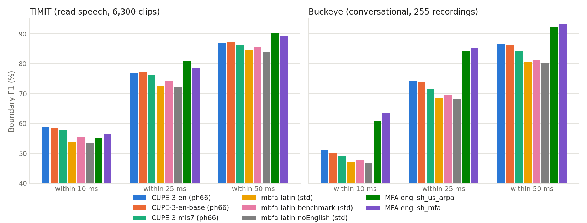

### TIMIT

| method | phoneme set | F1 @10 | F1 @25 | F1 @50 | R @10 | R @25 | recall @25 | precision @25 | median error | predicted / labelled |
|---|---|---:|---:|---:|---:|---:|---:|---:|---:|---:|
| `CUPE-3-en` | ph66 | **58.7** | 76.8 | 86.8 | **0.65** | 0.80 | 74.1 | 79.6 | **7 ms** | 0.93 |
| `CUPE-3-en-base` | ph66 | 58.5 | 77.2 | 87.1 | **0.65** | 0.80 | 74.5 | 80.0 | **7 ms** | 0.93 |
| `CUPE-3-mls7` | ph66 | 58.0 | 76.0 | 86.4 | **0.65** | 0.79 | 73.4 | 78.8 | **7 ms** | 0.93 |
| `mbfa-latin` | std | 53.7 | 72.6 | 84.6 | 0.61 | 0.77 | 72.2 | 73.0 | 8 ms | 0.99 |
| `mbfa-latin-benchmark` | std | 55.4 | 74.2 | 85.4 | 0.62 | 0.78 | 73.9 | 74.6 | 8 ms | 0.99 |
| `mbfa-latin-noEnglish` | std | 53.6 | 72.1 | 84.0 | 0.61 | 0.76 | 71.7 | 72.4 | 8 ms | 0.99 |
| MFA `english_us_arpa` | ARPAbet | 55.2 | **80.9** | **90.4** | 0.62 | **0.83** | **77.0** | **85.1** | 8 ms | 0.90 |
| MFA `english_mfa` | IPA | 56.5 | 78.6 | 89.1 | 0.63 | 0.81 | 73.8 | 84.0 | 8 ms | 0.88 |

### Buckeye

| method | phoneme set | F1 @10 | F1 @25 | F1 @50 | R @10 | R @25 | recall @25 | precision @25 | median error | predicted / labelled |
|---|---|---:|---:|---:|---:|---:|---:|---:|---:|---:|
| `CUPE-3-en` | ph66 | 51.0 | 74.2 | 86.6 | 0.56 | 0.76 | 78.7 | 70.3 | 9 ms | 1.12 |
| `CUPE-3-en-base` | ph66 | 50.2 | 73.7 | 86.3 | 0.55 | 0.76 | 78.1 | 69.8 | 9 ms | 1.12 |
| `CUPE-3-mls7` | ph66 | 48.9 | 71.4 | 84.4 | 0.54 | 0.74 | 75.7 | 67.6 | 10 ms | 1.12 |
| `mbfa-latin` | std | 47.1 | 68.4 | 80.6 | 0.50 | 0.68 | 75.4 | 62.6 | 9 ms | 1.20 |
| `mbfa-latin-benchmark` | std | 47.9 | 69.4 | 81.3 | 0.50 | 0.69 | 76.5 | 63.5 | 9 ms | 1.20 |
| `mbfa-latin-noEnglish` | std | 46.9 | 68.1 | 80.4 | 0.49 | 0.68 | 75.1 | 62.3 | 9 ms | 1.20 |
| MFA `english_us_arpa` | ARPAbet | 60.6 | 84.3 | 92.1 | 0.65 | 0.86 | **87.3** | 81.5 | 8 ms | 1.07 |
| MFA `english_mfa` | IPA | **63.6** | **85.3** | **93.2** | **0.69** | **0.87** | 85.9 | **84.7** | **7 ms** | 1.01 |

The columns:
- *R* is the R-value.
- *Median error* is taken over matched boundaries.
- *Predicted / labelled* is the number of predicted onsets over the number of hand-labelled
  ones. Above 1 means the method placed boundaries the transcribers did not mark.

R-value ranks the methods as F1 does, with one difference. It penalises the extra onsets of
the std models on Buckeye (1.20 predicted per labelled onset) a little harder than F1 does.
R @25 there is 0.68-0.69, against 0.74-0.76 for the ph66 models.

### How close is the nearest onset?

F1 is strict: each predicted onset may be matched to only one hand-labelled boundary, so an
extra onset costs precision and a missing one costs recall. The figure below is the lenient
view. For each hand-labelled boundary, it takes the distance to the nearest predicted onset,
whether or not that onset is also the nearest one to another boundary.

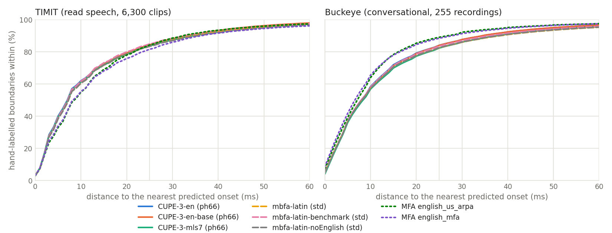

**TIMIT:**
- Up to 20 ms, all five BFA models are ahead of both MFA models. For example, `CUPE-3-en` has
  a predicted onset within 10 ms of 62.1% of hand-labelled boundaries; the two MFA models have
  55.0% and 55.4%.
- At 25 ms they are level with `english_us_arpa`.
- After that they stay within about a point of it.

**Buckeye:** MFA is ahead by 5-8 points between 10 and 30 ms.

Read with the tables, this means BFA places its onsets on read speech at least as well as MFA.
Where it loses F1 is in how many onsets it places compared with how many were labelled.

## Robustness to transcript errors

A forced aligner is only as good as its transcript, and real transcripts are wrong in places:
ASR output, a dictionary or G2P pronunciation of reduced speech, a transcriber's typo. Forced
alignment places every phone it is given. A phone that is not in the audio has to take time from
its neighbours, and a phone missing from the text leaves its audio to them.

**The test.** The TIMIT transcripts were corrupted and the audio left untouched, so every
condition is scored against the same hand labels. It is an accuracy test, not a consistency
test. The 833 clips used are the first 1,000 of a seeded shuffle of TIMIT, keeping only clips
whose every word both MFA dictionaries cover. They have 29,418 hand-labelled onsets. Two kinds
of error were tested:

- **Phone errors**, at 5%, 10% or 20% of each clip's phones. Every *N*-th phone is:
  - deleted;
  - preceded by an inserted phone that was not spoken;
  - replaced by a similar phone (/t/ → /d/);
  - or replaced by one of the other major class (consonant ↔ vowel).
- **Word errors**, at 10% or 20% of the words. Every *N*-th word is deleted, preceded by an
  inserted word, or replaced by another word from the corpus vocabulary.

The error sites are the same for every system, and each system writes the replacement in its
own phone set. BFA was given the corrupted phone sequence in place of its phonemizer's output,
at its defaults. MFA was given a private dictionary of one entry per word, built from its own
most likely pronunciation. Its clean condition uses the same kind of dictionary, so the only
handicap, the loss of alternative pronunciations, is the same in every condition. It costs
under a point: on clean transcripts of these clips, MFA scores 80.8 and 79.2 F1 @25 here,
against 81.5 and 79.8 with its full dictionaries.

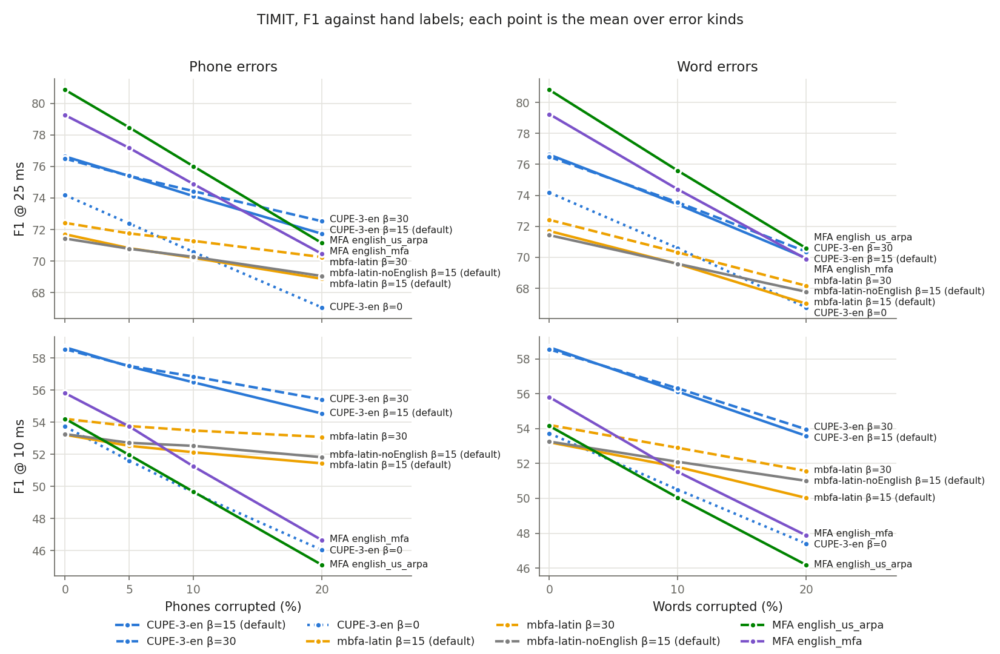

*Each point is the mean over the error kinds at that rate; 0% is the clean transcript.
`CUPE-3-en` and `mbfa-latin` are also drawn at onset bonus 30, and `CUPE-3-en` at 0. Those
settings are discussed below.*

F1 @25, with F1 @10 in brackets, averaged over the error kinds at each rate:

| method | clean | 5% phones | 10% phones | 20% phones | 10% words | 20% words | loss at 20% phones |
|---|---:|---:|---:|---:|---:|---:|---:|
| `CUPE-3-en` | 76.6 (**58.7**) | 75.4 (**57.5**) | 74.1 (**56.5**) | **71.7** (**54.5**) | 73.4 (**56.1**) | 70.0 (**53.6**) | −4.9 |
| `mbfa-latin` | 71.7 (53.2) | 70.8 (52.5) | 70.2 (52.1) | 68.9 (51.4) | 69.6 (51.8) | 67.0 (50.0) | −2.8 |
| `mbfa-latin-noEnglish` | 71.4 (53.3) | 70.8 (52.7) | 70.3 (52.5) | 69.1 (51.8) | 69.6 (52.1) | 67.8 (51.0) | **−2.4** |
| MFA `english_us_arpa` | **80.8** (54.2) | **78.5** (52.0) | **76.0** (49.7) | 71.1 (45.1) | **75.6** (50.0) | **70.6** (46.2) | −9.8 |
| MFA `english_mfa` | 79.2 (55.8) | 77.2 (53.7) | 74.9 (51.2) | 70.5 (46.7) | 74.4 (51.5) | 69.9 (47.9) | −8.8 |

**What it shows**

1. **BFA loses about half as much as MFA per error.**
   - With 10% of the phones wrong, F1 @25 falls by 2.5 points for `CUPE-3-en` and by 1.2-1.5 for
     the mbfa models, against 4.4-4.8 for MFA.
   - With 20% wrong, the falls are 4.9 and 2.4-2.8 for BFA, against 8.8-9.8 for MFA.
   - Word errors give the same order: with 20% of the words wrong the falls are 6.7, 3.7-4.7
     and 9.3-10.2.
   - Every curve is close to a straight line in the error rate.
2. **MFA's clean lead does not survive errors.**
   - At 25 ms: with 20% of the phones wrong, `CUPE-3-en` is ahead of both MFA models (71.7
     against 71.1 and 70.5). With 20% of the words wrong it is level (70.0 against 70.6 and 69.9).
   - At 10 ms BFA leads at every rate, and the lead widens from 2.9-4.5 points on clean
     transcripts to 7.8-9.4 points with 20% of the phones wrong.
3. **The damage stays local.**
   - For phone errors, the harm to the phones that were left intact is concentrated in the
     corrupted phone and its immediate neighbours. From three phones away it is under 5 points,
     for every system and rate.
   - An inserted word reaches about one word either side.
   - What differs between the systems is how deep the damage goes, not how far it spreads.
     After an other-class substitution at 10%, MFA misses 28-31 points more of the substituted
     phone's own onsets, and 15-17 more of its neighbours'. `CUPE-3-en` misses 13.8 and 7.8.
4. **The model that never heard English loses the least.** `mbfa-latin-noEnglish` loses the least
   of the three BFA models at every rate, and it is ahead of `mbfa-latin` at 10 ms at every
   rate. The robustness comes from the method, not from English training data.
5. **The onset bonus accounts for about half of BFA's advantage.** Its evidence comes from the
   audio, not from the transcript.
   - Without it (`boundary_bonus_weight=0`), `CUPE-3-en` loses 1.4× as much as at the default
     of 15.
   - At 30 it loses slightly less than at 15: 0.4 points less with 10% of the phones wrong,
     0.9 less with 20%.
   - If your transcripts are known to be noisy (ASR output, for example), 30 is the safer
     setting. The default, 15, is set for conversational speech, where it scores higher than 30
     for every model. On read speech the two are within about half a point.
6. **Low confidence partly flags a corrupted transcript.** Take mean per-phone confidence over
   a clip, with 10% of the phones corrupted. It separates corrupted clips from clean ones at
   AUROC 0.66-0.70 for insertions and substitutions (`CUPE-3-en`; 0.57-0.61 for the mbfa
   models). For deleted phones it does not separate them at all (0.50-0.52).

## Languages: one model, no English needed

Neither corpus above has non-English boundary labels, so the scores here are all on English.
Two results still speak to the other languages.

- **`mbfa-latin-noEnglish`** is the `mbfa-latin` recipe trained on the same languages minus
  English. It aligns English, a language it has never heard, within 0.5 points F1 @25 of
  `mbfa-latin` on TIMIT and 0.3 on Buckeye. Under transcript errors it loses less than
  `mbfa-latin` (see above). English is only 7 h of `mbfa-latin`'s 273 h of training audio. A
  language's share of the training data matters little once the model covers its writing
  system and its sounds.
- **`CUPE-3-mls7`** is `CUPE-3-en-base` after one more epoch on seven European languages from
  MLS, with no English. It keeps all but 1.2 points of the English model's TIMIT F1 @25 (76.0
  vs 77.2), and all but 2.3 on Buckeye.

Both point the same way: one model per writing system aligns a new language with no dictionary
and no acoustic model of its own. See [Language support](language-support.md) for the languages
each model was trained on, and its validation scores.

## Cost

Timing was measured on the same 100 TIMIT clips (5.2 min of audio) for every system. The
machine was an AMD Threadripper PRO 3975WX pinned to 16 cores (32 threads), and one NVIDIA RTX
A5000 ran BFA's network when a GPU was used. Each figure is the median of three passes.

- **BFA** ran in one process with 16 torch threads and batches of 16, timed after a warm-up
  clip. Model loading (1-12 s) is not included.
- **MFA 3.4.3** ran `mfa align` with 8 jobs. Its time is the whole call, split by MFA's own
  progress messages.

| 100 TIMIT clips | network on | padding | wall time | real-time factor | network | decoder |
|---|---|---:|---:|---:|---:|---:|
| BFA `CUPE-3-en` | GPU | 10 s | **17.8 s** | **0.057** | 1.4 s | 16.0 s |
| BFA `CUPE-3-en` | GPU | 30 s | 20.4 s | 0.065 | 4.0 s | 16.1 s |
| BFA `mbfa-latin` | GPU | 30 s | 22.5 s | 0.072 | 6.0 s | 16.1 s |
| BFA `CUPE-3-en` | CPU | 10 s | 34.6 s | 0.111 | 18.6 s | 15.7 s |
| BFA `CUPE-3-en` | CPU | 30 s | 69.7 s | 0.224 | 53.5 s | 15.9 s |
| BFA `mbfa-latin` | CPU | 30 s | 72.9 s | 0.234 | 56.2 s | 16.1 s |

| 100 TIMIT clips | wall time | real-time factor | start-up | corpus + dictionary setup | features | alignment | collect + export |
|---|---:|---:|---:|---:|---:|---:|---:|
| MFA `english_mfa` | 79.7 s | 0.256 | 38.0 s | 13.9 s | 8.5 s | 8.2 s | 11.1 s |
| MFA `english_us_arpa` | 114.1 s | 0.366 | 51.5 s | 36.7 s | 7.4 s | 6.5 s | 12.0 s |

*Real-time factor* is processing time over audio duration (0.1 = ten times faster than real time).

- **On a job of this size BFA is faster.** With a GPU it finishes 3.5-6.4× sooner than MFA. On a
  CPU with 10 s padding (`duration_max=10`) it finishes 2.3-3.3× sooner, and with 30 s padding
  1.1-1.6× sooner. Most of MFA's time is fixed cost: 38-52 s of start-up before its first
  progress message, then 14-37 s setting up the corpus and dictionary.
- **Once loaded, the two do a similar amount of work.** MFA's feature extraction and alignment
  take 14-17 s; BFA's network and decoder take 17-22 s on a GPU.
- **On a whole corpus MFA is faster.** Its fixed cost is paid once per call. With 8 jobs and one
  folder per speaker, it aligned all of Buckeye (21.4 h of speech) in 12-19 min. At the
  real-time factors above, one BFA process would need several times as long.
- **BFA's remaining cost is almost all the decoder.** It takes 16 s per 100 clips whatever the
  device, because it is a Python loop over 5 ms frames on one CPU thread. Compiling it is the
  main speed-up left.
- **Padding.** The network's share depends on padding: every segment is padded to
  `duration_max` (30 s by default). On short clips, `duration_max=10` halves the CPU time with
  identical onsets.
- **Nothing to prepare.** BFA needs no corpus layout, dictionary or per-language acoustic model.

## Analysis

### Read speech: BFA is more precise, MFA has fewer large misses

On TIMIT, BFA's errors are smaller when it is right (F1 @10 58.7 vs 55.2-56.5, median 7 vs 8 ms).
MFA pulls ahead from 25 ms on, because BFA's tail is heavier: its mean absolute error is
14.1 ms (`CUPE-3-en`) against MFA's 12.6-12.7 ms.

TIMIT also labels most stops as two intervals, a closure and a release (`tcl t`). Both
aligners place one onset per stop from the text, so one TIMIT boundary in ten (22,624 of
225,282 speech-phone onsets) is a release that neither can match one-to-one. This caps recall
for every method alike. The onset bonus pulls stop onsets towards the burst. That raises
boundary F1, but lowers accuracy when each phone's own onset is what you need: see
[About the models](about-models.md#the-onset-bonus).

### Why Buckeye favours MFA

Buckeye's phone labels were not drawn from scratch. According to the
[corpus documentation](https://buckeyecorpus.osu.edu/php/corpusTran.php), the labelling went
in three steps:

1. The audio and transcripts went first through the Entropic Aligner, an HMM forced aligner
   using phone models trained on TIMIT.
2. Research assistants picked the best-fitting pronunciation from that aligner's dictionary of
   variants.
3. They then corrected labels "placed at the wrong locations", using waveform and spectrogram
   displays.

A boundary the transcriber found acceptable kept the position the HMM aligner gave it.

That gives MFA three advantages on this corpus that have nothing to do with the audio:

1. **Same kind of aligner.** MFA is a GMM-HMM aligner. Where Buckeye's boundaries are the
   original aligner's output, they follow HMM placement conventions that MFA reproduces.
2. **Same pronunciations.** Buckeye's pronunciations were chosen from an ARPAbet variant
   dictionary, and MFA's dictionaries list variants too. BFA writes one pronunciation per word,
   with a G2P (std) or espeak-ng (ph66), so its phone sequences agree with the reference less
   often. This shows in two places:
   - the predicted / labelled ratio: 1.01-1.07 for MFA, 1.12-1.20 for BFA;
   - BFA's precision, 11-14 points lower.
3. **The benchmark it is developed against.** MFA's own
   [English benchmarks](https://mfa-models.readthedocs.io/en/latest/benchmarks/english_alignments.html)
   are Buckeye and TIMIT.

Our own numbers are consistent with this:
- Buckeye's audio is far harder than TIMIT's (conversational interview recordings). Every BFA
  model scores 2.6-5.4 points lower on it than on TIMIT.
- Both MFA models score *higher* on Buckeye, by 3.4 and 6.7 points.
- MFA also gains most at the tightest tolerance (F1 @10 +5.4 and +7.1). That is what
  reproducing the reference's own placement looks like.
- The phone set is not the reason: the IPA `english_mfa` gains more than the ARPAbet model.

TIMIT was segmented by hand, and it is the better test of where an aligner puts boundaries.

Two further things hold BFA back on Buckeye, and both can be changed:

- **Reduced speech.** Conversational English drops and merges phones ("probably" → "prolly").
  Forced alignment places every phone of the text, so a phone the speaker skipped becomes an
  extra onset squeezed between real ones. This is the same kind of transcript error as
  [above](#robustness-to-transcript-errors). A phonemizer that wrote reduced pronunciations
  would close part of the gap. A better acoustic model would not.
- **The onset bonus.** On the full corpus, turning the bonus off (`boundary_bonus_weight=0`)
  raises the CUPE-3 models' Buckeye F1 @25 by 1.6-3.2 points over their default of 15
  (`CUPE-3-en`: 76.4 against 74.2). The cost is 2.0-3.7 points on TIMIT, and more under
  transcript errors. On Buckeye the std models move by under 1 point either way
  (`mbfa-latin-benchmark`: 70.0 without the bonus, 69.4 at its default of 15).

`coverage_analysis["bad_alignment"]` flags the worst segments. It flags under 1% of Buckeye
segments for the two English CUPE-3 models, and 4-8% for `CUPE-3-mls7` and the mbfa models.

### Why the std models score lower

The std models are multilingual (36 trained languages for `mbfa-latin`). They score 4.2-5.8
points below the English-only CUPE-3 models. Two separate things are in that gap:

1. **Diphthongs and affricates are two tokens in std.** The std phoneme set writes /aɪ/ as
   `a ɪ` and /tʃ/ as `t ʃ`, so the std models place an onset inside every diphthong and
   affricate. ph66 has one token for each, as the corpora do.
   - These extra onsets are the difference between std's predicted / labelled ratio and
     ph66's: 0.99 vs 0.93 on TIMIT, and 1.20 vs 1.12 on Buckeye.
   - The scorer can merge them (`merge_two_token_phones: true` in `evaluate.yaml`), but that
     barely moves F1: TIMIT 72.6 → 72.5, Buckeye 68.4 → 68.1 for `mbfa-latin`. TIMIT itself
     splits stops and affricates, and the second token often lands on the release.
   - These tables leave the merge off, so every method is scored on the onsets it actually emits.
2. **Training data and noise.** `CUPE-3-en` heard 500 h of English. `mbfa-latin` heard 273 h
   across 36 languages, of which English is a small share, and was trained with more added
   noise (for robustness on real recordings).
   - `mbfa-latin-benchmark`, trained with less noise, is 1.0-1.6 points ahead on the two corpora.
   - `mbfa-latin-noEnglish`, trained with no English at all, is only 0.3-0.5 points behind
     `mbfa-latin`. English data are therefore a small part of the gap.

For English alone, use the ph66 set (`BFA(preset="en-us", phoneme_set="ph66")`). For anything
else, or for tone, stress and length labels, use std.

### Per phone class

Mean absolute error (ms) of matched onsets, by manner class. These columns are filled the same way
for every method (`mn_*` in the CSVs).

| | vowels | voiceless stops | voiced stops | voiceless fricatives | voiced fricatives | nasals | laterals | rhotics | glides |
|---|---:|---:|---:|---:|---:|---:|---:|---:|---:|
| **TIMIT** `CUPE-3-en` | 12.9 | 11.8 | 17.1 | 11.5 | 15.0 | 14.1 | 20.6 | 17.7 | 21.0 |
| TIMIT `mbfa-latin` | 16.6 | 12.7 | 15.9 | 12.9 | 16.6 | 14.2 | 19.5 | 19.3 | 17.4 |
| TIMIT MFA `english_us_arpa` | 11.3 | 11.1 | 14.6 | 13.4 | 12.7 | 10.8 | 17.6 | 18.7 | 16.7 |
| **Buckeye** `CUPE-3-en` | 15.5 | 15.3 | 12.9 | 12.5 | 14.0 | 13.5 | 22.2 | 22.2 | 17.8 |
| Buckeye `mbfa-latin` | 16.5 | 17.4 | 15.1 | 14.6 | 15.1 | 14.7 | 19.7 | 22.5 | 17.0 |
| Buckeye MFA `english_us_arpa` | 10.6 | 11.2 | 11.9 | 11.4 | 10.8 | 10.6 | 16.7 | 16.6 | 14.3 |

The hardest boundaries are the same for everyone: laterals, rhotics and glides, whose onsets
are gradual transitions with no acoustic edge.

On TIMIT, `CUPE-3-en`:
- beats MFA on voiceless fricatives and rhotics;
- is within a millisecond of it on voiceless stops;
- has its largest deficits on nasals, voiced stops and voiced fricatives (2-3 ms each).

### Confidence

Mean per-phone confidence over each corpus (the model's peak posterior inside each phone's
segment):

| | `CUPE-3-en` | `CUPE-3-en-base` | `CUPE-3-mls7` | `mbfa-latin` | `mbfa-latin-benchmark` |
|---|---:|---:|---:|---:|---:|
| TIMIT | 0.54 | 0.40 | 0.26 | 0.25 | 0.17 |
| Buckeye | 0.43 | 0.32 | 0.21 | 0.20 | 0.16 |

The models are trained towards a target with deliberate entropy, so these numbers are far below
1.0 even where the alignment is right. Each model also has its own scale, so compare
confidences within one model, never across models.

As a per-phone error detector, confidence is weak. Call a predicted onset bad when it is
unmatched or more than 50 ms off. Low confidence then picks out bad onsets at AUROC 0.56-0.63,
and the 10% of onsets with the lowest confidence are bad 1.3-2.2× as often as the rest. It is
more useful at the level of a whole clip, as a flag for a wrong transcript (see
[above](#robustness-to-transcript-errors)) or a failed segment. See
[About the models](about-models.md#confidence).

## Per-run error histograms

Distance from each hand-labelled boundary to the nearest predicted onset (0-100 ms), one plot
per run. These are written by `compute_metrics.py`.

<details>
<summary>TIMIT (7 plots)</summary>

| | |
|---|---|
|  |  |
| 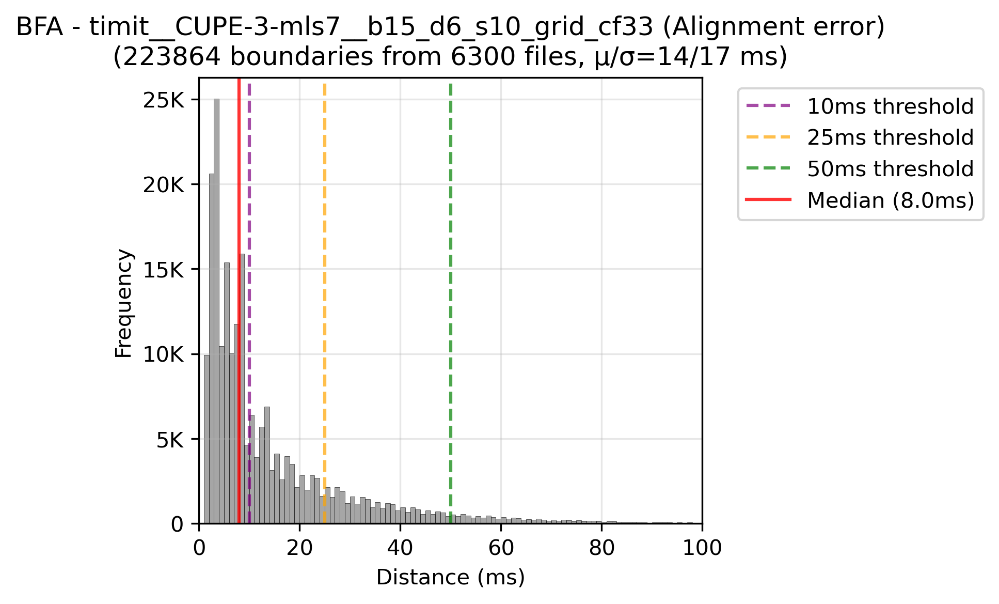 | 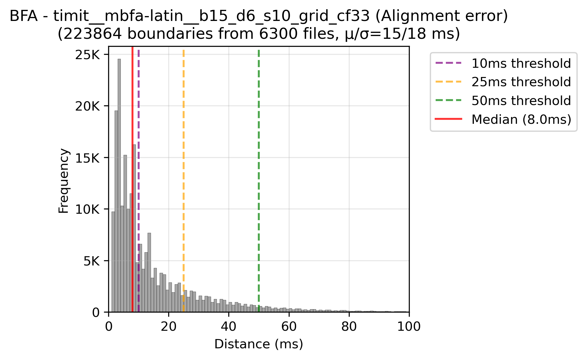 |
| 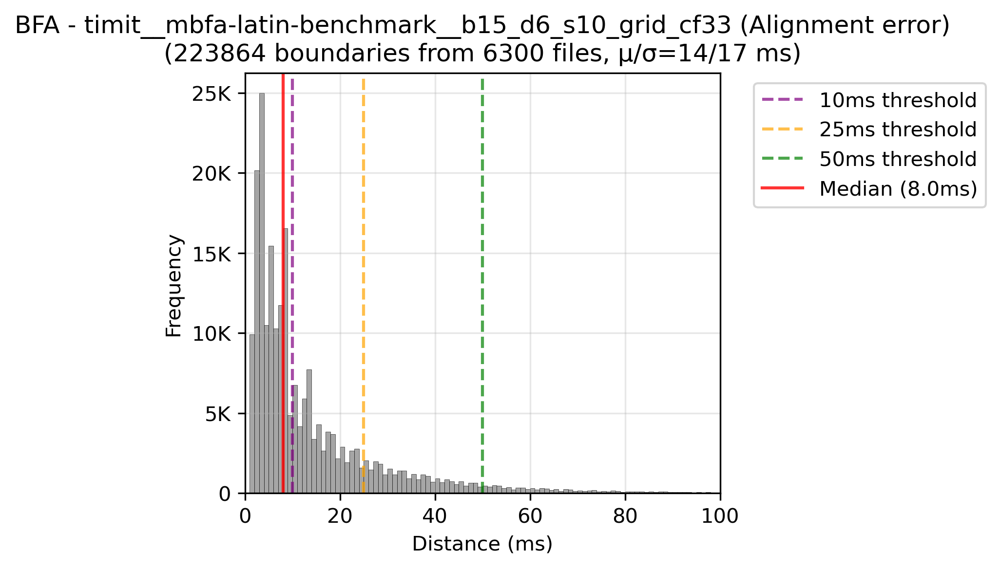 |  |
| 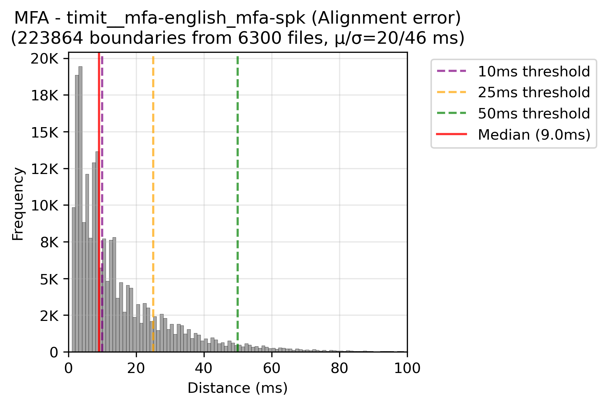 |  |

</details>

<details>
<summary>Buckeye (7 plots)</summary>

| | |
|---|---|
|  | 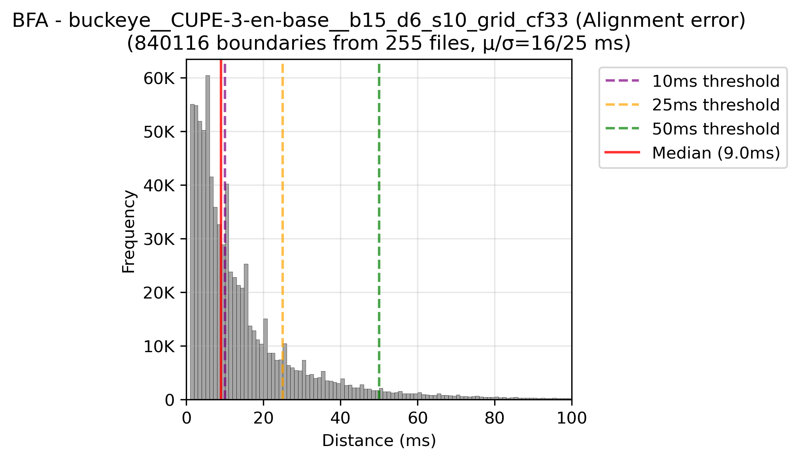 |
| 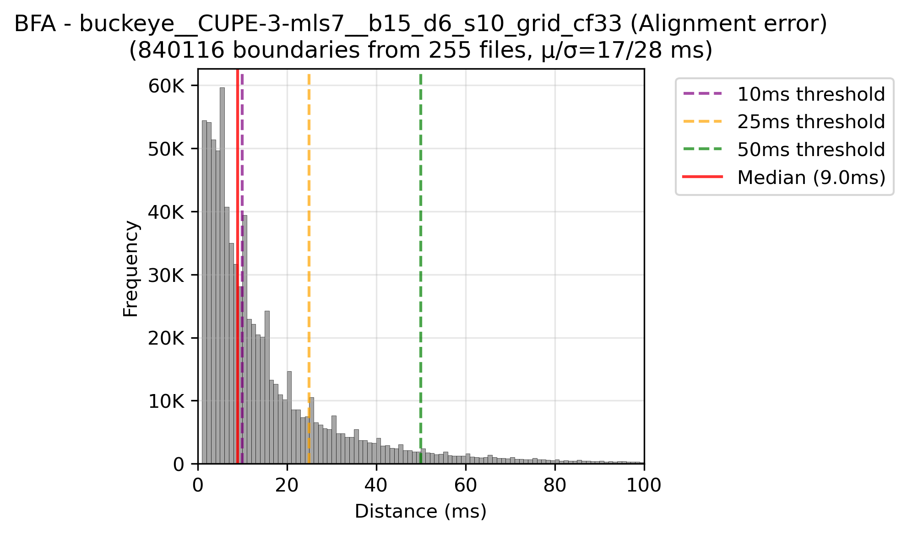 |  |
| 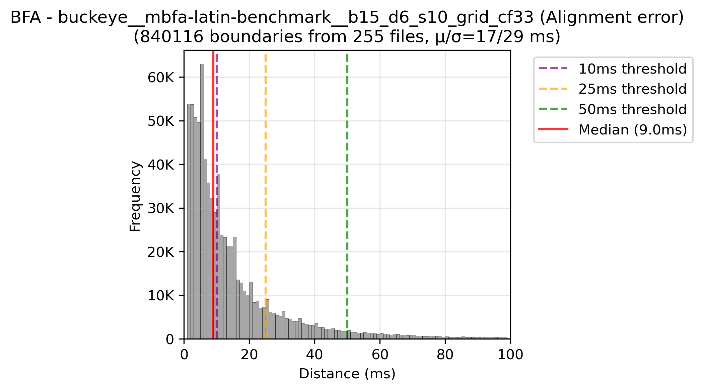 |  |
| 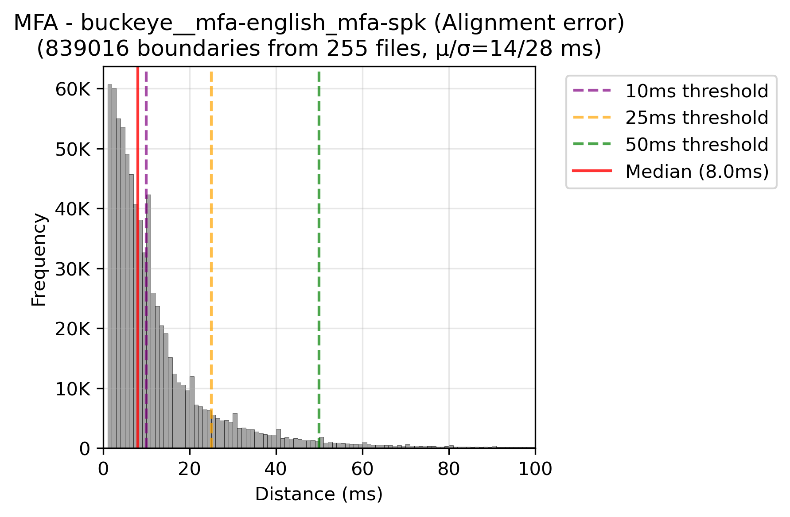 |  |

</details>

## What is not measured here

- **Boundary accuracy in languages other than English.** Neither corpus has non-English boundary
  labels. The eight non-Latin models (cyrillic, cjk, japanese, vietnamese, thai, abjad, brahmic,
  other_alphabetic) were selected on validation loss over their own alignments, and have no
  boundary score. `CUPE-3-mls7` is scored here on English only: the score shows how much
  English accuracy survived its multilingual epoch, not how well it aligns German or French.
  A hand-labelled non-English corpus would close this gap.
- **Real ASR transcripts.** The transcript-error test uses controlled, synthetic errors.
- **Sub-frame onsets**, the library default. These runs use the 5 ms frame grid.

## Reproducing

```bash
python evaluation/dataset/timit_parser.py       # ground truth, once
python evaluation/dataset/buckeye_parser.py
python evaluation/process_alignments.py         # align (the experiments in evaluate.yaml)
python evaluation/compute_metrics.py            # score into evaluation/results/results_<dataset>.csv
python evaluation/plot_summary.py               # the two comparison figures above
```

The transcript-error test and the timing benchmark are not part of this harness yet.

See [`evaluation/README.md`](../evaluation/README.md) for the configuration, run naming, caching
and parallel runs.
