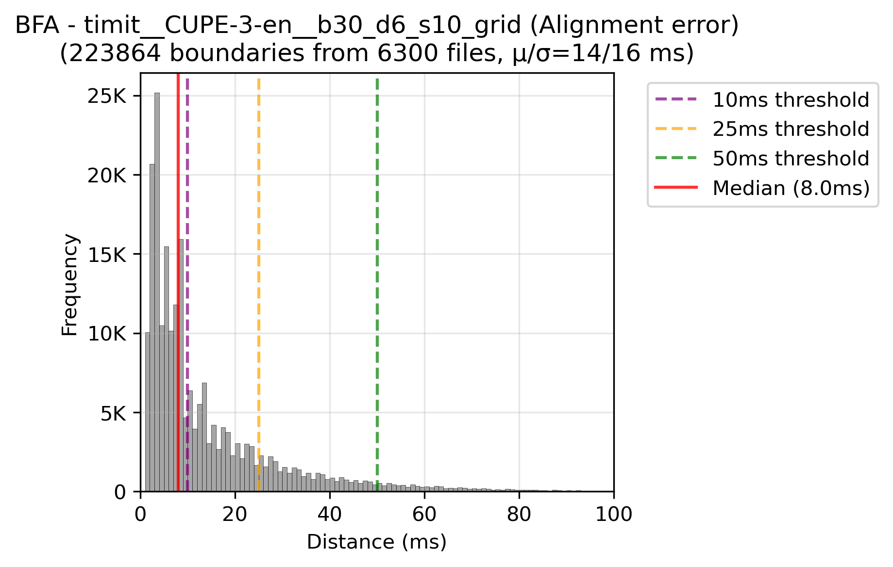
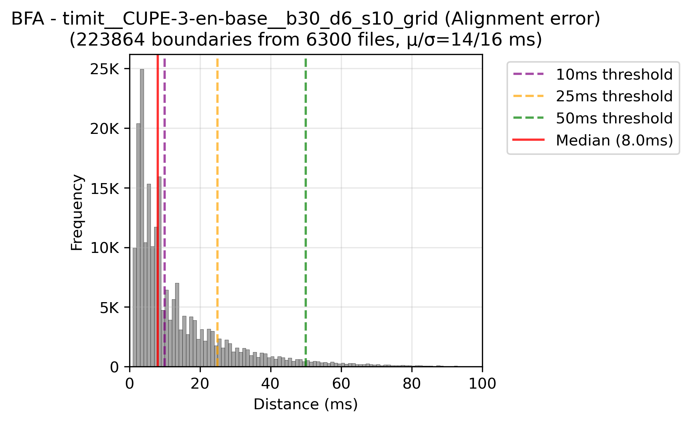
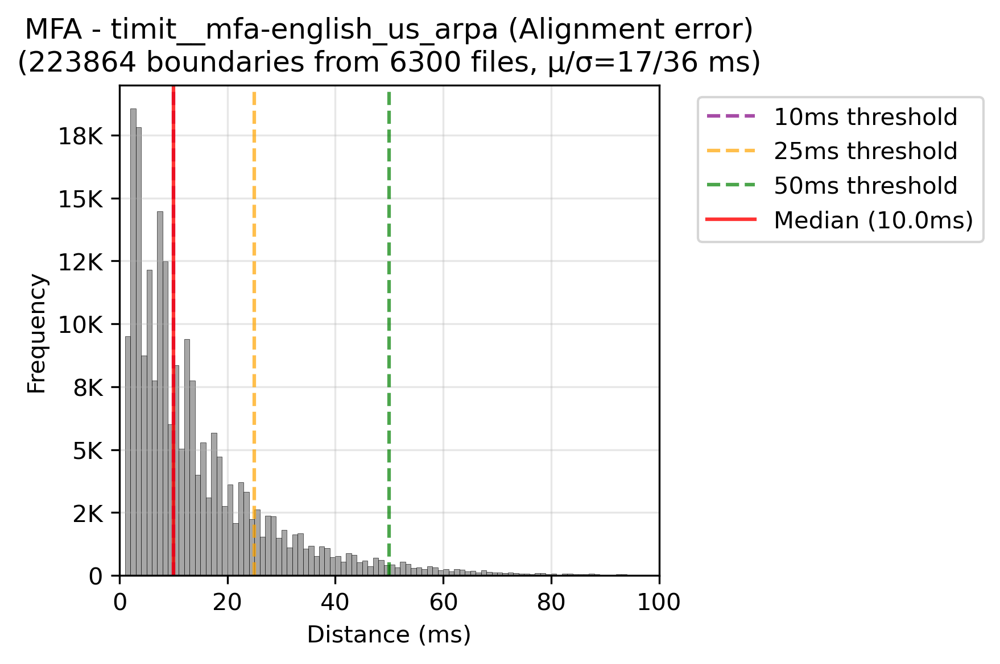
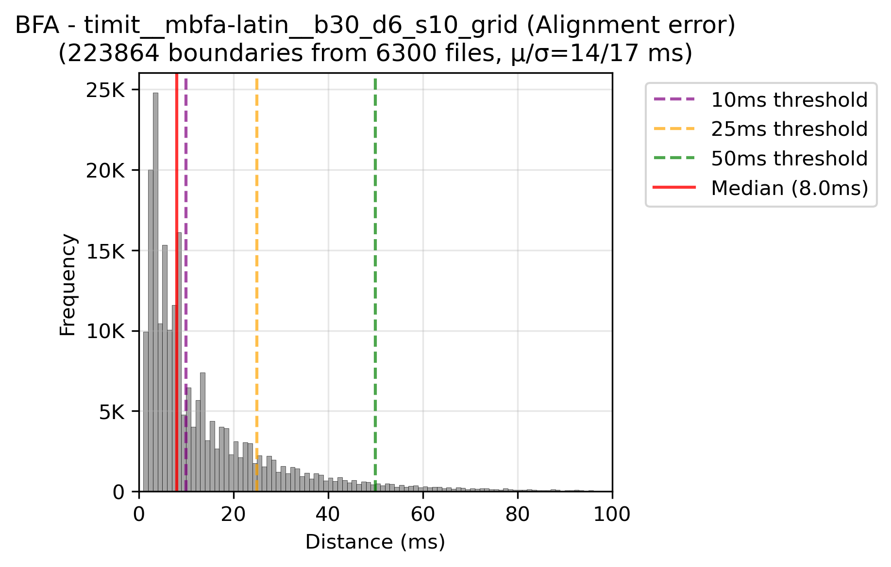
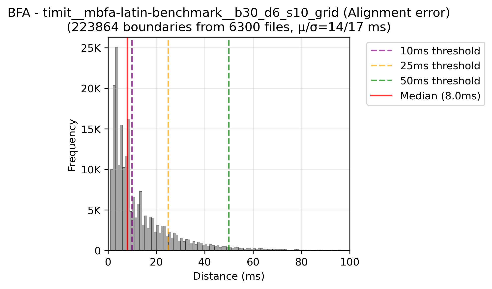
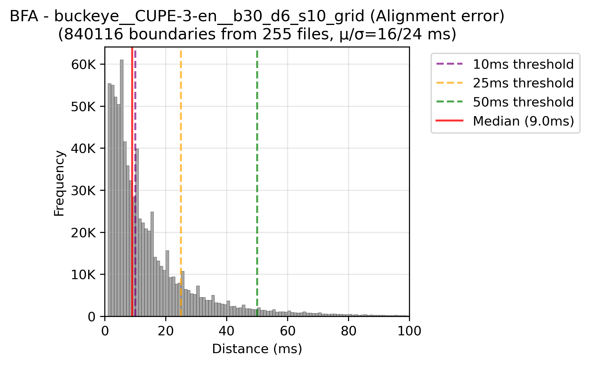
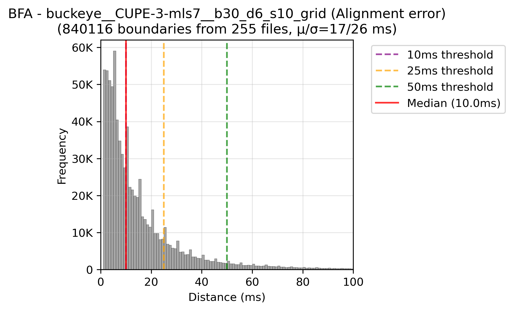

# Evaluation: how accurate are BFA's boundaries?

[Main README](../README.md) · [Developer guide](README.md) · [About the models](about-models.md) · **Evaluation** · [Language support](language-support.md)

This page reports how close BFA v2's phoneme onsets come to hand-labelled ones on two English
corpora, compared with the Montreal Forced Aligner (MFA). The harness that produced these numbers is
described in [`evaluation/README.md`](../evaluation/README.md). The raw scores are in
[`evaluation/results/`](../evaluation/results/), one CSV per corpus.

## Summary

- **One model, many languages, no dictionary.** `mbfa-latin` covers 36 trained languages
  (63 through its G2P) with one acoustic model and no pronunciation dictionary. MFA needs a separate
  acoustic model and pronunciation dictionary for each language. Both corpora here are English, so neither
  measures this.
- **BFA's onsets are more precise.** On TIMIT the three CUPE-3 models beat MFA at 10 ms
  (58 vs 55 F1), with a lower median error (7 ms vs 8 ms). Measured as distance from each
  hand-labelled boundary to the nearest predicted onset, all five BFA models are ahead of MFA up to about 25 ms.
- **On TIMIT, MFA leads by 4 points at 25 ms** (80.5 vs 76.3). The gap comes from BFA's heavier
  tail of large misses and from how many onsets it places, not from where it places them.
- **Buckeye favours MFA by construction.** Its reference boundaries were first placed by an HMM
  forced aligner and then corrected by hand, and its phone sequences were picked from that aligner's ARPAbet
  dictionary. MFA is an HMM aligner with an ARPAbet dictionary, which is why it scores *higher* on noisy
  conversational Buckeye (83.5) than on clean TIMIT (80.5). See [Why Buckeye favours MFA](#why-buckeye-favours-mfa).
  TIMIT, labelled by hand, is the fairer comparison.
- **For English, the ph66 models beat the std ones.** `CUPE-3-en` is the best BFA model
  on Buckeye and ties `CUPE-3-en-base` on TIMIT. The multilingual `mbfa-latin` trails
  them by 3-5 points. Part of that gap comes from the scoring, which does not merge std's
  two-token diphthongs and affricates back into one phone (see [Why the std models score lower](#why-the-std-models-score-lower)).

## Setup

| | TIMIT | Buckeye |
|---|---|---|
| speech | read sentences, studio | conversational interviews |
| scored | all 6,300 clips (TRAIN + TEST) | all 255 recordings (40 speakers), cut into 33,670 segments of ~2.3 s |
| hand-labelled onsets | 223,864 | 840,116 |

Every model was run on the full corpus with the decoder settings it was published with (minimum
phone duration 6 frames, soft duration 10 frames, onset bonus 30). Each method was asked to align
only the words of the transcript. Two settings differ from the library defaults, and both are
the harness's choice:

- **Frame-grid onsets** (`sub_frame_onsets: false`): onsets sit on the 5 ms frame grid rather
  than at the interpolated posterior crossing that the library uses by default.
- **Batches of 16 segments**, each padded to 30 s (`duration_max: 30`). Scores move slightly with
  batch composition, because the class prior used by the decoder is taken over the batch.

MFA ran with its pretrained `english_us_arpa` acoustic model and dictionary. On Buckeye it
returned no phones for 146 of 33,534 segments, so it was scored on 838,391 boundaries rather
than 840,116.

### How a boundary is scored

For every segment, the scorer takes the onsets of every predicted speech phone and the hand-labelled
onsets. It matches the two lists one-to-one in time order with an edit-distance alignment, and
counts a hit where a matched pair is within the tolerance. Recall, precision and F1 follow
from the hit count. No phoneme label is compared: a correctly timed boundary between the wrong
phones still counts. [`evaluation/LABEL_MAPPING.md`](../evaluation/LABEL_MAPPING.md) explains how
each corpus's labels become reference boundaries.

## Results


### TIMIT

| method | phoneme set | F1 @10 | F1 @25 | F1 @50 | recall @25 | precision @25 | median error | predicted / labelled |
|---|---|---:|---:|---:|---:|---:|---:|---:|
| `CUPE-3-en` | ph66 | **58.1** | 76.2 | 86.5 | 73.6 | 79.0 | **7 ms** | 0.93 |
| `CUPE-3-en-base` | ph66 | 58.0 | 76.3 | 86.7 | 73.7 | 79.1 | **7 ms** | 0.93 |
| `CUPE-3-mls7` | ph66 | 57.6 | 75.3 | 85.9 | 72.7 | 78.1 | **7 ms** | 0.93 |
| `mbfa-latin` | std | 54.3 | 72.5 | 84.5 | 72.1 | 72.9 | 8 ms | 0.99 |
| `mbfa-latin-benchmark` | std | 55.4 | 73.6 | 84.9 | 73.2 | 73.9 | 8 ms | 0.99 |
| MFA `english_us_arpa` | — | 54.8 | **80.5** | **90.2** | **76.6** | **84.7** | 8 ms | 0.90 |

### Buckeye

| method | phoneme set | F1 @10 | F1 @25 | F1 @50 | recall @25 | precision @25 | median error | predicted / labelled |
|---|---|---:|---:|---:|---:|---:|---:|---:|
| `CUPE-3-en` | ph66 | 50.1 | 73.3 | 86.3 | 77.7 | 69.4 | 9 ms | 1.12 |
| `CUPE-3-en-base` | ph66 | 49.3 | 72.5 | 85.7 | 76.8 | 68.6 | 10 ms | 1.12 |
| `CUPE-3-mls7` | ph66 | 48.0 | 70.4 | 84.0 | 74.6 | 66.6 | 10 ms | 1.12 |
| `mbfa-latin` | std | 47.0 | 68.4 | 80.8 | 75.4 | 62.6 | 9 ms | 1.20 |
| `mbfa-latin-benchmark` | std | 47.4 | 69.0 | 81.2 | 76.0 | 63.1 | 9 ms | 1.20 |
| MFA `english_us_arpa` | — | **60.0** | **83.5** | **91.6** | **86.4** | **80.8** | **8 ms** | 1.07 |

*Median error* is over matched boundaries. *Predicted / labelled* is the number of predicted
onsets over the number of hand-labelled ones: above 1 means the method placed boundaries the
transcribers did not mark.

### How close is the nearest onset?

F1 is strict: each predicted onset may be matched to one hand-labelled boundary only, so an
extra onset costs precision, and a missing one costs recall. The figure below is the lenient
view. For each hand-labelled boundary, it takes the distance to the nearest predicted onset,
whether or not that onset is also the nearest one to another boundary.


On TIMIT the five BFA models are slightly ahead of MFA up to about 25 ms, and level after
that. On Buckeye, MFA is ahead by 5-8 points between 10 and 30 ms. Read together with the
tables: BFA puts its onsets where the boundaries are at least as well as MFA does on read speech. Where it loses F1 is in
how many onsets it places, against how many were labelled.

## Analysis

### Read speech: BFA is more precise, MFA has fewer large misses

On TIMIT, BFA's errors are smaller when it is right (F1 @10 58 vs 55, median 7 vs 8 ms). MFA
pulls ahead from 25 ms on, because BFA's tail is heavier: its mean absolute error is about
14.3 ms against MFA's 12.8 ms.

TIMIT also labels most stops as two intervals, a closure and a release (`tcl t`). Both
aligners place one onset per stop from the text, so one TIMIT boundary in ten (22,624 of
225,282 speech-phone onsets) is a release that neither can match one-to-one. This caps recall for every method alike. The onset bonus (weight 30 in every
published model) pulls stop onsets towards the burst. This scores higher on boundary F1, and
lower when each phone's own onset is what you need: see
[About the models](about-models.md#the-onset-bonus).

### Why Buckeye favours MFA

Buckeye's phone labels were not drawn from scratch. According to the
[corpus documentation](https://buckeyecorpus.osu.edu/php/corpusTran.php), the audio and
transcripts went first through the Entropic Aligner, an HMM forced aligner using phone models trained on TIMIT.
Research assistants picked the best-fitting pronunciation from that aligner's dictionary of variants. They then corrected
labels "placed at the wrong locations", using waveform and spectrogram displays. A boundary
the transcriber found acceptable kept the position the HMM aligner gave it.

That gives MFA three advantages on this corpus that have nothing to do with the audio:

1. **Same kind of aligner.** MFA is a GMM-HMM aligner. Where Buckeye's boundaries are the
   original aligner's output, they follow HMM placement conventions that MFA reproduces.
2. **Same phone set and pronunciations.** Buckeye's labels are the aligner's ARPAbet-based set,
   with pronunciations chosen from an ARPAbet variant dictionary. `english_us_arpa` aligns ARPAbet
   phones from an ARPAbet dictionary with variants. BFA writes pronunciations with a G2P
   (std) or espeak-ng (ph66), so its phone sequences agree less often with the reference's. This shows
   in the predicted/labelled ratio, 1.07 for MFA and 1.12-1.20 for BFA, and in BFA's 11-point
   precision deficit.
3. **The benchmark it is developed against.** MFA's own
   [English benchmarks](https://mfa-models.readthedocs.io/en/latest/benchmarks/english_alignments.html)
   are Buckeye and TIMIT.

Our own numbers are consistent with this. Buckeye's audio is far harder than TIMIT's (conversational,
interview recordings), and every BFA model scores 3-5 points lower on it than on TIMIT. MFA
scores 3 points *higher*. MFA also gains most at the tightest tolerance (F1 @10: 60.0 on Buckeye
against 54.8 on TIMIT), which is what reproducing the reference's own placement looks like.

TIMIT was segmented by hand, and it is the better test of where an aligner puts boundaries.

Two further things hold BFA back on Buckeye, and both can be changed:

- **Reduced speech.** Conversational English drops and merges phones ("probably" → "prolly").
  Forced alignment places every phone of the text, so a phone the speaker skipped becomes an
  extra onset squeezed between real ones. A phonemizer that wrote reduced pronunciations would
  close part of the gap. A better acoustic model would not.
- **The onset bonus.** Every run here uses the published weight of 30. On a 3-interview sample,
  turning the bonus off raised the CUPE-3 models' Buckeye F1 @25 by 2-4.6 points
  ([About the models](about-models.md#the-onset-bonus)). That has not been measured on the full corpus yet.

`coverage_analysis["bad_alignment"]` flags the worst segments: under 1% of Buckeye segments for the CUPE-3-en
models, and 5-8% for `CUPE-3-mls7` and the mbfa models.

### Why the std models score lower

The std models are multilingual (36 trained languages for `mbfa-latin`) and score 3-5 points below the
English-only CUPE-3 models. Two separate things are in that gap:

1. **Diphthongs and affricates are two tokens in std.** The std phoneme set writes /aɪ/ as
   `a ɪ` and /tʃ/ as `t ʃ`, so the std models place an onset inside every diphthong and
   affricate. ph66 has one token for each, as the corpora do. The extra onsets are the
   difference between std's predicted/labelled ratio and ph66's (0.99 vs 0.93 on TIMIT, 1.20 vs 1.12 on
   Buckeye), and they all count against precision. The scorer can merge them
   (`merge_two_token_phones: true` in `evaluate.yaml`). These tables leave it off, so every
   method is scored on the onsets it actually emits.
2. **Training data and noise.** `CUPE-3-en` heard 500 h of English. `mbfa-latin` heard 273 h
   across 36 languages, of which English is a small share, and was trained with more added
   noise (for robustness on real recordings). `mbfa-latin-benchmark`, trained with less noise,
   is 0.6-1.1 points ahead on the two corpora.

For English alone, use the ph66 set (`BFA(preset="en-us", phoneme_set="ph66")`). For anything
else, or for tone, stress and length labels, use std.

### Per phone class

Mean absolute error (ms) of matched onsets, by manner class. These columns are filled the same way
for every method (`mn_*` in the CSVs).

| | vowels | voiceless stops | voiced stops | voiceless fricatives | voiced fricatives | nasals | laterals | rhotics | glides |
|---|---:|---:|---:|---:|---:|---:|---:|---:|---:|
| **TIMIT** `CUPE-3-en` | 13.2 | 12.0 | 17.6 | 11.8 | 15.7 | 14.3 | 20.6 | 18.2 | 20.9 |
| TIMIT `mbfa-latin` | 17.1 | 12.9 | 17.2 | 12.9 | 16.7 | 14.2 | 19.6 | 18.9 | 17.1 |
| TIMIT MFA | 11.5 | 11.2 | 14.6 | 13.3 | 12.8 | 10.9 | 18.2 | 19.7 | 16.8 |
| **Buckeye** `CUPE-3-en` | 15.9 | 16.1 | 13.6 | 12.8 | 14.6 | 13.9 | 21.7 | 22.1 | 18.0 |
| Buckeye `mbfa-latin` | 16.7 | 17.3 | 15.1 | 14.2 | 15.0 | 14.6 | 19.1 | 21.5 | 16.7 |
| Buckeye MFA | 11.0 | 11.4 | 12.0 | 11.6 | 11.0 | 11.1 | 17.1 | 17.1 | 14.3 |

The hardest boundaries are the same for everyone: laterals, rhotics and glides, whose onsets
are gradual transitions with no acoustic edge. On TIMIT `CUPE-3-en` beats MFA on voiceless
fricatives and rhotics, and is within a millisecond on voiceless stops. Its largest deficits
are on nasals, voiced stops and voiced fricatives (about 3 ms each).

### Confidence

Mean per-phone confidence over each corpus (the model's peak posterior inside each phone's
segment):

| | `CUPE-3-en` | `CUPE-3-en-base` | `CUPE-3-mls7` | `mbfa-latin` | `mbfa-latin-benchmark` |
|---|---:|---:|---:|---:|---:|
| TIMIT | 0.54 | 0.39 | 0.25 | 0.25 | 0.16 |
| Buckeye | 0.43 | 0.32 | 0.21 | 0.19 | 0.15 |

The models are trained towards a target with deliberate entropy, so these numbers are far
below 1.0 even where the alignment is right, and they are on a different scale for each model. Compare
confidences within one model, never across models. See
[About the models](about-models.md#confidence).

### Cost

Measured on CPU (16 torch threads, one process, batches of 16), including phonemization:

| | per TIMIT clip (3.1 s) | full Buckeye (21.5 h of speech) |
|---|---:|---:|
| CUPE-3 models | ~1.0 s | 7.6-8.0 h |
| mbfa models | ~1.1-1.2 s | ~6.2 h (`mbfa-latin-benchmark`) |

The TIMIT figure is dominated by padding every clip to `duration_max` (30 s). With
`duration_max=10` the same clips take about a third of the time, with identical onsets.

## Per-run error histograms

Distance from each hand-labelled boundary to the nearest predicted onset (0-100 ms), one plot
per run. These are written by `compute_metrics.py`.

<details>
<summary>TIMIT (6 plots)</summary>

| | |
|---|---|
|  |  |
|  |  |
|  |  |

</details>

<details>
<summary>Buckeye (6 plots)</summary>

| | |
|---|---|
|  |  |
|  |  |
|  |  |

</details>

## What is not measured here

- **Languages other than English.** Neither corpus has non-English boundary labels, so
  the cyrillic, cjk and japanese models were selected on validation loss over their own
  alignments, and have no boundary score. `CUPE-3-mls7` is scored here on English only:
  the score shows how much English accuracy survived its multilingual epoch, not how well it aligns
  German or French.
- **Sub-frame onsets**, the library default. These runs use the 5 ms frame grid.
- **The onset bonus switched off.** On a 3-interview Buckeye sample, `boundary_bonus_weight=0` scored
  2-4.6 points higher for the CUPE-3 models. That sweep is in `evaluate.yaml` (disabled), and has
  not been run on the full corpora.

## Planned: a label-free duration test

Both corpora above score an aligner against human labels, and those labels carry their own
conventions. Buckeye's were seeded by an HMM aligner, and TIMIT splits a stop into closure and release.
Neither exists outside English. We will add a more objective test that needs no reference
labels:

1. **Align the original audio** with BFA as it is.
2. **Distort the audio.** Stretch or compress chosen phones by known amounts, and add noise.
3. **Align the distorted audio**, and check that the change in each phone's aligned duration
   matches the change that was applied.

The ground truth is the distortion itself, so it is known exactly and does not depend on any
transcriber's or aligner's conventions. The test also works in **any language** the aligner
supports, which gives the cyrillic, cjk and japanese models a boundary score for the first time.

## Reproducing

```bash
python evaluation/dataset/timit_parser.py       # ground truth, once
python evaluation/dataset/buckeye_parser.py
python evaluation/process_alignments.py         # align (the experiments in evaluate.yaml)
python evaluation/compute_metrics.py            # score into evaluation/results/results_<dataset>.csv
python evaluation/plot_summary.py               # the two comparison figures above
```

See [`evaluation/README.md`](../evaluation/README.md) for the configuration, run naming, caching
and parallel runs.
